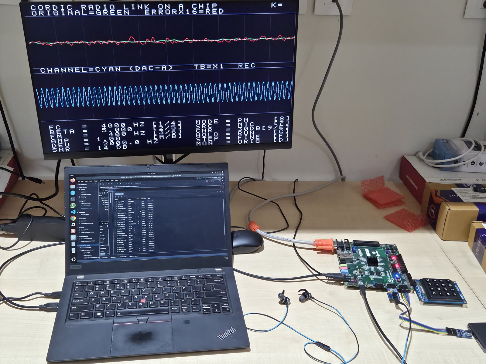
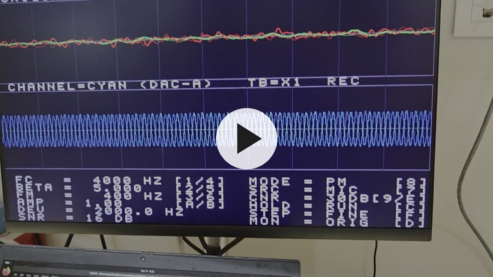
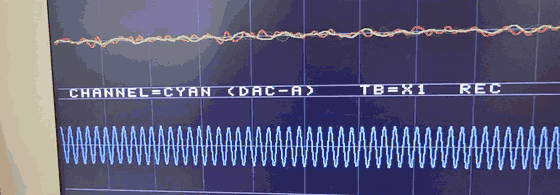
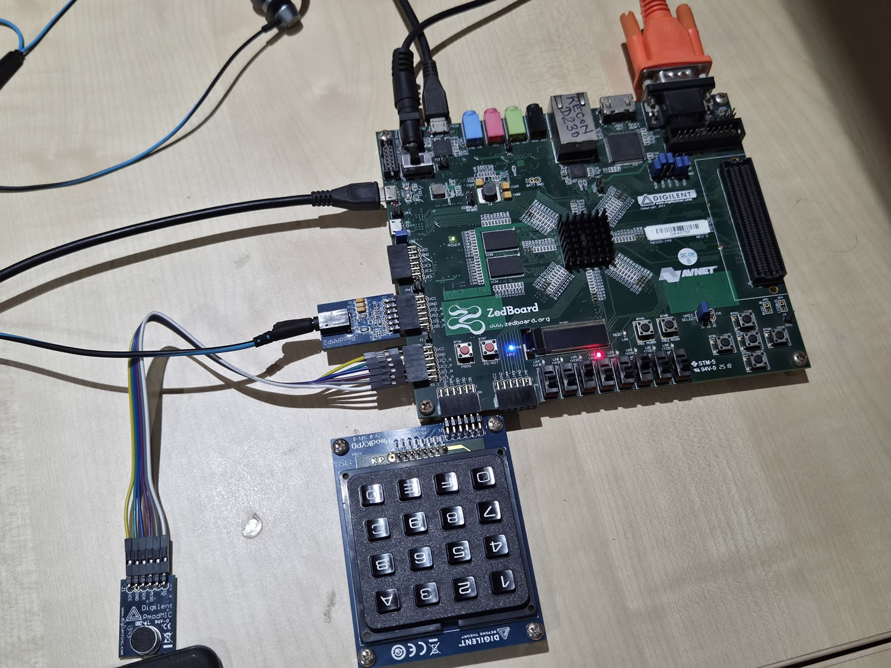
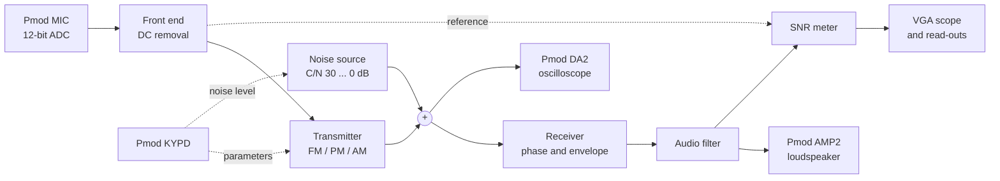
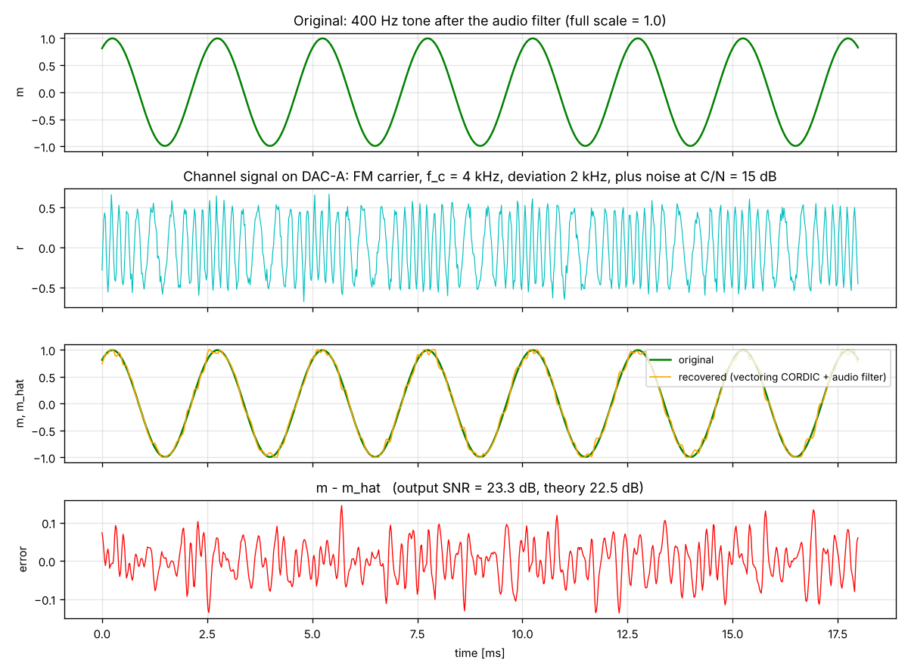
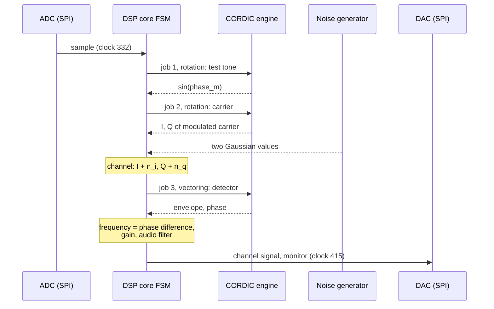
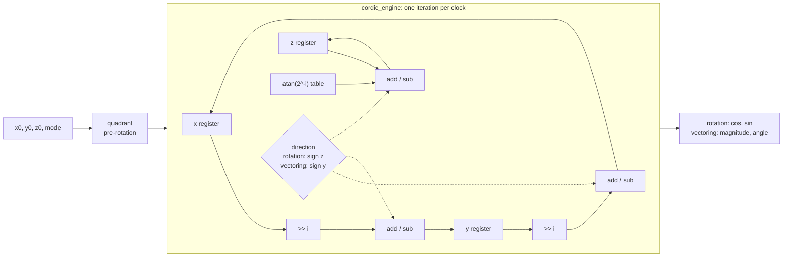
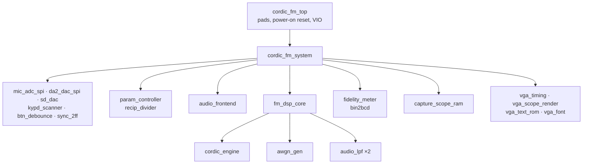
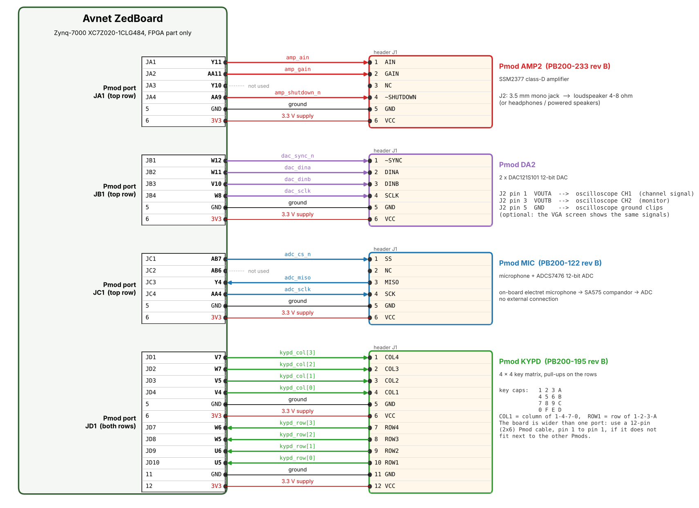

<h1 align="center">CORDIC Radio Link on a Chip</h1>

<p align="center">
<b>Real-time FM, PM and AM modulation and demodulation of live microphone audio through a
programmable noisy channel, built around a single hand-written CORDIC engine on an FPGA.</b>
</p>

<p align="center">


</p>

<p align="center">

</p>

<p align="center"><sub>The link running on the ZedBoard: live microphone audio, phase modulation,
C/N = 30 dB. The monitor is the design's own VGA oscilloscope; the laptop runs the Vivado
hardware manager.</sub></p>

Avnet ZedBoard (Zynq-7000 `xc7z020clg484-1`, programmable logic only) · Verilog-2001 ·
100 MHz single clock · 50 kS/s · four Digilent Pmods · VGA

---

**Contents:** [Overview](#overview) · [Demo](#demo) · [Highlights](#highlights) ·
[How it works](#how-it-works) · [Reading the display](#reading-the-display) ·
[Try it](#try-it-a-five-minute-tour) · [Results](#results) · [Architecture](#architecture) ·
[Hardware](#hardware) · [Controls](#controls) · [Verification](#verification) ·
[Implementation](#implementation) · [Limitations](#limitations) ·
[Build and run](#build-and-run)

## Overview

A modulator on its own says nothing about audio quality: over a perfect link the audio comes back
unchanged whatever the modulation. This design therefore places the modulator inside a complete
radio link on one FPGA. Speech from a microphone modulates a carrier, the carrier passes through
a channel that adds a selectable amount of noise, and a receiver recovers the audio and plays it
on a loudspeaker. A meter compares what came out with what went in and shows the
signal-to-noise ratio on a VGA monitor.

Everything is set live from a 16-key keypad: carrier frequency, modulation index, modulation type
and channel noise. The classical results of analogue communication can then be heard and seen
directly: FM outperforms AM at equal channel noise, gains 6 dB for each doubling of the
modulation index, and fails abruptly below a threshold.

## Demo

<p align="center">
<a href="docs/media/demo.mp4"></a>
<br><sub>Demonstration on the board (32 s, with sound): live voice through the link, the
VGA oscilloscope and keypad control. Click the picture to play.</sub>
</p>

<p align="center">

<br><sub>The on-chip oscilloscope updating in real time: original (green) and error x16 (red)
in the upper pane, the noisy channel signal (cyan) below.</sub>
</p>

<table>
<tr>
<td width="50%"></td>
<td width="50%"></td>
</tr>
<tr>
<td><sub><b>The board.</b> ZedBoard with the Pmod KYPD keypad, the Pmod MIC microphone (on
jumper wires) and the Pmod AMP2 audio amplifier driving earphones; the VGA cable leaves at the
top right.</sub></td>
<td><sub><b>The bench.</b> The read-outs show FC = 4000 Hz, β = 5, PM, microphone source,
C/N = 30 dB and the live output SNR; the VIO dashboard on the laptop reads the same values over
JTAG.</sub></td>
</tr>
</table>

## Highlights

* **One CORDIC, three roles.** A single iterative engine (24-bit, 18 iterations) is time-shared
  three times per sample: test-tone generation and carrier synthesis in rotation mode, and
  phase/envelope detection in vectoring mode. It is active for 57 of the 2000 clocks in a
  sample period. No vendor IP is used in the signal path.
* **Programmable channel.** Additive Gaussian noise from a xorshift generator (sum of twelve
  uniform values), 31 levels in 1 dB steps.
* **Live measurement.** Output SNR is accumulated over 0.66 s windows and displayed; the error
  signal can be overlaid on screen or listened to on its own.
* **Model-driven verification.** A Python model defines the arithmetic bit for bit. The RTL is
  checked against it sample by sample, and the same model produces every figure below.
* **Self-contained instrument.** VGA oscilloscope with triggered capture, parameter read-outs
  and SNR; two DAC channels for an external oscilloscope; block-RAM record readable over JTAG.

## How it works



Every 20 µs (50 000 times a second) the chip runs the following sequence for one audio sample:

1. **Capture.** The Pmod MIC delivers a 12-bit sample over SPI. A front end removes its DC offset
   and scales it. Alternatively an internal test tone, generated by the CORDIC, replaces the
   microphone.
2. **Modulate.** The transmitter turns the audio into a carrier. In FM the audio sets the
   carrier's instantaneous frequency, in PM its phase, in AM its amplitude. The CORDIC computes
   the carrier's sine and cosine from a phase accumulator.
3. **Add noise.** A xorshift random-number generator produces Gaussian noise, scaled to one of 31
   carrier-to-noise ratios between 30 dB and 0 dB, and adds it to both carrier components.
4. **Demodulate.** The same CORDIC, now in vectoring mode, converts the noisy carrier back into
   amplitude and phase. AM uses the amplitude; PM the phase; FM the change in phase from one
   sample to the next.
5. **Filter and measure.** A low-pass filter removes out-of-band noise. The meter accumulates the
   power of the original and of the difference between original and recovered audio, and turns
   the ratio into an SNR in dB.
6. **Output.** The recovered audio (or, on request, the original, the channel signal or the
   error) goes to the Pmod AMP2 loudspeaker amplifier through a sigma-delta modulator. The Pmod
   DA2 outputs the channel signal and the monitored signal for an external oscilloscope, and a
   triggered capture into block RAM feeds the VGA display.

The CORDIC is busy for 57 of the 2000 clock cycles available per sample; the rest of the time
the chip waits for the next sample.

## Reading the display


<sub>Display rendered from the same text ROM and layout as the RTL (FM, C/N = 15 dB).</sub>

* **Upper pane.** The original audio in green, with the recovered audio in yellow drawn on top.
  With switch SW2 up the yellow trace is replaced by the error (original minus recovered)
  magnified 16 times, in red: the larger the red trace, the worse the link.
* **Lower pane.** The channel signal in cyan: the modulated carrier with the channel noise added,
  the same signal that the Pmod DA2 outputs on channel A.
* **Read-outs.** Left: carrier frequency (FC), modulation index (BETA), test-tone frequency
  (FM), modulating amplitude (AMP), frequency deviation (DEV) and the measured output SNR. Right:
  modulation (MODE), source (SRC), channel C/N (CNR), hold, step size and the loudspeaker monitor
  (MON). The keys that change each value are shown in brackets beside it.

## Try it: a five-minute tour

With the board programmed and all switches down:

1. **Press `7`** to switch from the microphone to the internal 400 Hz tone. Both panes show clean
   sine waves and the SNR read-out is near its maximum.
2. **Press `9` a few times** to add channel noise. The cyan trace becomes ragged, the
   loudspeaker hisses and the SNR falls. `E` removes noise again; `F` toggles between 1 dB and
   5 dB steps.
3. **Press `8`** to step through FM, PM, AM and bypass at the same noise level. AM is clearly the
   noisiest: angle modulation trades bandwidth for noise immunity.
4. **Press `2` or `5`** in FM to change the modulation index β. Each doubling of β improves the
   SNR by about 6 dB.
5. **Keep adding noise** below a C/N of about 10 dB in FM. The audio breaks up into clicks and
   the SNR drops sharply: the FM threshold.
6. **Press `D`** to choose what the loudspeaker plays (recovered, original, channel or error),
   and **`7`** again to go back to the microphone and speak. **`0`** restores all defaults.

## Results

All results in this section are from the bit-exact model, which the RTL simulation matches
with zero mismatches.

### Output SNR against channel carrier-to-noise ratio


Markers: this design. Lines: small-noise theory for the implemented audio filter.

| C/N | FM (2 kHz deviation) | PM (2 rad) | AM (100 %) | Unmodulated |
|---|---|---|---|---|
| off | 90.3 dB | 90.5 dB | 79.9 dB | exact |
| 20 dB | 27.7 dB | 35.1 dB | 19.4 dB | 29.1 dB |
| 15 dB | 22.8 dB | 30.1 dB | 13.6 dB | 24.2 dB |
| 10 dB | 17.8 dB | 25.1 dB | 7.7 dB | 19.4 dB |
| 5 dB | 10.8 dB | 17.8 dB | 1.7 dB | 14.7 dB |

Above the threshold the design follows theory within 0.3 dB. Below about 10 dB the angle
modulations depart from their lines: the FM threshold effect.

### FM exchanges bandwidth for SNR


At C/N = 20 dB the output SNR rises from 14.1 dB at β = 1 to 37.6 dB at β = 15.875, 6 dB per
doubling, as theory predicts. With the channel clean the SNR saturates near 90 dB, which is
the arithmetic noise of the CORDIC itself and lies well beyond the resolution of the 12-bit
converters.

### Signals through the link



## Architecture


### Per-sample schedule

Every 20 µs the DSP core runs one fixed sequence. The CORDIC engine is shared by the three jobs
marked below; the noise generator and the converters run alongside.



### CORDIC engine



Angles are binary fractions of a turn, so phase accumulators wrap naturally and the FM
detector's phase difference needs no unwrapping.

### Module hierarchy



| Block | Function |
|---|---|
| `cordic_engine` | Iterative CORDIC, rotation and vectoring, 19 clocks per result |
| `fm_dsp_core` | Per-sample sequencer: tone, modulator, channel, detector, gain |
| `awgn_gen` | Gaussian noise pair with table-driven level |
| `audio_lpf` | Multiplier-free low-pass (four cascaded 4-sample averages), −3 dB at 2.93 kHz |
| `fidelity_meter` | Signal and error power sums, SNR estimate in dB |
| `param_controller` | Keypad, buttons and JTAG to parameters; derived constants |
| `capture_scope_ram` | Triggered, double-buffered record of original, channel and recovered signals |
| `mic_adc_spi`, `da2_dac_spi` | SPI masters for the ADCS7476 and the two DAC121S101 |
| `sd_dac` | First-order sigma-delta output driving the Pmod AMP2 |
| `vga_*` | 640 × 480 two-trace oscilloscope with text read-outs |

## Hardware

| Module | ZedBoard port | Purpose |
|---|---|---|
| Digilent Pmod DA2 | JA, top row | Two 12-bit DAC channels: channel signal and monitor |
| Digilent Pmod KYPD | JB | 16-key control panel |
| Digilent Pmod MIC | JC, top row | Microphone and 12-bit ADC |
| Digilent Pmod AMP2 | JD, top row | Class-D amplifier for a loudspeaker |

Also used: the on-board VGA connector, slide switches, push-buttons and LEDs. A loudspeaker
(4 to 8 Ω, 3.5 mm plug) and a VGA monitor are required; an oscilloscope is optional.



Pin assignments are in [`zedboard_cordic_fm.xdc`](CORDIC.srcs/constrs_1/new/zedboard_cordic_fm.xdc).

## Controls

```
[1] carrier +   [2] index +   [3] tone +    [A] amplitude +
[4] carrier -   [5] index -   [6] tone -    [B] amplitude -
[7] source      [8] mode      [9] noise +   [C] hold
[0] defaults    [F] step      [E] noise -   [D] monitor
```

| Parameter | Range | Default |
|---|---|---|
| Carrier frequency | 100 Hz to 10 kHz in 100 Hz steps | 4 kHz |
| Modulation index β | 0 to 15.875 in steps of 0.125 | 5.0 |
| Test-tone frequency | 50 Hz to 2 kHz in 50 Hz steps | 400 Hz |
| Modulating amplitude | 0 to 3.94 in steps of 1/16 | 1.0 |
| Modulation | FM, PM, AM, bypass | FM |
| Source | microphone, internal tone | microphone |
| Channel C/N | off, 30 to 0 dB in 1 dB steps | off |
| Loudspeaker monitor | recovered, original, channel, error | recovered |

Switches select the display time base, the error overlay, loudspeaker volume and mute. Every
parameter can also be set and every internal measurement read over JTAG through a VIO core.

## Verification

### Simulation

Twelve self-checking test benches cover every module and the complete system.

| Bench | Scope | Checks |
|---|---|---|
| `tb_cordic_engine` | CORDIC against the model: both modes, all quadrants, corner cases | 8701 |
| `tb_awgn_gen` | Noise generator against the model; statistics | 967 |
| `tb_audio_lpf` | Filter against the model; impulse and step response | 3056 |
| `tb_sd_dac` | Sigma-delta density and reset behaviour | 11 |
| `tb_bin2bcd` | Binary to decimal conversion | 2256 |
| `tb_mic_adc_spi` | ADC interface against a datasheet-timed device model | 286 |
| `tb_da2_dac_spi` | DAC interface against a device model | 316 |
| `tb_kypd_scanner` | Matrix scan, debounce, multi-key rejection | 70 |
| `tb_recip_divider` | Receiver gain divider | 1417 |
| `tb_fm_dsp_core` | **DSP core bit-exact against the model: 2900 samples, five signals, all modes, with noise** | 14502 |
| `tb_cordic_fm_top` | Top level: power-on reset, pads | 16 |
| `tb_cordic_fm_system` | Full system through the device models: user interface, SNR against theory, capture, VGA timing | 859 |

All twelve benches pass in Vivado XSim 2025.2 (`scripts/run_sims.tcl`) and in Icarus Verilog
12, with identical results: the system bench reports the same SNR values to 0.01 dB in both. The design also elaborates without errors under `slang`
(`scripts/lint_slang.py`).

### On hardware

The design was run on the ZedBoard with all four Pmods, a VGA monitor and earphones, and the full
bring-up procedure was carried out: clock and reset, display, buttons, switches and LEDs; the
complete link with the internal tone, including the on-screen SNR read-outs against the
model's expected values; DAC outputs; all 16 keys and parameter limits; audio output with volume,
gain and mute; the microphone path; FM, PM, AM and bypass with live voice; triggered capture and
block-RAM read-back. Every check passed.

## Implementation

Vivado 2025.2, `xc7z020clg484-1`, default synthesis and implementation strategies, one 100 MHz
clock.

### Utilisation

| Resource | Design | Debug (VIO + hub) | Total | Available | Utilisation |
|---|---|---|---|---|---|
| Slice LUTs | 3 511 | 1 553 | 5 064 | 53 200 | 9.52 % |
| Slice registers | 3 416 | 2 800 | 6 216 | 106 400 | 5.84 % |
| DSP48E1 | 20 | 0 | 20 | 220 | 9.09 % |
| Block RAM (RAMB36) | 3 | 0 | 3 | 140 | 2.14 % |
| Bonded I/O | | | 54 | 200 | 27.0 % |
| Global clock buffers | 1 | 1 | 2 | 32 | 6.25 % |
| Latches | 0 | 0 | 0 | | |

"Design" comprises all logic except the debug cores, including the top-level power-on reset
and input synchronisers. The VIO core serves bring-up only and may be omitted from a final
build.

Breakdown of the design (`u_sys`):

| Block | LUTs | Registers | DSP48E1 | RAMB36 |
|---|---|---|---|---|
| `fm_dsp_core` (complete link) | 1 648 | 1 948 | 11 | |
| &nbsp;&nbsp;of which `cordic_engine` | 374 | 81 | 0 | |
| &nbsp;&nbsp;of which `awgn_gen` | 135 | 141 | 1 | |
| &nbsp;&nbsp;of which `audio_lpf` (two instances) | 512 | 1 215 | 0 | |
| `fidelity_meter` | 327 | 306 | 2 | |
| `param_controller`, `recip_divider` | 390 | 242 | 6 | |
| `vga_timing`, `vga_scope_render` | 597 | 341 | 1 | |
| `capture_scope_ram` | 119 | 32 | | 3 |
| Interfaces (keypad, front end, SPI masters, sigma-delta, debouncers) | 372 | 457 | | |

The CORDIC engine, which performs all trigonometric operations of both transmitter and
receiver, occupies 374 LUTs (0.7 % of the device) and no DSP slices.

### Timing

Post-route timing summary for the 100 MHz system clock (`sys_clk`, 10 ns period), slow process
corner:

| | Worst slack | Total negative slack | Failing endpoints | Total endpoints |
|---|---|---|---|---|
| Setup | +0.193 ns | 0.000 ns | 0 | 14 766 |
| Hold | +0.032 ns | 0.000 ns | 0 | 14 750 |
| Pulse width | +3.750 ns | 0.000 ns | 0 | 6 313 |

All user-specified timing constraints are met. The critical path lies in the receiver's audio
filter (`audio_lpf`, accumulator to saturated output). The first implementation had shown a
setup violation of 0.276 ns on the multiplication that computes the frequency deviation for the
VGA read-out; that product was divided into two register stages, which has no functional effect
because the value is converted once per video frame.

### Power

Vivado estimate with default switching activity (confidence: low): 0.221 W on chip, of which
0.114 W dynamic and 0.108 W device static; junction temperature 27.6 °C.

### Design checks

Synthesis and implementation complete without critical warnings; no latches are inferred, and
the design rule check reports no errors. All 21 serial and VGA outputs are driven from
flip-flops placed in the I/O cells, giving matched output delays. The remaining DRC and
methodology warnings are advisory: optional DSP and block RAM pipelining registers, and
structures inside the Xilinx debug hub.

## Limitations

* The channel is modelled inside the FPGA. The DAC output is not received back through an ADC,
  so the analogue parts are outside the measured loop.
* The receiver shares the transmitter's carrier reference. FM detection does not depend on the
  carrier phase and carries over to a separate receiver; PM detection as implemented would
  additionally need carrier recovery.
* There is no pre-detection band-pass filter; C/N is defined over the full 25 kHz Nyquist band.
* The hardware tests were pass/fail checks against expected values; no bench measurements are
  published. The figures under [Results](#results) are from the bit-exact model.

## Build and run

Requirements: Vivado (ML Standard edition is sufficient) with the ZedBoard part installed.
Clone to a path without spaces.

```tcl
# Vivado Tcl console, in the repository root
source create_project.tcl            ;# creates the project and the VIO core
source scripts/run_sims.tcl          ;# optional: all test benches
source scripts/build_bitstream.tcl   ;# synthesis, implementation, reports/, bitstream
```

Without Vivado, the model and the figures can be reproduced with Python 3 (NumPy, Matplotlib):

```sh
python3 scripts/analysis.py          # figures in docs/img/
python3 scripts/gen_vectors.py       # test vectors for the benches
```

### Programming the board

1. Set jumper **J18 (VADJ) to 1V8**: the buttons and switches are constrained as 1.8 V inputs.
   Set all slide switches down.
2. Plug in the Pmods (power off): DA2 on JA, KYPD on JB, MIC on JC, AMP2 on JD, each 6-pin Pmod in
   the top row. Connect a VGA monitor and earphones or a loudspeaker to the AMP2.
3. Power on, open the Vivado Hardware Manager, connect to the board and program it with
   `cordic_fm_top.bit`, adding `cordic_fm_top.ltx` as the probes file for the VIO dashboard.
4. LD7 blinks once a second and the display shows the default read-outs. Keep the volume low at
   first (SW4 and SW5 up), then follow the [tour](#try-it-a-five-minute-tour).

## Repository

```
CORDIC.srcs/sources_1/new/   RTL (22 modules)
CORDIC.srcs/sim_1/new/       test benches, device models, test vectors
CORDIC.srcs/constrs_1/new/   pin and timing constraints
scripts/                     reference model, analysis, generators, Vivado scripts
docs/img/                    figures generated from the model
docs/media/                  photographs and demonstration video
docs/wiring_schematic.png    connections between the ZedBoard and the Pmods
Manuals/                     data sheets and reference manuals of the parts used
create_project.tcl           rebuilds the Vivado project
```

The developer handbook, the bring-up and test procedure and the demonstration script are kept
in a separate repository for the project's contributors.

## References

* J. E. Volder, "The CORDIC Trigonometric Computing Technique", *IRE Transactions on Electronic
  Computers*, 1959.
* J. S. Walther, "A Unified Algorithm for Elementary Functions", *AFIPS Spring Joint Computer
  Conference*, 1971.
* R. Andraka, "A Survey of CORDIC Algorithms for FPGA Based Computers", *FPGA '98*.
* S. Haykin, *Communication Systems*: noise in AM and FM receivers, FM threshold.
* G. Marsaglia, "Xorshift RNGs", *Journal of Statistical Software*, 2003.
* Digilent reference manuals for the Pmod MIC, KYPD, DA2 and AMP2; ZedBoard Hardware User's
  Guide.
