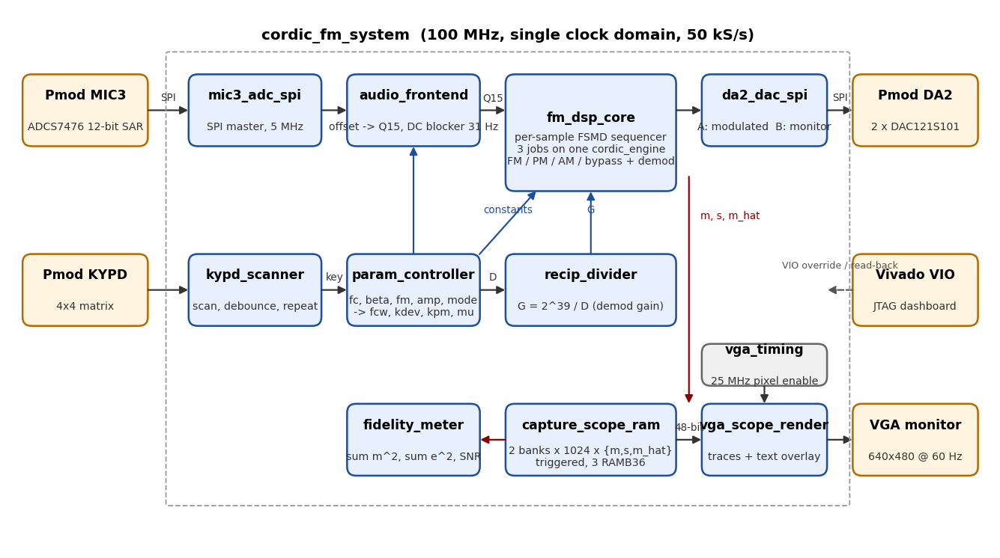
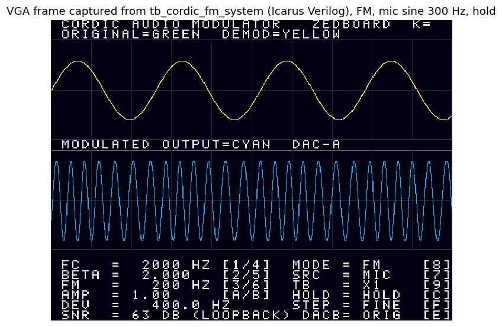
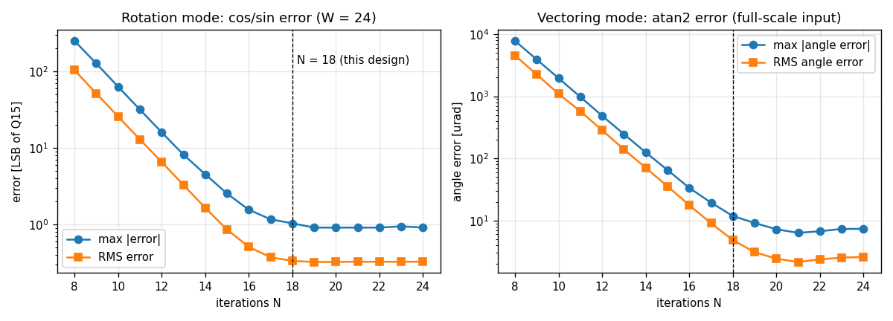
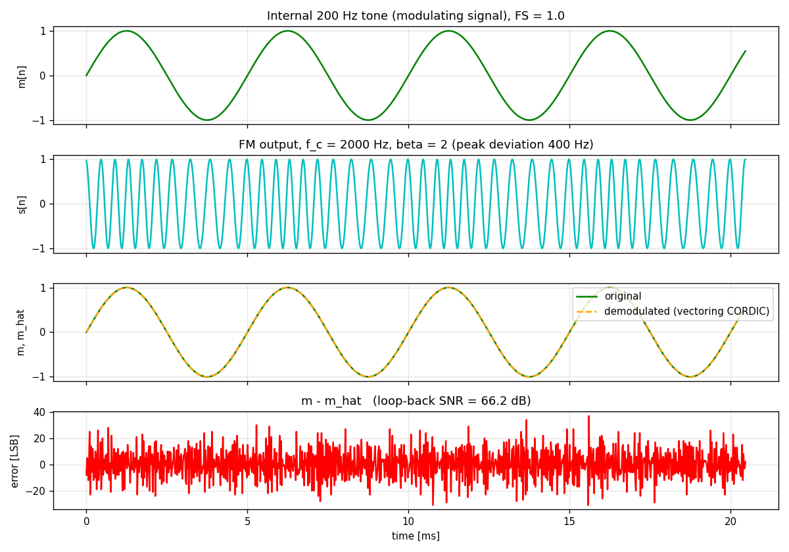
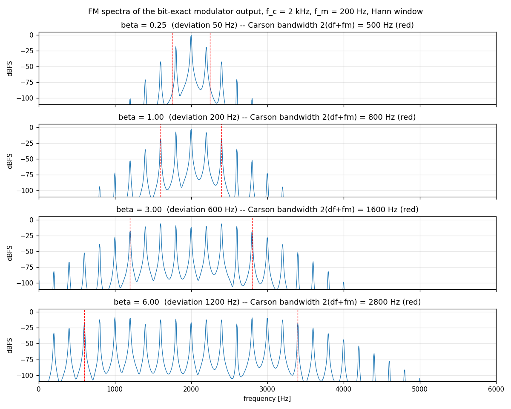
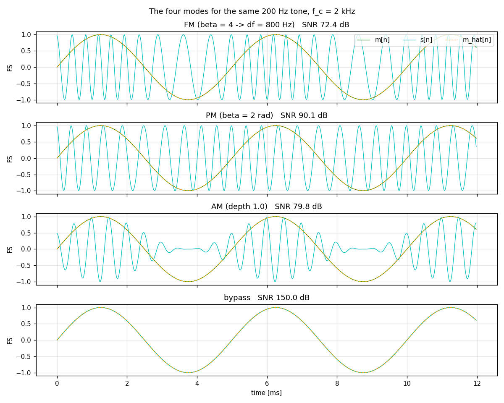
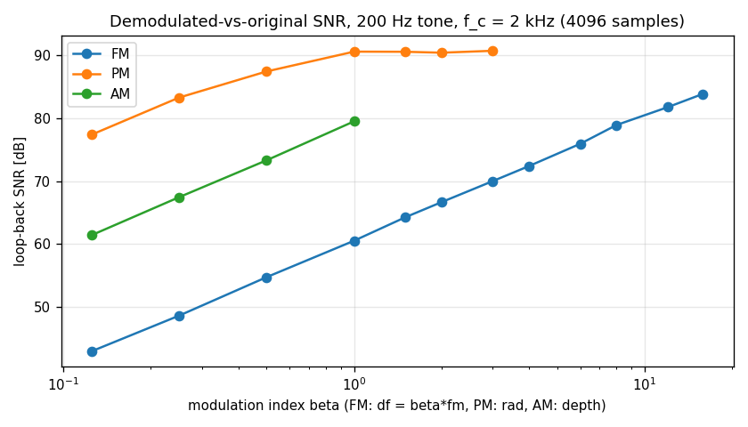
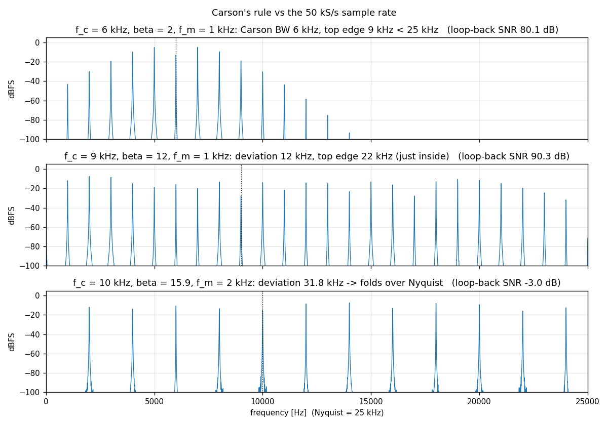

# CORDIC Audio Modulator — real-time FM / PM / AM of microphone audio on the ZedBoard

**Course project, Reconfigurable Computing (CS G553), Problem Statement 1**
*CORDIC-Based Audio Signal Processing System with User-Controlled Frequency Modulation*

Target: Avnet ZedBoard, Zynq-7000 `xc7z020clg484-1`, programmable logic only, 100 MHz · Vivado 2025.x · Verilog-2001 · XSim · VIO over JTAG

This document is written to be read on its own: it covers the theory the design rests on (sampling, fixed point, FM/PM/AM, CORDIC, demodulation, the peripheral protocols), every design decision, every module, how to build, run and demonstrate the system, how it was verified, and what the measurements show. Section 1 is a two-page summary; everything after it is the long form.

---

## Contents

1. [Summary](#1-summary)
2. [The brief and how it is met](#2-the-brief-and-how-it-is-met)
3. [Theory](#3-theory)
   - 3.1 [Sampling, fixed point and the audio chain](#31-sampling-fixed-point-and-the-audio-chain)
   - 3.2 [Angle modulation: FM and PM](#32-angle-modulation-fm-and-pm)
   - 3.3 [Amplitude modulation](#33-amplitude-modulation)
   - 3.4 [Direct digital synthesis: the phase accumulator](#34-direct-digital-synthesis-the-phase-accumulator)
   - 3.5 [CORDIC](#35-cordic)
   - 3.6 [Demodulation with the vectoring CORDIC](#36-demodulation-with-the-vectoring-cordic)
   - 3.7 [The DC blocker](#37-the-dc-blocker)
   - 3.8 [Measuring quality: SNR, Carson's rule, aliasing](#38-measuring-quality-snr-carsons-rule-aliasing)
   - 3.9 [The peripherals: ADCS7476, DAC121S101, keypad matrix, VGA](#39-the-peripherals-adcs7476-dac121s101-keypad-matrix-vga)
4. [Hardware setup](#4-hardware-setup)
5. [Quick start](#5-quick-start)
6. [User interface](#6-user-interface)
7. [Architecture and design](#7-architecture-and-design)
   - 7.1 [Top-level structure and clocking](#71-top-level-structure-and-clocking)
   - 7.2 [One sample period, clock by clock](#72-one-sample-period-clock-by-clock)
   - 7.3 [cordic_engine](#73-cordic_engine)
   - 7.4 [fm_dsp_core: the per-sample sequencer](#74-fm_dsp_core-the-per-sample-sequencer)
   - 7.5 [param_controller and recip_divider](#75-param_controller-and-recip_divider)
   - 7.6 [audio_frontend](#76-audio_frontend)
   - 7.7 [mic3_adc_spi and da2_dac_spi](#77-mic3_adc_spi-and-da2_dac_spi)
   - 7.8 [kypd_scanner and btn_debounce](#78-kypd_scanner-and-btn_debounce)
   - 7.9 [capture_scope_ram](#79-capture_scope_ram)
   - 7.10 [fidelity_meter](#710-fidelity_meter)
   - 7.11 [vga_timing, vga_scope_render, fonts and text](#711-vga_timing-vga_scope_render-fonts-and-text)
   - 7.12 [cordic_fm_top, synchronisers, LEDs, VIO](#712-cordic_fm_top-synchronisers-leds-vio)
   - 7.13 [Constraints](#713-constraints)
   - 7.14 [Numerics reference](#714-numerics-reference)
8. [Verification](#8-verification)
9. [Performance analysis and results](#9-performance-analysis-and-results)
10. [Bench procedure and demo script](#10-bench-procedure-and-demo-script)
11. [Design decisions, limitations, extensions](#11-design-decisions-limitations-extensions)
12. [File map and tooling](#12-file-map-and-tooling)
13. [References](#13-references)

---

## 1. Summary

| | |
|---|---|
| **Input** | Pmod MIC3 (ADCS7476, 12-bit SAR) sampled at 50 kS/s through a hand-written SPI master |
| **Processing** | one iterative CORDIC engine (24-bit data, 24-bit angle, 18 iterations) time-shared by a small sequencer for three jobs per sample: internal test tone, carrier/modulator (rotation mode), demodulator (vectoring mode) |
| **Modulation** | FM (the assignment), PM, AM and bypass — one phase accumulator, one CORDIC, a mode mux |
| **Control** | Pmod KYPD: carrier frequency 100 Hz–10 kHz, modulation index 0–15.875, modulating-tone frequency 50 Hz–2 kHz, modulating amplitude 0–3.94, mode, source, scope time base, hold, DAC monitor select, mute, defaults; board buttons duplicate the common actions; the VIO dashboard can override everything |
| **Storage** | 2 banks × 1024 samples × {original, modulated, demodulated} in block RAM, triggered like an oscilloscope, double-buffered, readable word by word from the VIO |
| **Output** | Pmod DA2: channel A = modulated signal, channel B = selectable monitor (original / demodulated / tone / quadrature); on-board VGA shows both traces, the demodulated overlay, and all parameters as text |
| **Analysis** | loop-back demodulator + fidelity meter (Σm², Σ(m−m̂)², peak error, SNR in dB on screen and on the VIO); bit-exact Python model; spectra, Carson bandwidth, aliasing and CORDIC-accuracy studies in `docs/img` |
| **Numbers** | 70 DSP clocks per 2000-clock sample (3.5 %), CORDIC busy 2.9 %, 7.2 µs deterministic input-to-output latency, 3 RAMB36, single 100 MHz clock domain |
| **Verification** | 7 self-checking test benches run in Icarus Verilog (section 8), 600 CORDIC vectors bit-exact against the Python model, all datasheet-derived device models with protocol monitors, zero elaboration errors under a strict SystemVerilog front end |

What makes it more than the minimum: the **same CORDIC demodulates what it modulates**, so the effect of modulation on the audio can be *quantified* on the board (the brief's item 6) rather than only listened to; a **reciprocal divider** calibrates the demodulator gain for any modulation index, so the recovered audio can be overlaid directly on the original; the **VGA screen is a real instrument** with text read-outs; everything is derived from **one bit-exact Python model** that also produces the analysis figures.


*The VGA screen layout (Python rendering of the exact RTL geometry, font and colours; the real frame produced by the system test bench is in section 8). FM of the internal 200 Hz tone, β = 2, f_c = 2 kHz. The yellow demodulated trace covers the green original — that is the point; SW2 shows the difference ×16 in red instead.*

---

## 2. The brief and how it is met

| Brief item | Implementation |
|---|---|
| 1. Audio capture with Pmod MIC | `mic3_adc_spi` drives the ADCS7476 exactly as its datasheet describes (section 3.9), 50 000 conversions per second; `audio_frontend` converts the offset-binary code to signed Q15 and removes the microphone bias with a 31 Hz DC blocker |
| 2. CORDIC-generated modulated signal from user parameters (modulation index …) | `cordic_engine` in rotation mode produces `cos θ`/`sin θ` of a 32-bit phase accumulator advanced by `fcw_c + kdev·m[n]` (FM); the modulation index β sets `kdev = β·fcw_m`; PM and AM reuse the same engine |
| 3. UI with PMOD KYPD: modulation index, carrier frequency, modulating frequency, modulating amplitude, "can be extended to type of modulation" | `kypd_scanner` + `param_controller`: all four parameters with fine/coarse steps and auto-repeat, mode FM/PM/AM/bypass, source mic/tone, plus scope and output controls |
| 4. Store original and modulated signals in FPGA RAM for comparison | `capture_scope_ram`: triggered, double-buffered BRAM record of original, modulated **and demodulated** samples; displayed on VGA and readable through the VIO |
| 5. Output through PMOD DA2, visualise on VGA (optional) or on an oscilloscope via the DAC | `da2_dac_spi` updates both DAC channels every sample (A modulated, B monitor); `vga_timing` + `vga_scope_render` draw a two-channel scope with text; the oscilloscope alternative works at the same time |
| 6. Performance analysis of modulation's impact on audio quality | `fidelity_meter` (Σm², Σe², peak, SNR) on the loop-back demodulator; Python analysis of CORDIC accuracy vs iterations, spectra vs β with Carson's bandwidth, SNR vs β (the 6 dB/octave law), aliasing beyond Nyquist; bench measurement procedure |

---

## 3. Theory

### 3.1 Sampling, fixed point and the audio chain

**Sampling.** The ADC converts the microphone voltage 50 000 times per second (`F_s = 50 kHz`, period `T_s = 20 µs = 2000` clocks of the 100 MHz board clock). Any signal component above `F_s/2 = 25 kHz` (Nyquist) is *aliased*: it appears at a mirrored frequency inside 0…25 kHz and cannot be told apart from a genuine component there. Speech and the MIC3's microphone stop well below 10 kHz, so the input is safe; the modulator, however, can create components above 25 kHz when the carrier plus deviation is pushed high enough, and section 3.8 and figure *aliasing.png* show exactly what happens then.

**Fixed point.** The design uses two's-complement integers with an implied binary point. "Q15" means a 16-bit signed word with 15 fractional bits: the integer `v` represents `v / 32768`, so the range is −1.0 … +0.99997 and full scale is ±32767. Products of Q15 numbers are Q30 (32-bit); a right shift by 15 brings them back. All shifts of signed values are *arithmetic* (`>>>` in Verilog: the sign bit is replicated), which equals a floor division by 2ⁿ. Floor introduces a bias of up to one LSB per truncation; where that matters (the CORDIC outputs) a *rounding* shift `(v + 2ⁿ⁻¹) >>> n` is used instead.

**The chain.** The ADC code `c ∈ 0…4095` sits around 2048 at rest (the microphone's amplifier biases the ADC at mid-scale). The front end forms `x = (c − 2048) · 16`, a Q15 number using the top 12 of 16 bits, then removes the slowly varying bias (section 3.7). A *gain* `A` (Q2.4, i.e. 0…3.94 in steps of 1/16) scales the chosen source to produce the **modulating signal** `m[n] = sat(A · src[n])`, saturated to ±32767. `m[n]` is what the modulator sees; everything downstream is defined relative to full scale `|m| = 1`.

### 3.2 Angle modulation: FM and PM

A sinusoidal carrier is `s(t) = A_c cos θ(t)`. In *angle modulation* the information is carried in `θ`:

* **Phase modulation**: `θ(t) = ω_c t + k_p m(t)`. The phase deviates from the unmodulated ramp by `k_p m(t)` radians. With `|m| ≤ 1`, `k_p` is the peak phase deviation and is called the modulation index of PM.
* **Frequency modulation**: the *instantaneous frequency* `f_i(t) = (1/2π) dθ/dt` deviates: `f_i(t) = f_c + Δf · m(t)`, so `θ(t) = ω_c t + 2π Δf ∫ m(τ) dτ`. `Δf` is the peak frequency deviation (for `|m| = 1`).

For a sinusoidal modulating signal `m(t) = cos 2π f_m t`, the FM phase is `θ = ω_c t + β sin 2π f_m t` with the **modulation index**

```
β = Δf / f_m
```

(FM with a sine *is* PM with index β — the two differ only in how a general `m(t)` enters: directly for PM, integrated for FM. The design exploits this: both use the same phase accumulator, FM adds `kdev·m` to the *increment*, PM adds `kpm·m` to the *phase*.)

Expanding `cos(ω_c t + β sin ω_m t)` with the Jacobi–Anger identity gives the famous Bessel spectrum:

```
s(t) = A_c Σ_{k=−∞}^{∞} J_k(β) cos((ω_c + k ω_m) t)
```

Sidebands sit at `f_c ± k f_m` with amplitudes `J_k(β)`, the Bessel functions of the first kind. For small β only `J_0` and `J_±1` matter (narrow-band FM, bandwidth ≈ 2 f_m, which looks like AM in the spectrum); as β grows, more sidebands become significant and the power spreads over roughly `2(Δf + f_m)` — **Carson's rule**, which captures ≈ 98 % of the power:

```
B_Carson = 2 (Δf + f_m) = 2 f_m (β + 1)
```

Both effects are visible in *fm_spectrum_beta.png* (section 9): the bit-exact modulator output shows sidebands at multiples of 200 Hz with Bessel amplitudes, and the red Carson lines bracket the significant ones.

In this design the user sets β and f_m, and the deviation follows as `Δf = β · f_m` (shown as `DEV` on the screen). With the microphone as source `m(t)` is not a sine, so "β" is best read as "deviation per full-scale input in units of f_m" — the parameter is still the one knob that scales how far the carrier swings.

### 3.3 Amplitude modulation

Conventional AM multiplies the carrier by an envelope: `s(t) = A_c (1 + μ m(t)) cos ω_c t`, with depth `μ`. For `μ ≤ 1` the envelope never crosses zero and an *envelope detector* (rectify + low-pass, or here: the CORDIC magnitude) recovers `1 + μ m(t)`. For `μ > 1` (over-modulation) the envelope goes negative, i.e. the carrier flips phase, and the detector returns `|1 + μ m|` — a folded, distorted copy. The design uses β as the AM depth and halves the envelope (`(1 + μ m)/2`) so that `μ = 1` exactly fills the output range; over-modulation is deliberately allowed because its folding is instructive and visible on the scope.

### 3.4 Direct digital synthesis: the phase accumulator

A digital oscillator is a counter. A 32-bit register `φ` is advanced every sample by the **frequency control word** `fcw`; interpreting `φ` as a fraction of a turn (`2³² = 360°`) gives

```
f = fcw · F_s / 2³²        ⇔        fcw = f · 2³² / F_s
```

The resolution is `F_s / 2³² = 11.6 µHz` and overflow is exactly the modulo-2π wrap of a phase, free of charge. For FM the increment is modulated: `φ[n] = φ[n−1] + fcw_c + kdev · m[n]`, where `kdev = Δf · 2³²/F_s` is the increment that a full-scale `m` adds. Since `Δf = β f_m`, `kdev = β · fcw_m` — the product of the index and the tone's own control word. These products are integer multiplications; nothing is approximated. The top 24 bits of `φ` feed the CORDIC (section 3.5), the truncation of the lower 8 bits being a phase error of at most `2⁻²⁴` turn (−145 dBc of phase noise, far below anything the 12-bit DAC can show).

### 3.5 CORDIC

**Idea.** COordinate Rotation DIgital Computer (Volder, 1959) rotates a 2-D vector by a chosen angle using only shifts, adds and a small table. Rotating `(x, y)` by angle `α` is

```
x' = x cos α − y sin α = cos α · (x − y tan α)
y' = y cos α + x sin α = cos α · (y + x tan α)
```

If the rotation angles are restricted to `αᵢ = atan(2⁻ⁱ)`, then `tan αᵢ = 2⁻ⁱ` and the bracketed terms need only a shift: `x − (y >>> i)`, `y + (x >>> i)`. The `cos αᵢ` factors are *dropped* — every micro-rotation then stretches the vector by `1/cos αᵢ = √(1 + 2⁻²ⁱ)`, and after N of them by the constant

```
K = Π_{i=0}^{N−1} √(1 + 2⁻²ⁱ) = 1.6467602581 …   (converged for N ≥ 16)
```

Any angle in the convergence range can be written as `Σ dᵢ αᵢ` with `dᵢ = ±1` because each `αᵢ` is smaller than the sum of all the following ones. The iteration is

```
xᵢ₊₁ = xᵢ − dᵢ (yᵢ >>> i)
yᵢ₊₁ = yᵢ + dᵢ (xᵢ >>> i)
zᵢ₊₁ = zᵢ − dᵢ αᵢ
```

with `z` the residual angle. Two choices of `dᵢ` give the two modes:

* **Rotation mode**: `dᵢ = sign(zᵢ)` — rotate so as to drive the residual angle to zero. From `(x₀, 0)` and `z₀ = θ` the result is `(K x₀ cos θ, K x₀ sin θ)`: a sine/cosine generator. Choosing `x₀ = A/K` removes the gain without a multiplier.
* **Vectoring mode**: `dᵢ = −sign(yᵢ)` — rotate so as to drive `y` to zero. The result is `x_N = K √(x₀² + y₀²)` and `z_N = z₀ + atan2(y₀, x₀)`: a rectangular-to-polar converter, i.e. a magnitude and phase detector.

**Convergence range.** `Σ αᵢ = 45° + 26.57° + 14.04° + … → 99.88°`, so the target angle (rotation) or the input vector's angle (vectoring) must lie within ±99.88°. To cover the full circle the engine first applies a ±90° **pre-rotation**, which is just a swap and a negation: rotating `(x, y)` by +90° gives `(−y, x)`, by −90° gives `(y, −x)`. For rotation mode the quadrant of the target angle decides (top two bits of the angle word); for vectoring mode the sign of `x` decides, and `z₀` is set to ±90° so that the final `z` is still the true `atan2`.

**Angle representation.** Angles are **binary turns** (binary angle measurement, BAM): a Z-bit two's-complement word in which `2ᶻ` is one full turn, so +90° is `2ᶻ⁻²` and −180° is `−2ᶻ⁻¹`. The `atan(2⁻ⁱ)` table is stored in the same unit (`atan(2⁻ⁱ)/2π · 2ᶻ`). Three things become trivial: the phase accumulator *is* the angle (no scaling by 2π), the quadrant is the top two bits, and **subtracting two angles wraps correctly modulo 360° by plain integer subtraction** — which is exactly what the FM demodulator needs (section 3.6). With Z = 24, one LSB is 2π/2²⁴ = 374 nrad.

**Accuracy.** Three error sources: (1) the residual angle after N iterations, bounded by `α_{N−1} = atan(2^{−(N−1)})` — 7.6 µrad for N = 18 — which appears as an amplitude error of `A·α` in rotation mode and directly as an angle error in vectoring mode; (2) each `>>> i` truncates, adding up to 1 LSB of error per iteration per component, so the data path carries *guard bits* below the useful result (4 here) to keep the accumulated truncation below ½ LSB of the 16-bit output; (3) the table entries are rounded to Z bits. The measured behaviour of the bit-exact model (figure *cordic_error_vs_iterations.png*) shows the rotation error levelling off at ≈1 LSB from N ≈ 16 and the vectoring angle error reaching its floor (≈5 µrad RMS, set by the 24-bit angle grid and the truncation noise) at N = 18 — hence the choice of 18 iterations.

**Pipelined vs iterative.** The textbook FPGA CORDIC unrolls the N iterations into N pipeline stages and accepts one new input per clock: at 100 MHz that is 100 M rotations per second. This system needs three per 20 µs sample — 150 k per second. An *iterative* (folded) engine executes one micro-rotation per clock in a single stage with a variable shifter and a small counter; a result takes N + 1 = 19 clocks and the hardware is about 1/18 of the pipelined version. Three jobs occupy 57 of the 2000 clocks in a sample, so the same engine could serve ~30 channels. Right-sizing, not peak throughput, is the design criterion.

### 3.6 Demodulation with the vectoring CORDIC

If a receiver has the carrier in *quadrature* form — `I = A cos θ`, `Q = A sin θ` — then the vectoring CORDIC returns `θ̂ = atan2(Q, I)` (modulo 2π) and `K·A`. From that:

* **FM**: the instantaneous frequency is the phase *increment* per sample. `Δθ̂[n] = θ̂[n] − θ̂[n−1]` (mod 2π — automatic in binary turns) equals `fcw_c + kdev·m[n]` in angle units; subtracting the known carrier increment and dividing by `kdev` returns `m[n]`. This is the classic digital FM discriminator ("phase differentiation"), and because it uses the difference of two angles it needs no absolute phase reference.
* **PM**: `θ̂[n] − φ_c[n]` (the carrier's own phase is available locally) divided by `kpm` returns `m[n]` as long as `|kpm · m| < π` — a memoryless phase detector cannot unwrap beyond ±180°.
* **AM**: the magnitude output `K · A · |env|` is the envelope detector; subtracting the carrier level and dividing by the depth returns `m[n]`, folded when over-modulated.

In all three cases the last step is a division by a parameter-dependent constant `D`. Rather than a per-sample divider, the design computes the **reciprocal** `G = ⌊2³⁹ / D⌋` once, whenever a parameter changes, with a 40-step restoring divider, and then multiplies: `m̂ = (r · G) ≫ 24`. The reciprocal has ≥ 16 significant bits for every legal setting, so the recovered amplitude matches the original to better than 2⁻¹⁶ and `m̂` can be overlaid on `m` or subtracted from it for a fidelity measurement.

Note what this loop-back measures: the I/Q pair fed to the demodulator is the same digital carrier that goes to the DAC. The analog path (DAC, cable, speaker) is not in the loop. The measurement therefore isolates the *algorithm's* contribution to signal quality — angle quantisation, finite iterations, truncation — which is exactly the quantity the brief's "insights into the performance of the CORDIC algorithm" asks for.

### 3.7 The DC blocker

The microphone bias and any ADC offset appear as a constant in `x[n]`. Fed into an FM modulator a constant is a constant frequency offset (the carrier would sit at `f_c + Δf·x_dc`), into AM a wrong depth. A first-order **DC blocker** removes it:

```
y[n] = x[n] − x[n−1] + a · y[n−1],      a = 1 − 2⁻⁸
H(z) = (1 − z⁻¹) / (1 − a z⁻¹)
```

The zero at z = 1 nulls DC; the pole at `a` makes the response flat again above the corner `f_c ≈ F_s (1 − a) / 2π = 50000/(256·2π) ≈ 31 Hz`. It is implemented with 8 extra fractional bits in the accumulator (`acc` is Q15.8) so that the small term `a·y` is computed without losing precision: `acc ← acc − (acc ≫ 8) + ((x − x₋₁) ≪ 8)`. The step response to a bias jump decays with a time constant of 256 samples (5 ms).

### 3.8 Measuring quality: SNR, Carson's rule, aliasing

**Signal-to-noise ratio.** With `e[n] = m[n] − m̂[n]` over a window of N samples,

```
SNR = 10 log10 ( Σ m² / Σ e² )   dB
```

The design accumulates both sums over 32 768 samples (0.66 s) and exports them; a hardware log₂ estimator (leading-one position plus three mantissa bits, interpolated) turns them into an integer dB figure for the screen with ±0.5 dB accuracy.

**Why FM's SNR grows with β.** The demodulator's noise is a phase-error floor that does not depend on the deviation, while the recovered signal is proportional to `Δf = β f_m`. Doubling β doubles the signal amplitude and adds 6.02 dB — the classical FM result that post-detection SNR scales with β². PM's detector output is the phase itself, so its SNR is flat in β until the ±π limit; AM's grows with depth until 1. All three curves are in *demod_snr_vs_beta.png*.

**Bandwidth and aliasing.** Carson's bandwidth grows with Δf. When `f_c + Δf + f_m` approaches `F_s/2`, sidebands fold back and land inside the audio band as unrelated tones; the demodulator then sees a corrupted phase trajectory and the SNR collapses. The design lets the user walk to that point deliberately (*aliasing.png*).

### 3.9 The peripherals: ADCS7476, DAC121S101, keypad matrix, VGA

**ADCS7476 (Pmod MIC3).** A 12-bit successive-approximation ADC with a three-wire serial interface. A conversion starts on the *falling edge of CS*, which is also the sampling instant (track-and-hold goes to hold). The converter then shifts out 16 bits on the *falling edges of SCLK*: four leading zeros followed by `DB11…DB0`, MSB first; the datasheet states that these bits "are intended to be clocked in by a receiver on subsequent falling edges of SCLK", i.e. each bit is captured one SCLK period after it was launched, and the LSB is valid on the 16th falling edge, after which the data line goes to high impedance. SCLK must be between 1 and 20 MHz, CS must then stay high for t_QUIET ≥ 50 ns. The master here idles SCLK high, captures on falling edges exactly as intended, and uses 5 MHz (3.3 µs per conversion).

**DAC121S101 (Pmod DA2).** A 12-bit DAC with a 16-bit serial frame `X X PD1 PD0 D11…D0` (two don't-care bits, two power-down bits — `00` for normal operation — and 12 data bits, MSB first). The frame is shifted in on *falling edges of SCLK* while SYNC is low; on the 16th falling edge the DAC register is updated. SYNC must then return high for at least 20 ns before the next frame. The Pmod DA2 carries two of these with shared SCLK and SYNC and separate data lines, so one 16-clock frame updates both channels. The master changes the data lines only on *rising* edges, 100 ns away from the latching edge, giving generous setup and hold margins (the datasheet asks for a few ns).

**Keypad matrix (Pmod KYPD).** Sixteen switches at the crossings of four rows and four columns; the rows have pull-up resistors. The host drives *one column low at a time* and reads the rows: a row reading low means the key at that (row, column) is pressed. Because mechanical contacts bounce for a few ms, a key image is accepted only when it has been identical for several complete scans (**debouncing**); a single new key produces one event, and holding it produces auto-repeat after a delay.

**VGA 640 × 480 @ 60 Hz.** A line is 800 pixel periods: 640 visible, 16 front porch, 96 horizontal-sync pulse (active low), 48 back porch; a frame is 525 lines: 480 visible, 10 front porch, 2 vertical-sync lines, 33 back porch. The VESA pixel clock is 25.175 MHz; 25.0 MHz (a 59.5 Hz frame) is inside every monitor's lock range. The ZedBoard converts 4 + 4 + 4 colour bits to analog with resistor ladders. Instead of a second clock domain, this design advances the pixel counters with a *clock enable* every fourth 100 MHz cycle.

**Block RAM.** The Zynq-7020 has 140 36-kbit block RAMs, each usable as a true dual-port memory with independent address/data ports and registered outputs (one clock of read latency). Vivado infers them from a `reg` array accessed in clocked blocks; a 2048 × 48-bit array becomes three RAMB36 (2048 × 18 each).

---

## 4. Hardware setup

### 4.1 Modules and connectors

| Module | Connector | Pins used (Pmod pin → ZedBoard pin) |
|---|---|---|
| **Pmod MIC3** | **JA, top row** (JA1–JA6) | 1 SS → Y11 (`adc_cs_n`), 2 NC, 3 MISO → Y10 (`adc_miso`), 4 SCK → AA9 (`adc_sclk`), 5 GND, 6 VCC |
| **Pmod DA2** | **JA, bottom row** (JA7–JA12) | 1 ~SYNC → AB11 (`dac_sync_n`), 2 DINA → AB10, 3 DINB → AB9, 4 SCLK → AA8, 5 GND, 6 VCC |
| **Pmod KYPD** | **JB** (all 12 pins) | 1 COL4 → W12, 2 COL3 → W11, 3 COL2 → V10, 4 COL1 → W8, 7 ROW4 → V12, 8 ROW3 → W10, 9 ROW2 → V9, 10 ROW1 → V8 |
| **VGA** | on-board DB15 | R V20 U20 V19 V18 · G AB22 AA22 AB21 AA21 · B Y21 Y20 AB20 AB19 · HS AA19 · VS Y19 (bank 33) |
| Clock | Y9 | 100 MHz oscillator, bank 13 |
| Buttons | BTND R16 reset · BTNU T18 mode · BTNL N15 / BTNR R18 carrier −/+ · BTNC P16 hold/run | bank 34, LVCMOS18 |
| Switches | SW2 H22 error overlay · SW3 F21 LED key-code test (SW0, 1, 4–7 constrained, unused) | bank 35, LVCMOS18 |
| LEDs | LD0–LD7: T22 T21 U22 U21 V22 W22 U19 U14 | bank 33 |

A ZedBoard 2×6 Pmod port hosts **two** 1×6 Pmods, one per row: the MIC3 goes in the top row of JA and the DA2 in the bottom row. JA and JB are on bank 13 (fixed 3.3 V), which is why they were chosen over JC/JD (bank 34/35 at VADJ, 1.8 V by default). Buttons and switches are on the 1.8 V banks and are constrained `LVCMOS18` as in the Digilent master XDC (`Manuals/Zedboard-Master.xdc`); the keypad rows additionally get the FPGA's internal pull-ups.

### 4.2 Audio connections

* **MIC3**: the on-board potentiometer sets the microphone gain. Turn it until normal speech reaches roughly half scale on the VGA original trace; `CLIP` (VGA) and LD5 light when the raw code comes within 64 LSB of a rail.
* **DA2**: each channel outputs 0–3.3 V around a 1.65 V mid-scale. For listening, feed channel A through a 10 µF series capacitor (AC coupling) into the line input of powered PC speakers (the DAC output cannot drive a speaker directly). For the oscilloscope, probe channel A (modulated) and channel B (original or demodulated) directly — this is the "visualise both via DAC on an oscilloscope" alternative the brief allows, and it works at the same time as the VGA.
* **VGA**: any 640×480-capable monitor.

---

## 5. Quick start

```tcl
# Vivado Tcl console (or: vivado -mode batch -source create_project.tcl)
cd <path>/CORDIC
source create_project.tcl          ;# creates CORDIC.xpr in place + the vio_0 IP
source scripts/run_sims.tcl        ;# runs all 7 test benches in XSim, prints a PASS/FAIL table
source scripts/build_bitstream.tcl ;# synthesis, implementation, bitstream, reports/
```

Program the board with `CORDIC.runs/impl_1/cordic_fm_top.bit` **and** the probes file `cordic_fm_top.ltx` (Hardware Manager → Program Device → both fields; without the `.ltx` the VIO probes come up unnamed).

**Bring-up checklist (2 minutes):**

1. LD7 blinks at 1 Hz → clock and bitstream alive.
2. VGA shows the screen with `FC = 2000 HZ`, `MODE = FM`, `SRC = MIC`.
3. Press `7` → `SRC = TONE`; the top trace becomes a clean 200 Hz sine, the bottom trace an FM carrier whose spacing breathes at 200 Hz; `SNR` reads in the 60s.
4. Press `7` again, speak into the mic → the top trace is your voice, DAC A plays the FM'ed voice.
5. Set SW3 up and press any key: LD0–LD3 show the key code in binary, LD7 shows "key held" — this confirms the keypad wiring/orientation (section 6.1 if a key reads wrong).

---

## 6. User interface

### 6.1 Keypad (Pmod KYPD)

```
         COL1  COL2  COL3  COL4
ROW1   [1]fc+ [2]β+  [3]fm+ [A]amp+
ROW2   [4]fc- [5]β-  [6]fm- [B]amp-
ROW3   [7]src [8]mode[9]tbas[C]hold
ROW4   [0]dflt[F]step[E]dacB[D]mute
```

| Key | Action | Range / step |
|---|---|---|
| `1` / `4` | carrier frequency f_c up / down | 100 Hz … 10 kHz, step 100 Hz (coarse 1 kHz) |
| `2` / `5` | modulation index β up / down | 0 … 15.875, step 0.125 (coarse 1.0) |
| `3` / `6` | modulating-tone frequency f_m up / down | 50 Hz … 2 kHz, step 50 Hz (coarse 200 Hz) |
| `A` / `B` | modulating amplitude up / down | 0 … 3.94, step 1/16 (coarse 1/4); 1.00 = unity |
| `7` | source: microphone ↔ internal tone | |
| `8` | mode: FM → PM → AM → BYPASS → FM | |
| `9` | scope time base: 1 → 2 → 4 pixels per sample | 12.8 / 6.4 / 3.2 ms per screen |
| `C` | scope hold / run (freezes the last complete record) | |
| `0` | restore defaults (f_c 2 kHz, β 2, f_m 200 Hz, amp 1, FM, mic, fine, unmuted) | |
| `F` | coarse / fine step | |
| `E` | DAC-B monitor: original → demodulated → tone → quadrature (sin θ) | |
| `D` | mute DAC-A (mid-scale) | |

Keys are debounced (5 ms) and auto-repeat after 0.5 s at 10 Hz, so holding `1` sweeps the carrier. Chords are ignored. Defaults are chosen so that the first screen is instructive: Carson bandwidth 2(400 + 200) = 1.2 kHz around 2 kHz, visible sidebands, a demodulated trace that lands exactly on the original.

*If a key maps wrongly*, the keypad is plugged in the other way round or the column/row order differs from the reference manual: swap the order of the four `kypd_col`/`kypd_row` lines in the XDC — nothing in the RTL assumes anything but "COL1 is the column of 1-4-7-0, ROW1 the row of 1-2-3-A".

### 6.2 Buttons, switches, LEDs

| Control | Function |
|---|---|
| BTND | synchronous reset (parameters back to defaults, phases to 0) |
| BTNU | next mode (= key 8) |
| BTNL / BTNR | carrier − / + (= keys 4 / 1) |
| BTNC | hold / run (= key C) |
| SW2 | VGA top-trace overlay: 0 = demodulated signal (yellow), 1 = error (m − m̂) × 16 (red) |
| SW3 | LEDs show the key code (bring-up aid) |
| LD0–LD1 | mode (00 FM, 01 PM, 10 AM, 11 bypass) |
| LD2 | source = tone |
| LD3 | hold |
| LD4 | coarse step |
| LD5 | clip (raw ADC within 64 LSB of a rail, stretched 250 ms) |
| LD6 | key activity (200 ms) |
| LD7 | 1 Hz heartbeat (with SW3 up: key held) |

### 6.3 VGA screen

40 × 30 character cells of 16 × 16 px (an 8 × 8 font drawn at 2×), two 160 px scope panes, each ±64 px = full scale.

| Row(s) | Content |
|---|---|
| 0 | title, `K=` + the key currently held |
| 1 | legend for trace A; `CLIP` appears at the right while clipping |
| 2–11 | **trace A**: original `m[n]` (green) with `m̂[n]` (yellow) or `(m − m̂)×16` (red, SW2) drawn on top; grid every 64 px (1.28 ms at ×1) |
| 12 | legend for trace B; `REC` while a record is being written, `MUTE` when muted |
| 13–22 | **trace B**: modulated output `s[n]` (cyan) |
| 24–29 | `FC`, `BETA`, `FM`, `AMP` with their keys; `DEV` = β·f_m (peak deviation at full-scale input, Hz); `SNR` from the fidelity meter; `MODE`, `SRC`, `TB`, `HOLD`, `STEP`, `DACB` |

Consecutive samples are joined with vertical segments, so even a 10 kHz carrier (5 samples per cycle) reads as a waveform. The scope **triggers on a rising zero crossing of the original signal with hysteresis** (armed below −1024, fires at ≥ 0) and double-buffers the record, so periodic signals stand still and nothing tears.

### 6.4 VIO dashboard

`vio_0` (generated by `create_project.tcl`) exposes:

| Direction | Probes |
|---|---|
| out (write) | `probe_out0` override enable · `1` fc_idx (×100 Hz) · `2` beta_q (/8) · `3` fm_idx (×50 Hz) · `4` amp (/16) · `5` mode · `6` source · `7` hold · `8` capture-RAM read address `{bank, index}` |
| in (read) | `probe_in0..6` the live parameters · `7` key code · `8` raw ADC code · `9..11` m, s, m̂ (Q15) · `12` Σm² · `13` Σ(m−m̂)² · `14` peak error · `15` SNR estimate (dB) · `16` RAM read-back `{m, s, m̂}` · `17` status `{clip, recording, coarse, mute, dacb_sel, tbase}` · `18` demodulator gain `G` · `19` divisor `D` |

With `probe_out0 = 1` the dashboard drives all parameters (bench use without a keypad); its initial values are the defaults. Radix tips: set `probe_in9..11,16` to *signed decimal*, `12,13` to *unsigned decimal*. The RAM read-back pulls stored samples into a spreadsheet: step `probe_out8` through `{bank, 0…1023}`; the bank currently displayed alternates with each record, so read whichever of the two holds the frozen capture (`C` first).

---

## 7. Architecture and design



### 7.1 Top-level structure and clocking

Two levels: `cordic_fm_top` (pins, synchronisers, LEDs, VIO) and `cordic_fm_system` (everything functional, board-independent, fully parameterised so the test bench can run it with fast keypad and meter settings). There is **one clock**, the 100 MHz oscillator; the ADC/DAC serial clocks are ordinary registered data outputs toggled by counters, and the VGA pixel rate is a clock enable. No MMCM, no clock-domain crossings, no asynchronous resets: every flip-flop uses the synchronous `rst` derived from BTND through a two-flop synchroniser. Every asynchronous board input (buttons, switches, keypad rows, the ADC data line) also passes through a two-flop synchroniser with the `ASYNC_REG` attribute before it is used.

Design style follows the course's **FSMD** approach: each block is a small controller FSM plus its datapath registers, written in Verilog-2001 with `` `default_nettype none `` (an undeclared identifier is a hard error instead of a silently floating wire).

### 7.2 One sample period, clock by clock

| Clock | Event |
|---|---|
| 0 | `sample_tick`; the ADC master sees it and drops CS one clock later = **sampling instant** |
| 1 … 331 | 16 SCLK periods at 5 MHz (33 half-periods of 10 clocks); a bit captured on each falling edge |
| 332 | `adc_valid`; `audio_frontend` converts and DC-blocks in 1 clock |
| 333 … 402 | **DSP sequence, 70 clocks** (section 7.4) |
| 403 | `out_valid`: `m, s, m̂, tone, Q` valid together; DAC frame starts, capture writes, meter accumulates |
| 403 … 723 | 16 SCLK periods to both DACs; **the DAC outputs update on the 16th falling edge at ≈ clock 723** |
| 723 … 1999 | idle (64 % of the period) |

Input-to-output latency is therefore fixed at **7.2 µs** (sampling instant → DAC update, 36 % of one sample period); the DSP uses 3.5 % of the period and the CORDIC 2.9 % (57 of 2000 clocks). The sample rate could be raised to ≈130 kS/s before the serial links, not the arithmetic, become the limit.

### 7.3 cordic_engine

```
parameters : W = 24 (data), Z = 24 (angle), N = 18 (iterations)
inputs     : start, vectoring, x_in, y_in (W-bit signed), z_in (Z-bit binary turns)
outputs    : busy, done (1-cycle pulse), x_out, y_out, z_out (hold until the next start)
latency    : N + 1 clocks
```

State: an idle/running bit, the iteration counter `i`, and the three working registers `x, y, z`. On `start` while idle the pre-rotation (section 3.5) is applied combinationally and loaded; then one micro-rotation per clock with `xs = x >>> i`, `ys = y >>> i` from two variable (barrel) shifters, the direction `d` taken from `y`'s sign (vectoring) or `z`'s sign (rotation), and the table value `atan_bam(i)`. When `i == N−1` the last update is written and `done` is pulsed; the outputs are the working registers, stable until the next `start`. A `start` arriving while busy is ignored (the sequencer never does that; the bench checks it anyway).

The table is a `case` function holding the 32-bit master values `round(atan(2⁻ⁱ)/2π · 2³²)`, rounded to Z bits at elaboration; `scripts/cordic_model.py` generated it and verified that this double rounding equals direct rounding for every Z ≤ 26. Widths: W = 24 = 16-bit payload + 4 guard bits + 4 bits of headroom. The headroom is needed because vectoring multiplies the magnitude by K = 1.65 and inputs can be full scale; the guard bits keep the 18 truncations below ½ LSB (section 3.5). Callers pass Q15 values shifted left by 4 and take the result back with a rounding shift `(v + 8) >>> 4`. The start vector for rotation is `X0 = round((32767 ≪ 4)/K) = 318366`, which makes the carrier come out at exactly ±32767.

### 7.4 fm_dsp_core: the per-sample sequencer

The heart of the design is a 14-state FSMD that runs once per sample and owns the single CORDIC:

```
IDLE ──in_valid──► TONE_W ──done──► SRC ► GAIN ► SAT ► PHMUL ► PHUPD ──► CAR_W ──done──► AMMUL ► OUTSEL ──► DEM_W ──done──► DEM_R ► DEM_MUL ► DEM_FIN ──► IDLE
       job 1: rotation(X0, 0, φ_m)                       job 2: rotation(X0, 0, θ)                job 3: vectoring(I, Q)
```

| State | Work done (registered at the end of the state) |
|---|---|
| `IDLE` | latch `x_mic`; **launch job 1** with angle `φ_m[31:8]`; `φ_m += fcw_m` |
| `TONE_W` | on `done`: `tone = round(y_out)` = sin φ_m |
| `SRC` | `src = source ? tone : x_mic` |
| `GAIN` | `gain_p = src × amp` (16 × 7 signed, one DSP48) |
| `SAT` | `m = sat16(gain_p >>> 4)` — the modulating signal |
| `PHMUL` | three products in parallel: `p_fm = kdev × m`, `p_pm = kpm × m`, `p_am = mu_q × m` |
| `PHUPD` | `φ_c += fcw_c (+ p_fm ≫ 15 if FM)`; `θ = φ_c (+ p_pm ≫ 15 if PM)`; `env = sat16(16384 + (p_am ≫ 16))`; **launch job 2** with `θ[31:8]` |
| `CAR_W` | on `done`: `I = round(x_out)`, `Q = round(y_out)` |
| `AMMUL` | `I_am = (I × env) ≫ 15`, `Q_am = (Q × env) ≫ 15` |
| `OUTSEL` | `s = I` (FM, PM) / `I_am` (AM) / `m` (bypass); **launch job 3**, vectoring on `(I, Q)` or `(I_am, Q_am)` shifted into engine scale |
| `DEM_W` | on `done`: `θ̂ = z_out`, `mag = x_out` |
| `DEM_R` | raw demod value `r`: FM `(θ̂ − θ̂_prev) − fcw_c[31:8]`; PM `θ̂ − φ_c[31:8]`; AM `mag16 − K·16384`; `θ̂_prev ← θ̂` |
| `DEM_MUL` | `p_dem = r × G` (25 × 33 signed) |
| `DEM_FIN` | `m̂ = sat16(p_dem ≫ 24)` (or `m` in bypass); register all outputs, pulse `out_valid` |

All arithmetic is in the widths listed in section 7.14, every multiplication sits alone in its own state (so each is a registered DSP48 operation with a full clock), and all five results are published on the same `out_valid`, which keeps the DAC, the capture RAM and the meter trivially aligned. The whole sequence is 3 × 20 + 10 = 70 clocks.

### 7.5 param_controller and recip_divider

`param_controller` holds the user parameters (`fc_idx`, `beta_q`, `fm_idx`, `amp`, `mode`, `source`, `hold`, `tbase`, `coarse`, `dacb_sel`, `mute`), applies keypad and button events with saturating increments and the fine/coarse step, honours the VIO override, and derives the DSP constants with registered integer multiplications:

```
fcw_c   = fc_idx · 8589935          (8589935 = round(100 · 2³²/50000))
fcw_m   = fm_idx · 4294967          (4294967 = round( 50 · 2³²/50000) = 2³²/1000)
kdev    = (beta_q · fcw_m) ≫ 3      (β = beta_q/8)
kpm     = beta_q · 85445659         (85445659 = round(2³²/(16π)) : 0.125 rad in turns)
mu_q    = beta_q ≪ 12               (β in Q15)
d_am    = (beta_q · 215845) ≫ 6     (K · 2¹⁴ · β)
div_den = FM: kdev ≫ 8 | PM: kpm ≫ 8 | AM: d_am | bypass: 0
```

A change of `div_den` (edit or mode change) pulses `params_changed`; the system holds a *pending* flag and starts `recip_divider` as soon as it is idle, so edits during a division are never lost. The divider is a 40-step restoring division of the constant numerator `2³⁹` by `div_den` (26 bits): one quotient bit per clock, 42 clocks in all, quotient clamped to 32 bits, `den = 0 → G = 0` (demodulator muted in bypass). While it runs the previous `G` stays in use; the switch to the new gain is one sample late at most.

### 7.6 audio_frontend

One clock after `adc_valid`: `x = {~code[11], code[10:0], 0000}` (offset binary → two's complement, ×16), the DC blocker of section 3.7 with a 28-bit Q15.8 accumulator, saturation to Q15, and the clip flag (`code < 64` or `code > 4031`).

### 7.7 mic3_adc_spi and da2_dac_spi

Both are three-state FSMs (`IDLE / XFER / TAIL`) with a half-period counter (`SCLK_DIV/2 = 10` clocks → 5 MHz).

*ADC*: on `start`, CS falls (sampling instant). Every 10 clocks the SCLK output toggles; on each falling-edge boundary the synchronised MISO is shifted in (the bit launched a full period earlier), on the 16th rising edge the FSM enters `TAIL`, and 10 clocks later CS rises and `valid` is pulsed with `data = shift[11:0]` (the four leading zeros are in `shift[15:12]`). CS is low for 33 half-periods = 3.3 µs; the next conversion is 16.7 µs later, far more than t_QUIET.

*DAC*: on `start`, SYNC falls with the frames `{00, 00, data}` loaded and the first (don't-care) bit presented. SCLK idles low; on each *rising* boundary the next bit is shifted out, on each *falling* boundary the DACs latch it; after the 16th falling edge (the update) `TAIL` raises SYNC 10 clocks later. One frame = 33 half-periods = 3.3 µs for both channels. The 12-bit DAC code of a Q15 sample is its offset-binary top 12 bits, `{~s[15], s[14:4]}`.

### 7.8 kypd_scanner and btn_debounce

The scanner drives one column low for `SCAN_CLKS = 8192` clocks (82 µs, ample for the pull-ups to settle through the cable) and samples the four rows at the end of the window into a 16-bit *key image* (bit = column·4 + row). After each full scan (328 µs) the image is compared with the previous one; only after `DEBOUNCE_SCANS = 16` identical scans (5.2 ms) is it accepted as `stable`. If the new stable image has exactly one bit set, `key_valid` pulses with the cap value from a 4 × 4 lookup; a held key repeats after `REPEAT_DELAY = 1500` scans (0.49 s) every `REPEAT_RATE = 300` scans (98 ms); images with two or more keys are ignored (chords), and release clears `key_down`. `btn_debounce` does the simpler job for the five push buttons: the output follows the input once it has been stable for 10 ms, and a one-cycle `press` pulse marks each debounced rising edge.

### 7.9 capture_scope_ram

A 2048 × 48-bit true-dual-port RAM (three RAMB36) holds two banks of 1024 samples of `{m, s, m̂}`. The trigger FSM:

```
ARM ──(below & m>=0) or auto-trigger──► REC (1024 samples) ──► SWAP ──vblank_start──► ARM or HOLD
```

`below` is set when `m < −1024` and cleared at the trigger (hysteresis against noise); the auto-trigger fires after 32 768 samples without a crossing so silence still produces a picture. Recording writes `wr_idx = 0 … 1023` of the write bank; the swap of display/write banks waits for the first line of vertical blanking so the monitor never shows a half-written record. `hold` freezes after the next completed record. Port A is time-shared: it is a write port for the 1024 clocks per record in which a sample is stored, and a read port at the VIO address the rest of the time (the write and read-back happen in different clocks, so no arbitration is needed). Port B serves the VGA renderer.

### 7.10 fidelity_meter

Per sample (two pipeline stages so the DSP48 multiplications have a full clock): `m²` and `e² = (m − m̂)²` are accumulated in 48-bit registers over a window of `2^WLOG = 32768` samples together with the peak `|e|`; at the end of the window the sums are latched and the accumulators cleared. The SNR estimate: `log2q3(x)` returns the position of the leading one times 8 plus the next three mantissa bits (a piece-wise linear log₂ in units of ⅛); the difference between the signal's and the error's values times 24/64 (≈ 3.0103/8) is the dB figure, clamped to 0 … 99.

### 7.11 vga_timing, vga_scope_render, fonts and text

`vga_timing` divides the clock by 4 into `pix_en`, counts `h = 0 … 799` and `v = 0 … 524`, and derives `active`, `hs_n`, `vs_n`, `vblank` and `frame_start`. `vga_scope_render` works entirely in terms of `(h, v)`:

* *Prefetch.* At every `pix_en` it issues the BRAM address of the **next** pixel's sample (`(h+1) ≫ tbase`); the BRAM's registered output is ready two clocks later, well within the four-clock pixel. The current pixel therefore has both its own sample (`rd_data`) and the previous pixel's (`s_last`), and each trace is drawn as the vertical segment between the two heights (`centre − value ≫ 9`, i.e. ±64 px for ±32768).
* *Layers.* Priority from top: text (white), overlay (yellow demodulated or red error ×16), original (green), modulated (cyan), centre lines, grid, frame, background. The error trace is `sat16((m − m̂) ≪ 4)`.
* *Text.* Character cell `(v ≫ 4, h ≫ 4)`, glyph row `v[3:1]`, glyph column `h[3:1]` (2× magnification). `vga_text_rom` (generated by `scripts/gen_text_layout.py`) returns the static character at a cell; the renderer overrides the dynamic cells — digits from double-dabble binary→BCD converters (`fc`, `fm`, `dev`, `snr`), fraction tables for `β` and `amp`, and the mode/source/hold/step/time-base/monitor words — and `vga_font` (generated by `scripts/gen_font.py`, 8 × 8 glyphs for 50 characters) turns the code into pixels.
* *Registration.* RGB, HS and VS are registered together on `pix_en`, so they lag the counters by exactly one clock and stay aligned with each other.

### 7.12 cordic_fm_top, synchronisers, LEDs, VIO

The wrapper instantiates the synchronisers, the system, a 27-bit counter for the 1 Hz heartbeat, a 200 ms stretch for key activity, the LED multiplexer (SW3 selects the key-code view) and, under `` `ifdef USE_VIO ``, the `vio_0` core with 20 input and 9 output probes. `create_project.tcl` sets `USE_VIO=1` on the synthesis file set only, so the same top level simulates without any IP.

### 7.13 Constraints

`zedboard_cordic_fm.xdc` pins every port with the package pin and I/O standard taken from the Digilent master XDC, declares the 100 MHz clock, puts the SPI and VGA output flops into the I/O blocks (`IOB TRUE`, clean edges), enables the internal pull-ups on the keypad rows, and declares all board inputs and the slow registered outputs as false paths (every input is resynchronised, every output is a ≤ 25 MHz registered signal whose consumer tolerates nanoseconds of skew; the 5 MHz serial clocks are data outputs, not clocks, and the devices they drive accept any phase). Bitstream compression is enabled.

### 7.14 Numerics reference

| Quantity | Width / format | Range / note |
|---|---|---|
| ADC code | 12-bit unsigned | 0 … 4095, mid-scale 2048 |
| `x, m, s, m̂, tone, I, Q` | 16-bit signed Q15 | ±32767; `m` and `m̂` saturated |
| DC-blocker accumulator | 28-bit signed Q15.8 | |
| gain `amp` | 6-bit Q2.4 | 0 … 3.9375 |
| `φ_m, φ_c, θ` | 32-bit unsigned turns | wrap = mod 2π |
| CORDIC `x, y` | 24-bit signed | Q15 ≪ 4 plus headroom; `X0 = 318366` |
| CORDIC `z` | 24-bit two's-complement turns | 1 LSB = 374 nrad; ¼ turn = `0x400000` |
| `fcw_c` | 31 bits | ≤ 858 993 500 (10 kHz) |
| `fcw_m` | 29 bits | ≤ 171 798 680 (2 kHz) |
| `beta_q` | 7-bit Q4.3 | 0 … 15.875 |
| `kdev` | 32 bits | `(beta_q · fcw_m) ≫ 3`; Δf < 50 kHz always |
| `kpm` | 34 bits | `beta_q · 85445659` |
| `mu_q` | 19 bits Q15 | `beta_q ≪ 12` |
| `p_fm, p_pm, p_am` | 49 / 51 / 36 bits signed | `[46:15]` gives the 32-bit modular increment; `[35:16]` the envelope term |
| `env` | 16-bit signed | `sat16(16384 + (mu_q·m) ≫ 16)` |
| `div_den` | 26 bits | mode-selected divisor |
| `G = ⌊2³⁹ / div_den⌋` | 32 bits | ≥ 2¹⁶ for every legal setting |
| `r` (raw demod) | 25-bit signed | 24-bit angle difference or 17-bit magnitude minus offset |
| `p_dem = r · G` | 58-bit signed | `m̂ = sat16(p_dem ≫ 24)` |
| capture word | 48 bits | `{m, s, m̂}` |
| meter sums | 48 bits | 32768 × 2³⁰ = 2⁴⁵ max |

---

## 8. Verification

### 8.1 Methodology

Each block has a self-checking bench; every check increments a counter and the last line is `ALL PASS (n checks)` or `FAILED: k of n`. Golden references deliberately use *different algorithms* from the design under test, so agreement is evidence rather than tautology:

* the CORDIC against double-precision `$cos/$sin/$atan2/$hypot`;
* the restoring divider against the simulator's 64-bit `/`;
* the fixed-point FM/PM/AM sequencer against a floating-point model of the modulation equations, driven by the RTL's own `m[n]` so that the check isolates the modulator and demodulator;
* the fixed-point DC blocker against a floating-point IIR;
* the SPI masters against behavioural models of the ADCS7476 and DAC121S101 written from the datasheet timing diagrams, which launch data on the correct edges, go to tri-state when the real parts do, and *count protocol violations* (wrong number of clocks, setup violations, CS/SYNC framing);
* the keypad scanner against a matrix model with pull-ups and a settling delay.

The only "same algorithm" comparison is the bit-exact check of 600 CORDIC vectors against the Python model, and its purpose is to tie the hardware to the analysis figures, which are computed with that model.

### 8.2 The benches

| Bench | DUT | What it proves |
|---|---|---|
| `tb_cordic_engine` | `cordic_engine` | 4096-angle rotation vs `$cos/$sin` (≤ 2 LSB), 600 vectors **bit-exact vs the Python model** (`cordic_vectors.mem`), 2000 vectoring jobs vs `$atan2/$hypot`, latency N+1, start-while-busy ignored, back-to-back jobs |
| `tb_mic3_adc_spi` | `mic3_adc_spi` + ADCS7476 model | every code received (47 fixed + random), 16 falling edges, 33-half-period frame, idle levels, protocol monitor clean, restart while busy ignored |
| `tb_da2_dac_spi` | `da2_dac_spi` + 2 × DAC121S101 models | both channels updated, PD = 00, DIN setup margin, SYNC framing, idle levels, frame time |
| `tb_kypd_scanner` | `kypd_scanner` + matrix model | all 16 keys decode to their caps, bounce rejected, exactly three auto-repeats at the expected times, chord ignored, release clears `key_down` |
| `tb_recip_divider` | `recip_divider` | 709 divisions vs 64-bit `/` including 0, 1, max and the real divisors, latency 42, clamping |
| `tb_cordic_fm_system` | `cordic_fm_system` with all three device models | divider calibration after reset · bypass: DAC-A/B codes vs samples, `m` vs floating DC blocker · FM, PM, AM outputs vs floating-point models (≤ 8 LSB) and loop-back SNR > 55 dB · hardware meter window vs bench sums · keypad edits incl. clamping, coarse step, defaults, tone source · **1024 captured samples read back through the VIO port equal the bench's log from the trigger instant**, trigger on a rising zero crossing · VGA timing (800 × 525, 96-px HS, 2-line VS) · **writes one real frame to `vga_frame.ppm`** |
| `tb_cordic_fm_top` | `cordic_fm_top` (no VIO) | pins, synchronisers, LEDs, heartbeat, key-code LED mode, BTNU with the full-speed keypad and button timing |

### 8.3 Results

The benches were run with Icarus Verilog 12.0 (`iverilog -g2012`); the same files run unchanged in XSim via `scripts/run_sims.tcl`.

| Bench | Result | Highlights |
|---|---|---|
| `tb_cordic_engine` | **ALL PASS (8701 checks)** | rotation worst error 0.935 LSB over 4096 angles; 600/600 vectors bit-exact; vectoring worst angle error 57 µrad (random magnitudes down to 4096), worst magnitude error 0.62 LSB; latency 19 |
| `tb_mic3_adc_spi` | **ALL PASS (286 checks)** | 48 conversions, 0 protocol errors, 3.3 µs each |
| `tb_da2_dac_spi` | **ALL PASS (316 checks)** | 45 dual-channel frames, 0 protocol errors, 3.3 µs each |
| `tb_kypd_scanner` | **ALL PASS (70 checks)** | |
| `tb_recip_divider` | **ALL PASS (1417 checks)** | latency 42 clocks |

| `tb_cordic_fm_system` | **ALL PASS (845 checks)**, 4 min in Icarus | FM (β 2, mic sine): modulator worst error 1.42 LSB vs the floating-point model, demodulated worst error 29 LSB, loop-back SNR 63.8 dB; hardware meter Σm² = 286 953 232 394, Σe² = 123 405 → 63.66 dB exact, on-screen estimate 63 dB, peak error 28 · PM (β 2): 1.40 LSB, SNR 87.6 dB · AM (depth 1): 1.69 LSB, SNR 76.0 dB · FM of the internal tone (β 4): SNR 72.5 dB · capture read-back 0 mismatches of 1024 · VGA: HS 32.0 µs period / 3.84 µs pulse, VS 16.800 ms / 64.0 µs |
| `tb_cordic_fm_top` | **ALL PASS (8 checks)** | pins, LEDs, key-code LED mode, BTNU mode change |



*The frame written by `tb_cordic_fm_system` (converted from `vga_frame.ppm`): the 300 Hz microphone sine of the bench with its demodulated overlay on top, the FM carrier below, `HOLD` active, `SNR = 63 DB` from the hardware meter. Compare with the Python rendering in section 1.*

Four bugs were found and fixed by the benches before this table was produced. Three were in the verification code: the ADC and DAC models counted the X→1 edge of chip-select at power-up as a short frame, and the CORDIC bench squeezed the 17-bit vectoring magnitude into a 16-bit helper. One was in the RTL and worth remembering: the parameters settle *during* reset, so no `params_changed` pulse follows it and the reciprocal divider never ran — the demodulator stayed muted (`G = 0`) until the first key press. The fix sets the divider's pending flag on reset (`cordic_fm_system.v`). The system bench's very first check (reciprocal valid after reset) is what caught it. The RTL also passed a strict static elaboration (`scripts/lint_slang.py`, zero errors) whose 54 sign/width warnings were reviewed one by one.

### 8.4 Running the benches yourself

* **Vivado**: `source scripts/run_sims.tcl` (runs all seven; or set a bench as the simulation top and type `run all` in the Tcl console — the default 1000 ns runtime stops every bench mid-way). The unit benches finish in seconds; `tb_cordic_fm_system` simulates ≈ 0.3 s of real time (≈ 26 M clocks) and takes 10–20 minutes in XSim, `tb_cordic_fm_top` about 2 minutes. `vga_frame.ppm` appears in `CORDIC.sim/sim_1/behav/xsim/`.
* **Icarus Verilog**: from a scratch directory containing a copy of `cordic_vectors.mem`,
  `iverilog -g2012 -o t <rtl>/*.v <sim>/model_*.v <sim>/tb_cordic_fm_system.v && vvp -n t`.
* **Static elaboration without a simulator**: `python3 scripts/lint_slang.py` (needs `pip install pyslang`).

---

## 9. Performance analysis and results

The brief asks for an analysis of "the impact of modulation on audio quality, allowing students to observe and quantify changes". The system offers three complementary instruments — the VGA/oscilloscope (observe), the fidelity meter and VIO sums (quantify on the board), and the bit-exact Python model (quantify offline, exactly what the hardware computes). All figures below come from `scripts/analysis.py` running the model.

### 9.1 CORDIC accuracy versus iterations



| Measure at N = 18, W = Z = 24 | Value |
|---|---|
| rotation: max / RMS error of `32767·cos`, `32767·sin` over 1500 random angles | **1.04 / 0.34 LSB** (Q15) |
| vectoring: max / RMS angle error, full-scale input | **11.8 / 4.8 µrad** |
| vectoring: max magnitude error | 0.66 LSB |

The rotation error levels off at ≈1 LSB from N ≈ 16; the vectoring angle error keeps improving until it meets the floor set by the 24-bit angle grid and the data-path truncation at N ≈ 18. Two more iterations would cost two clocks per job and change nothing visible; two fewer would double the demodulator's noise. The 4.8 µrad RMS angle error is what sets the FM loop-back floor: per sample it is a frequency error of `4.8e-6/(2π)·50000·√2 ≈ 0.054 Hz` RMS, i.e. −74 dB relative to a 400 Hz deviation.

### 9.2 The signal path, sample by sample



Top to bottom: the modulating tone, the FM carrier (f_c = 2 kHz, Δf = 400 Hz — the instantaneous frequency visibly follows the tone), the demodulated signal over the original, and their difference in LSB. The residual is noise-like at ±30 LSB peak, 66 dB below the signal: the CORDIC's own contribution, measured in the loop.

### 9.3 Bandwidth: Carson's rule, visible



Spectra of the bit-exact modulator output for the default tone and four modulation indices. Sidebands sit at multiples of f_m = 200 Hz around 2 kHz with Bessel-function amplitudes; the red lines are Carson's bandwidth `2(Δf + f_m)`, which contains ≈ 98 % of the power in each case. Turning `2`/`5` on the keypad while watching a spectrum analyser (or just listening) is the live version of this plot: with β = 0.25 the sound is a slightly warbling tone, with β = 6 a 2.8 kHz-wide buzz.

### 9.4 The four modes side by side



Same tone, same carrier: FM (frequency follows `m`), PM (phase follows `m` — for a sinusoidal `m` the waveforms of FM and PM differ only by a 90° shift of the modulating signal), AM at depth 1 (envelope follows `m`; the carrier vanishes at the troughs), and bypass. The dashed demodulated traces land on the originals in every mode.

### 9.5 Loop-back SNR versus modulation index — the 6 dB per octave law



| β (FM) | 0.125 | 0.25 | 0.5 | 1 | 2 | 4 | 8 | 15.875 |
|---|---|---|---|---|---|---|---|---|
| loop-back SNR (dB), 200 Hz tone, f_c = 2 kHz | 43.0 | 48.6 | 54.8 | 60.5 | 66.7 | 72.4 | 78.9 | 83.9 |

Doubling β adds 6.0 dB — the classic post-detection FM relationship `SNR ∝ β²` (section 3.8). PM saturates near 90 dB (its noise is the angle error itself, independent of β) and stops at β ≈ π where the ±180° wrap sets in; AM reaches 80 dB at depth 1, beyond which over-modulation folds the envelope. The on-screen `SNR` figure is a ±0.5 dB estimate of the same quantity over the last 0.66 s; the exact sums are on the VIO (`10·log10(probe_in12 / probe_in13)`).

### 9.6 Aliasing: when Carson exceeds Nyquist



Three settings: a benign one, the widest that still fits below 25 kHz, and one whose deviation alone (31.8 kHz) exceeds Nyquist — the sidebands fold back into the audio band and the loop-back SNR collapses to −3 dB. On the board this is the point where the demodulated trace stops resembling the original; `F` (coarse) then `1`/`2`/`3` walks there in a few presses.

### 9.7 Latency, throughput, utilisation

| Measure | Value |
|---|---|
| sample rate | 50 kS/s (`CLK_PER_SAMPLE = 2000`) |
| input → output latency | 7.2 µs, deterministic (sampling instant → DAC update) |
| DSP clocks per sample | 70 of 2000 (3.5 %) |
| CORDIC busy | 57 of 2000 clocks (2.9 %) → 30 channels, or 1.3 MS/s, with the same engine |
| control reaction | key → parameters ≤ 5.5 ms (debounce); parameters → audio: next sample (20 µs); → demodulator gain: + 0.42 µs |
| block RAM | 3 RAMB36 of 140 (2.1 %) |
| DSP48 | 11 of 220 (5 parameter products, 6 in the DSP core, 2 in the meter) — estimate |
| logic | ≈ 2 000 LUTs / 1 500 FFs including the VGA text — **estimate**; `reports/utilization_hier.rpt` after `scripts/build_bitstream.tcl` is authoritative |

The critical paths are expected in the VGA read-out (BCD converters feeding the text multiplexer) and in the 58-bit demodulator product; both are single-cycle at 100 MHz with margin on this device, and the pixel path is effectively a four-clock multicycle path. If timing ever needs help, the products already sit alone in their own sequencer states and can be split.

### 9.8 Measuring on the bench

| Measurement | How | Expected |
|---|---|---|
| carrier frequency | tone source, β = 0, DAC-A on a frequency counter / scope | `fc_idx · 100 Hz` ± 10 µHz |
| peak deviation | tone source, β = 2, f_m = 200 Hz: shortest and longest carrier period on the scope | f = 2000 ± 400 Hz |
| Carson bandwidth | DAC-A into a PC spectrum analyser (free software, line-in) | sidebands fade at ±(Δf + f_m) |
| demodulation fidelity | DAC-B = demodulated (`E` once) vs DAC-B = original, same scope settings | identical amplitude; VGA `SNR` in the 60s |
| over-modulation (AM) | mode AM, β from 0.5 to 1.5 | envelope touches zero at 1.0, folds above |
| phase-wrap limit (PM) | mode PM, β from 2 to 4 | demodulated overlay breaks beyond ≈ 3.1 |
| aliasing | FM, f_c = 10 kHz, f_m = 2 kHz, β up | overlay collapses once `f_c + Δf + f_m > 25 kHz` |
| latency | scope: DAC-A vs the MIC3 analog node | 7.2 µs + DAC settling |

---

## 10. Bench procedure and demo script

1. **Program** bit + ltx. LD7 blinks. VGA shows the default screen. Hardware Manager: add all VIO probes, set radixes.
2. **Keypad check** (SW3 up): press 1…F, LD0–3 show the codes; SW3 down.
3. **Tone, FM** (`7`): clean sine on top, FM carrier below, `SNR ≈ 66`. Press `2` repeatedly: `DEV` grows, the carrier's "breathing" deepens, the sound widens; press `9` to zoom the time base and see individual carrier cycles.
4. **Scope on DAC-A / DAC-B**: the same two traces as on the VGA. `E` once: DAC-B becomes the demodulated signal — overlay it on channel A's trigger and compare amplitude with DAC-B = original.
5. **Microphone** (`7`): speak; DAC-A plays FM voice (f_c = 1 kHz, β ≈ 4 for the classic "robot" effect; f_c = 5 kHz, β = 0.5 for a subtle vibrato). `C` freezes a word on screen; `C` again resumes.
6. **Modes** (`8`): PM (sounds similar at the same β, phase-wrap beyond β ≈ π), AM (depth = β; 1.0 = full modulation, > 1 over-modulation — the envelope detector shows the fold), BYPASS (clean voice — the A/B reference).
7. **Quantify**: read `probe_in12/13` for Σm² and Σe² and compute the SNR; compare with the on-screen value; step β and reproduce the 6 dB/octave table of section 9.5.
8. **Aliasing** (`F` then `1`/`3`): drive `f_c + Δf + f_m` past 25 kHz and watch the demodulated overlay fall apart.

Troubleshooting: no VGA → check LD7 and that the monitor accepts 640×480; VGA but flat traces → nothing has triggered yet (speak, or use the tone); keypad dead → SW3 check, then JB orientation; flat top trace with the mic → MIC3 gain pot up; distorted → `CLIP`, pot down; demodulated trace missing → bypass mode or β = 0 (`G = 0`).

---

## 11. Design decisions, limitations, extensions

| Decision | Reason |
|---|---|
| **Iterative CORDIC, time-shared** instead of pipelined | right-sized: 2.9 % utilisation; the sequencer is a small FSMD and the demodulator is nearly free |
| Unified rotation/vectoring engine | modulator and demodulator agree by construction; both CORDIC modes demonstrated in one block |
| Binary-turn angles, 32-bit accumulators | exact frequencies, modular wrap for free, demodulation needs no unwrapping |
| Reciprocal divider for the demodulator gain | amplitude-exact `m̂` for any β → direct overlay and SNR; 42 clocks per parameter change instead of a per-sample divide |
| 50 kS/s (2000 clocks) | integer, generous for the serial links (ADC 3.3 µs, DAC 3.3 µs), 25 kHz Nyquist leaves room to *show* aliasing deliberately |
| DC blocker before the modulator | a DC term would become a constant carrier offset — audible as a detuned carrier |
| Pixel enable instead of a 25 MHz clock | one clock domain, no CDC, no MMCM; 59.5 Hz is universally accepted |
| Triggered, double-buffered capture | the brief's "store for comparison" becomes a real instrument: stable picture, numeric read-back |
| Loop-back demodulation | isolates the CORDIC's contribution to audio quality from the analog path — the quantity students can attribute to the algorithm |
| VIO behind `` `ifdef `` | the top level simulates without IP; synthesis gets the dashboard |
| Buttons duplicate four keys | the demo survives a keypad problem |
| All constants from one Python model | hardware and analysis cannot drift apart; the CORDIC vectors are bit-exact |

**Limitations.** The FM demodulator is a loop-back on the digital I/Q; it does not receive the DAC's analog output (that would need an ADC on DAC-A and a quadrature mixer — a natural extension, since the vectoring engine already exists). PM demodulation is limited to ±π and AM demodulation to depth ≤ 1, as physics dictates. The scope has a single trigger source (original signal, rising edge). Parameter changes take effect at the next sample without smoothing, so a large carrier step clicks — intentional, to keep the datapath simple. The analysis figures are from the bit-exact model, not from the board; the board reproduces them through the VIO sums.

**Extensions that fit in an afternoon.** An output ADC and a fourth CORDIC job for true over-the-wire demodulation; a 300 Hz high-pass instead of the 31 Hz DC blocker for cleaner speech; a quadrature-output (SSB) mode; 96 kS/s by shortening the serial frames (SCLK 10 MHz).

---

## 12. File map and tooling

```
CORDIC/
├── create_project.tcl              recreate CORDIC.xpr + vio_0 (run from this folder)
├── README.md                       this document
├── .gitignore                      Vivado generated folders
├── CORDIC.srcs/
│   ├── sources_1/new/              RTL (Verilog-2001, `default_nettype none)
│   │   ├── cordic_fm_top.v         board wrapper, synchronisers, LEDs, VIO
│   │   ├── cordic_fm_system.v      integration, sample clock, DAC mux, divider control
│   │   ├── fm_dsp_core.v           per-sample sequencer (FSMD) around one CORDIC
│   │   ├── cordic_engine.v         iterative CORDIC, rotation + vectoring
│   │   ├── param_controller.v      parameters, keypad decode, derived constants
│   │   ├── recip_divider.v         2^39 / D
│   │   ├── audio_frontend.v        ADC code -> Q15, DC blocker, clip
│   │   ├── mic3_adc_spi.v          ADCS7476 master
│   │   ├── da2_dac_spi.v           dual DAC121S101 master
│   │   ├── kypd_scanner.v          keypad scan / debounce / repeat
│   │   ├── btn_debounce.v, sync_2ff.v
│   │   ├── fidelity_meter.v        sum of squares, SNR estimate
│   │   ├── capture_scope_ram.v     triggered double-buffered BRAM capture
│   │   ├── vga_timing.v, vga_scope_render.v, vga_font.v*, vga_text_rom.v*   (* generated)
│   ├── constrs_1/new/zedboard_cordic_fm.xdc
│   └── sim_1/new/
│       ├── tb_*.v                  seven self-checking benches
│       ├── model_adcs7476.v, model_dac121s101.v, model_kypd.v
│       └── cordic_vectors.mem*     600 golden vectors from the Python model
├── scripts/
│   ├── cordic_model.py             bit-exact reference model (constants, tables, chain)
│   ├── gen_vectors.py, gen_font.py, gen_text_layout.py
│   ├── analysis.py                 all figures in docs/img
│   ├── render_vga_mockup.py, draw_architecture.py
│   ├── lint_slang.py               static elaboration of design + benches
│   ├── run_sims.tcl                run all benches in XSim
│   └── build_bitstream.tcl         batch build + reports/
├── docs/img/                       figures used above (+ vga_frame_sim.png from the bench)
└── Manuals/                        datasheets and guides (section 13)
```

Regeneration order after a numerics change: edit `scripts/cordic_model.py` → `gen_vectors.py` (test vectors) → `analysis.py` (figures) → mirror the constants into `param_controller.v` / `fm_dsp_core.v` → `lint_slang.py` → benches.

---

## 13. References

All in `Manuals/`:

* **ZedBoard Hardware User's Guide v2.2** and the Digilent **Zedboard-Master.xdc** (pins, bank voltages, Pmod rows)
* **Pmod MIC3 / DA2 / KYPD reference manuals** (pinouts, protocols, key matrix) and the **Pmod Interface Specification 1.2.0**
* **TI ADCS7476** datasheet (SNAS192G) — serial timing, "clocked out on falling edges, clocked in on subsequent falling edges", t_QUIET, f_SCLK ≤ 20 MHz
* **TI DAC121S101** datasheet (SNAS265J) — 16-bit frame `X X PD1 PD0 D11…D0`, update on the 16th falling edge, f_SCLK ≤ 30 MHz
* R. Andraka, *A survey of CORDIC algorithms for FPGA based computers*, FPGA '98 — the rotation/vectoring formulation, gain and convergence range used in section 3.5
* Xilinx **PG105** CORDIC IP (for comparison with a vendor implementation), **PG159** VIO, **UG473** block RAM (true-dual-port inference), **UG901** synthesis (RAM/ROM templates, `IOB`, `ASYNC_REG`), **UG900** simulation, **UG903** constraints, **UG949** methodology, **DS190/DS187** Zynq-7000 overview and switching characteristics
