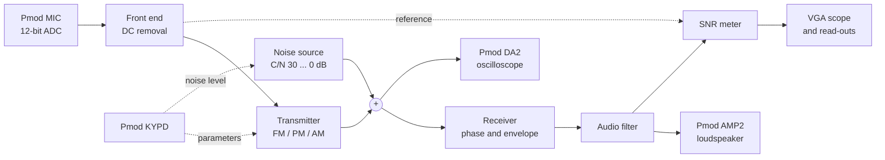
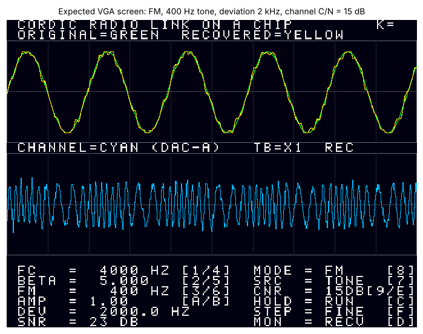
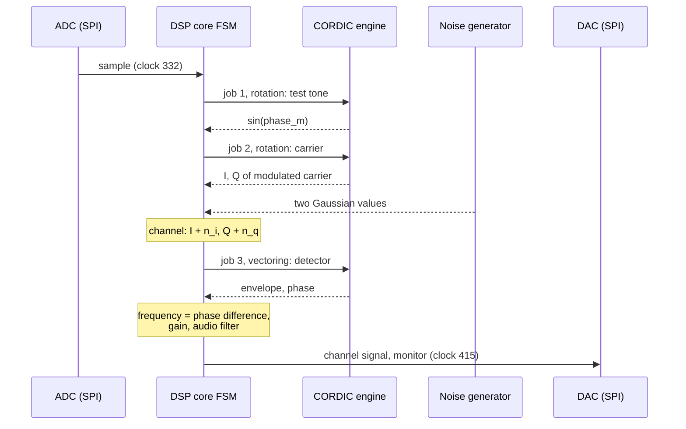
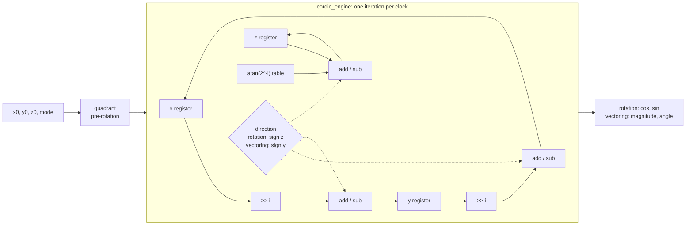
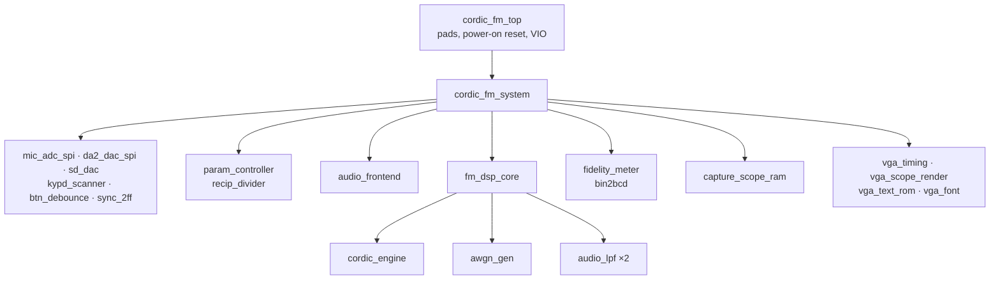

# CORDIC Radio Link on a Chip

**Real-time FM / PM / AM modulation and demodulation of microphone audio through a
programmable noisy channel, built around a single hand-written CORDIC engine.**

Avnet ZedBoard (Zynq-7000 `xc7z020clg484-1`, programmable logic only) · Verilog-2001 ·
100 MHz single clock · 50 kS/s · Vivado

Course project for Reconfigurable Computing, Problem Statement 1: *CORDIC-Based Audio Signal
Processing System with User-Controlled Frequency Modulation* ([statement](Project%20Statement.pdf)).

> **Project status.** The RTL is complete and verified in simulation against a bit-exact
> reference model: twelve self-checking test benches pass in Vivado XSim and in Icarus
> Verilog. The design has been synthesised and implemented in Vivado 2025.2 and a bitstream
> generated; all timing constraints are met at 100 MHz
> ([implementation results](#implementation)). The design **has not yet been run on the
> board**. The bring-up procedure is in [`docs/TESTING.md`](docs/TESTING.md). See
> [Scope](#scope-what-was-done-and-what-was-not).

---

## Overview

The assignment asks for a CORDIC-based FM modulator for microphone audio, with keypad control,
storage in block RAM, DAC and VGA output, and an analysis of *the impact of modulation on audio
quality*.

A modulator alone cannot answer that last point: over a perfect link the audio comes back
unchanged whatever the modulation. This design therefore places the modulator inside a complete
link on one FPGA:



The channel noise is generated on chip and set from the keypad. A meter compares the recovered
audio with the original and displays the signal-to-noise ratio, and a loudspeaker makes the
same comparison audible. The classical results of analogue communication can then be observed
directly: FM outperforms AM at equal channel noise, gains 6 dB for each doubling of the
modulation index, and fails abruptly below a threshold.

## Highlights

* **One CORDIC, three roles.** A single iterative engine (24-bit, 18 iterations) is time-shared
  three times per sample: test-tone generation and carrier synthesis in rotation mode, and
  phase/envelope detection in vectoring mode. It is active for 57 of the 2000 clocks in a
  sample period. No vendor IP is used in the signal path.
* **Programmable channel.** Additive Gaussian noise from a xorshift generator (sum of twelve
  uniform values), 31 levels in 1 dB steps.
* **Live measurement.** Output SNR is accumulated over 0.66 s windows and displayed; the error
  signal can be overlaid on screen or listened to on its own.
* **Model-driven verification.** A Python model defines the arithmetic bit for bit. The RTL is
  checked against it sample by sample, and the same model produces every figure below.
* **Self-contained instrument.** VGA oscilloscope with triggered capture, parameter read-outs
  and SNR; two DAC channels for an external oscilloscope; block-RAM record readable over JTAG.

## Results

All results in this section are from the bit-exact model, which the RTL simulation matches
with zero mismatches.

### Output SNR against channel carrier-to-noise ratio


Markers: this design. Lines: small-noise theory for the implemented audio filter.

| C/N | FM (2 kHz deviation) | PM (2 rad) | AM (100 %) | Unmodulated |
|---|---|---|---|---|
| off | 90.3 dB | 90.5 dB | 79.9 dB | exact |
| 20 dB | 27.7 dB | 35.1 dB | 19.4 dB | 29.1 dB |
| 15 dB | 22.8 dB | 30.1 dB | 13.6 dB | 24.2 dB |
| 10 dB | 17.8 dB | 25.1 dB | 7.7 dB | 19.4 dB |
| 5 dB | 10.8 dB | 17.8 dB | 1.7 dB | 14.7 dB |

Above the threshold the design follows theory within 0.3 dB. Below about 10 dB the angle
modulations depart from their lines: the FM threshold effect.

### FM exchanges bandwidth for SNR


At C/N = 20 dB the output SNR rises from 14.1 dB at β = 1 to 37.6 dB at β = 15.875, 6 dB per
doubling, as theory predicts. With the channel clean the SNR saturates near 90 dB, which is
the arithmetic noise of the CORDIC itself and lies well beyond the resolution of the 12-bit
converters.

### Signals through the link


### Display

Expected VGA output (rendered from the same text ROM and layout as the RTL), FM at C/N = 15 dB:



## Architecture


### Per-sample schedule

Every 20 µs the DSP core runs one fixed sequence. The CORDIC engine is shared by the three jobs
marked below; the noise generator and the converters run alongside.



### CORDIC engine



Angles are binary fractions of a turn, so phase accumulators wrap naturally and the FM
detector's phase difference needs no unwrapping.

### Module hierarchy



| Block | Function |
|---|---|
| `cordic_engine` | Iterative CORDIC, rotation and vectoring, 19 clocks per result |
| `fm_dsp_core` | Per-sample sequencer: tone, modulator, channel, detector, gain |
| `awgn_gen` | Gaussian noise pair with table-driven level |
| `audio_lpf` | Multiplier-free low-pass (four cascaded 4-sample averages), −3 dB at 2.93 kHz |
| `fidelity_meter` | Signal and error power sums, SNR estimate in dB |
| `param_controller` | Keypad, buttons and JTAG to parameters; derived constants |
| `capture_scope_ram` | Triggered, double-buffered record of original, channel and recovered signals |
| `mic_adc_spi`, `da2_dac_spi` | SPI masters for the ADCS7476 and the two DAC121S101 |
| `sd_dac` | First-order sigma-delta output driving the Pmod AMP2 |
| `vga_*` | 640 × 480 two-trace oscilloscope with text read-outs |

## Hardware

| Module | ZedBoard port | Purpose |
|---|---|---|
| Digilent Pmod MIC | JA, top row | Microphone and 12-bit ADC |
| Digilent Pmod KYPD | JB | 16-key control panel |
| Digilent Pmod AMP2 | JC, top row | Class-D amplifier for a loudspeaker |
| Digilent Pmod DA2 | JD, top row | Two 12-bit DAC channels: channel signal and monitor |

Also used: the on-board VGA connector, slide switches, push-buttons and LEDs. A loudspeaker
(4 to 8 Ω, 3.5 mm plug) and a VGA monitor are required; an oscilloscope is optional.


Pin-level tables are in [`docs/WIRING.md`](docs/WIRING.md).

## Controls

```
[1] carrier +   [2] index +   [3] tone +    [A] amplitude +
[4] carrier -   [5] index -   [6] tone -    [B] amplitude -
[7] source      [8] mode      [9] noise +   [C] hold
[0] defaults    [F] step      [E] noise -   [D] monitor
```

| Parameter | Range | Default |
|---|---|---|
| Carrier frequency | 100 Hz to 10 kHz in 100 Hz steps | 4 kHz |
| Modulation index β | 0 to 15.875 in steps of 0.125 | 5.0 |
| Test-tone frequency | 50 Hz to 2 kHz in 50 Hz steps | 400 Hz |
| Modulating amplitude | 0 to 3.94 in steps of 1/16 | 1.0 |
| Modulation | FM, PM, AM, bypass | FM |
| Source | microphone, internal tone | microphone |
| Channel C/N | off, 30 to 0 dB in 1 dB steps | off |
| Loudspeaker monitor | recovered, original, channel, error | recovered |

Switches select the display time base, the error overlay, loudspeaker volume and mute. Every
parameter can also be set and every internal measurement read over JTAG through a VIO core.

## Verification

Twelve self-checking test benches cover every module and the complete system.

| Bench | Scope | Checks |
|---|---|---|
| `tb_cordic_engine` | CORDIC against the model: both modes, all quadrants, corner cases | 8701 |
| `tb_awgn_gen` | Noise generator against the model; statistics | 967 |
| `tb_audio_lpf` | Filter against the model; impulse and step response | 3056 |
| `tb_sd_dac` | Sigma-delta density and reset behaviour | 11 |
| `tb_bin2bcd` | Binary to decimal conversion | 2256 |
| `tb_mic_adc_spi` | ADC interface against a datasheet-timed device model | 286 |
| `tb_da2_dac_spi` | DAC interface against a device model | 316 |
| `tb_kypd_scanner` | Matrix scan, debounce, multi-key rejection | 70 |
| `tb_recip_divider` | Receiver gain divider | 1417 |
| `tb_fm_dsp_core` | **DSP core bit-exact against the model: 2900 samples, five signals, all modes, with noise** | 14502 |
| `tb_cordic_fm_top` | Top level: power-on reset, pads | 16 |
| `tb_cordic_fm_system` | Full system through the device models: user interface, SNR against theory, capture, VGA timing | 859 |

All twelve benches pass in Vivado XSim 2025.2 (`scripts/run_sims.tcl`) and in Icarus Verilog
12, with identical results: the system bench reports the same SNR values to 0.01 dB in both. The design also elaborates without errors under `slang`
(`scripts/lint_slang.py`).

## Implementation

Vivado 2025.2, `xc7z020clg484-1`, default synthesis and implementation strategies, one 100 MHz
clock.

### Utilisation

| Resource | Design | Debug (VIO + hub) | Total | Available | Utilisation |
|---|---|---|---|---|---|
| Slice LUTs | 3 508 | 1 552 | 5 060 | 53 200 | 9.51 % |
| Slice registers | 3 418 | 2 800 | 6 218 | 106 400 | 5.84 % |
| DSP48E1 | 20 | 0 | 20 | 220 | 9.09 % |
| Block RAM (RAMB36) | 3 | 0 | 3 | 140 | 2.14 % |
| Bonded I/O | | | 54 | 200 | 27.0 % |
| Global clock buffers | 1 | 1 | 2 | 32 | 6.25 % |
| Latches | 0 | 0 | 0 | | |

"Design" comprises all logic except the debug cores, including the top-level power-on reset
and input synchronisers. The VIO core serves bring-up only and may be omitted from a final
build.

Breakdown of the design (`u_sys`):

| Block | LUTs | Registers | DSP48E1 | RAMB36 |
|---|---|---|---|---|
| `fm_dsp_core` (complete link) | 1 643 | 1 948 | 11 | |
| &nbsp;&nbsp;of which `cordic_engine` | 372 | 81 | 0 | |
| &nbsp;&nbsp;of which `awgn_gen` | 135 | 141 | 1 | |
| &nbsp;&nbsp;of which `audio_lpf` (two instances) | 509 | 1 215 | 0 | |
| `fidelity_meter` | 327 | 306 | 2 | |
| `param_controller`, `recip_divider` | 389 | 242 | 6 | |
| `vga_timing`, `vga_scope_render` | 598 | 341 | 1 | |
| `capture_scope_ram` | 119 | 32 | | 3 |
| Interfaces (keypad, front end, SPI masters, sigma-delta, debouncers) | 375 | 459 | | |

The CORDIC engine, which performs all trigonometric operations of both transmitter and
receiver, occupies 372 LUTs (0.7 % of the device) and no DSP slices.

### Timing

Post-route timing summary for the 100 MHz system clock (`sys_clk`, 10 ns period), slow process
corner:

| | Worst slack | Total negative slack | Failing endpoints | Total endpoints |
|---|---|---|---|---|
| Setup | +0.113 ns | 0.000 ns | 0 | 14 762 |
| Hold | +0.056 ns | 0.000 ns | 0 | 14 746 |
| Pulse width | +3.750 ns | 0.000 ns | 0 | 6 313 |

All user-specified timing constraints are met. The critical path lies in the receiver's audio
filter (`audio_lpf`, accumulator to saturated output). The first implementation had shown a
setup violation of 0.276 ns on the multiplication that computes the frequency deviation for the
VGA read-out; that product was divided into two register stages, which has no functional effect
because the value is converted once per video frame.

### Power

Vivado estimate with default switching activity (confidence: low): 0.220 W on chip, of which
0.113 W dynamic and 0.108 W device static; junction temperature 27.5 °C.

### Design checks

Synthesis reports no critical warnings and no inferred latches, and the design rule check
reports no errors. The remaining DRC and methodology warnings concern optional DSP pipelining,
the unused processing system (`ZPS7-1`) and reset structures within the Xilinx debug hub.

## Scope: what was done and what was not

**Done**

* Complete RTL for the link, user interface, display, storage and audio output.
* Bit-exact Python reference model; generation of test vectors, ROM contents and all figures
  from it.
* Simulation of every module and of the full system; agreement of the simulated output SNR
  with communication theory.
* Synthesis, implementation and bitstream generation in Vivado 2025.2, with all timing
  constraints met at 100 MHz.
* Constraints, project and build scripts, wiring documentation, bring-up and demonstration
  procedures.

**Not done**

* **Operation on the ZedBoard.** No measurement in this repository was taken on hardware.
  Bench results will be added after the procedure in `docs/TESTING.md` has been carried out.
* The pin order of ports JC and JD is taken from the ZedBoard schematic and is to be confirmed
  with a multimeter during bring-up (`docs/WIRING.md`, section 4).

**Design limits**

* The channel is modelled inside the FPGA. The DAC output is not received back through an ADC,
  so the analogue parts are outside the measured loop.
* The receiver shares the transmitter's carrier reference. FM detection does not depend on the
  carrier phase and carries over to a separate receiver; PM detection as implemented would
  additionally need carrier recovery.
* There is no pre-detection band-pass filter; C/N is defined over the full 25 kHz Nyquist band.

## Build

Requirements: Vivado (ML Standard edition is sufficient) with the ZedBoard part installed.
Clone to a path without spaces.

```tcl
# Vivado Tcl console, in the repository root
source create_project.tcl            ;# creates the project and the VIO core
source scripts/run_sims.tcl          ;# optional: all test benches
source scripts/build_bitstream.tcl   ;# synthesis, implementation, reports/, bitstream
```

Without Vivado, the model and the figures can be reproduced with Python 3 (NumPy, Matplotlib):

```sh
python3 scripts/analysis.py          # figures in docs/img/
python3 scripts/gen_vectors.py       # test vectors for the benches
```

## Repository

```
CORDIC.srcs/sources_1/new/   RTL (22 modules)
CORDIC.srcs/sim_1/new/       test benches, device models, test vectors
CORDIC.srcs/constrs_1/new/   pin and timing constraints
scripts/                     reference model, analysis, generators, Vivado scripts
docs/                        developer handbook, wiring, test and demonstration procedures
Manuals/                     data sheets and reference manuals of the parts used
create_project.tcl           rebuilds the Vivado project
```

## Documentation

| Document | Content |
|---|---|
| [`docs/README.md`](docs/README.md) | Developer handbook: theory from first principles, the Pmods, every module, verification, results |
| [`docs/WIRING.md`](docs/WIRING.md) | Connection schematic and pin tables |
| [`docs/TESTING.md`](docs/TESTING.md) | Step-by-step bring-up and test procedure |
| [`docs/DEMO.md`](docs/DEMO.md) | Demonstration script |
| [`Manuals/`](Manuals/README.md) | Reference manuals and data sheets |

## References

* J. E. Volder, "The CORDIC Trigonometric Computing Technique", *IRE Transactions on Electronic
  Computers*, 1959.
* J. S. Walther, "A Unified Algorithm for Elementary Functions", *AFIPS Spring Joint Computer
  Conference*, 1971.
* R. Andraka, "A Survey of CORDIC Algorithms for FPGA Based Computers", *FPGA '98*.
* S. Haykin, *Communication Systems*: noise in AM and FM receivers, FM threshold.
* G. Marsaglia, "Xorshift RNGs", *Journal of Statistical Software*, 2003.
* Digilent reference manuals for the Pmod MIC, KYPD, DA2 and AMP2; ZedBoard Hardware User's
  Guide.
