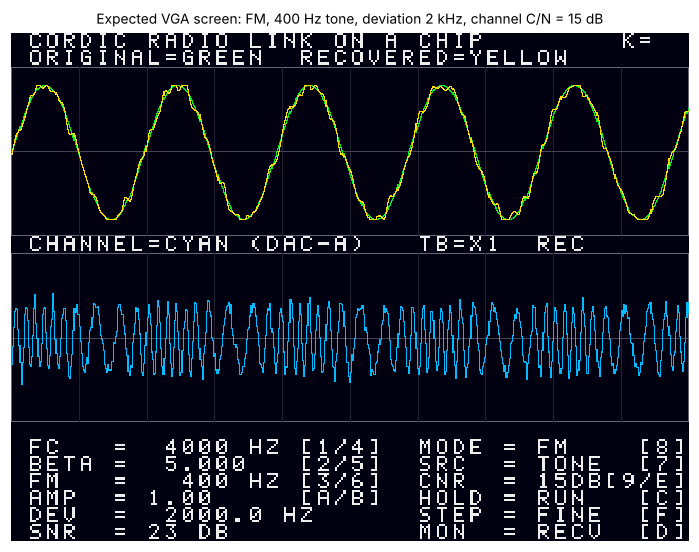
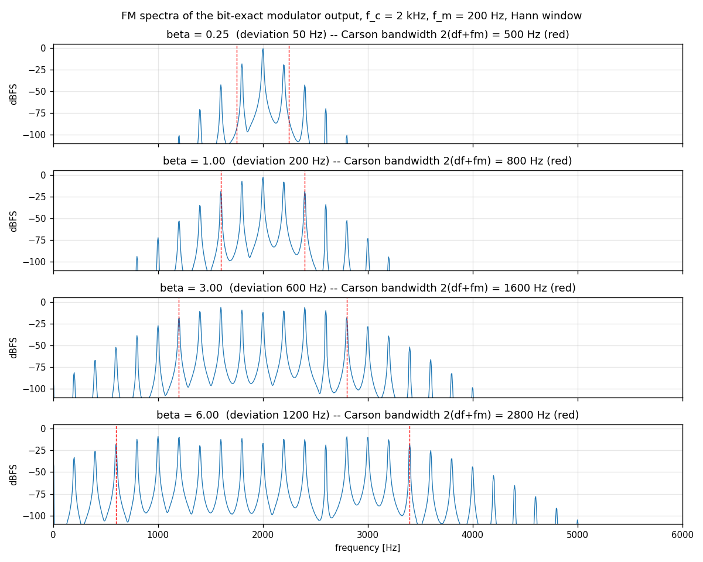
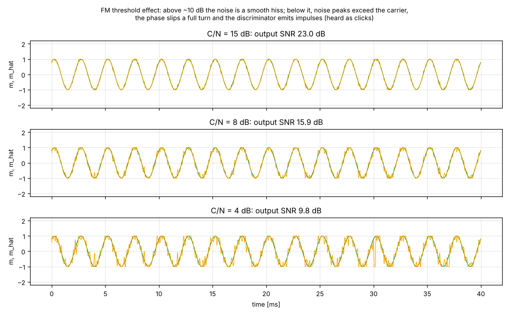
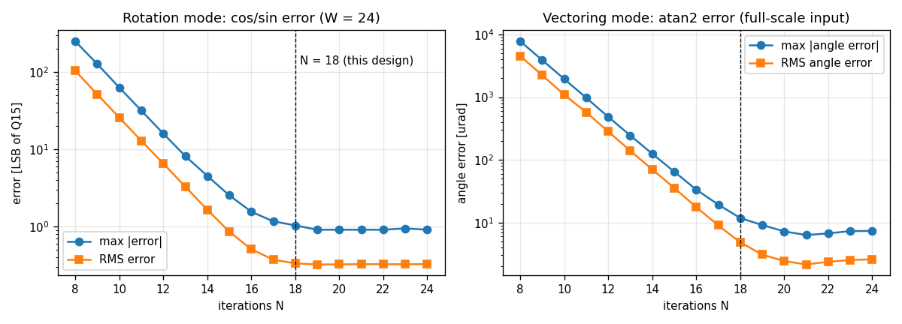
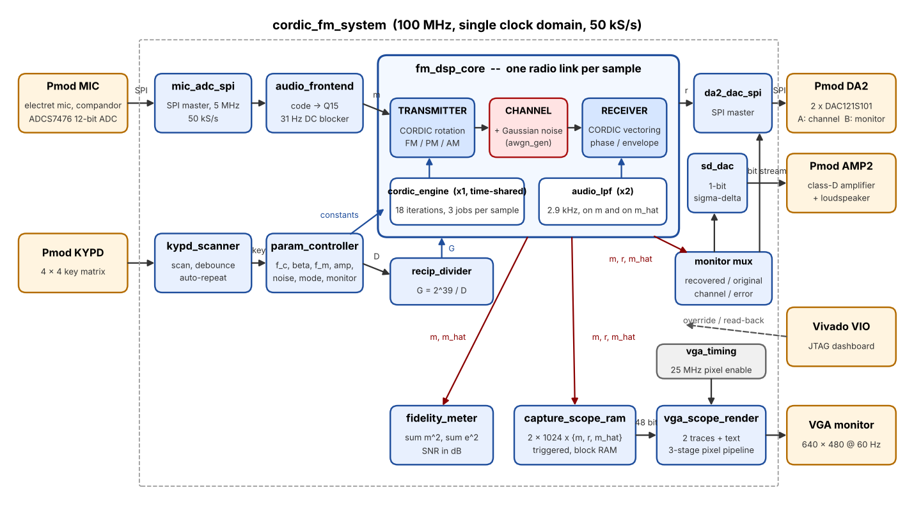
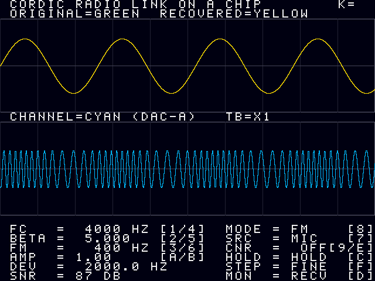
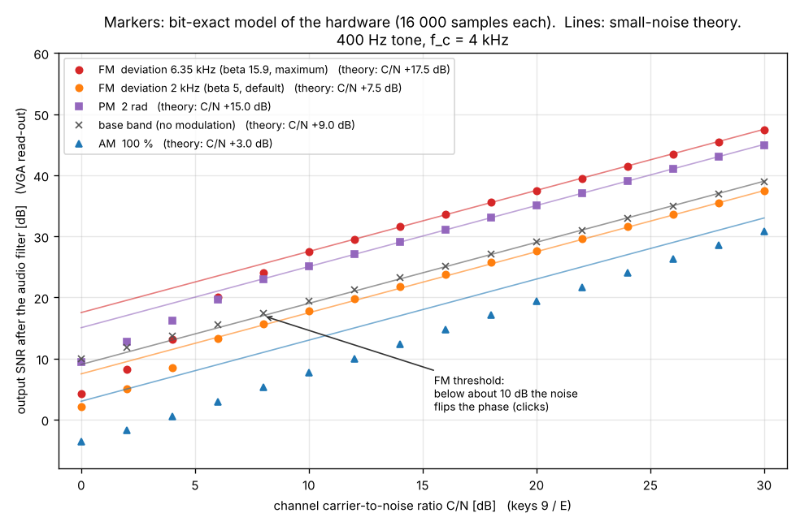
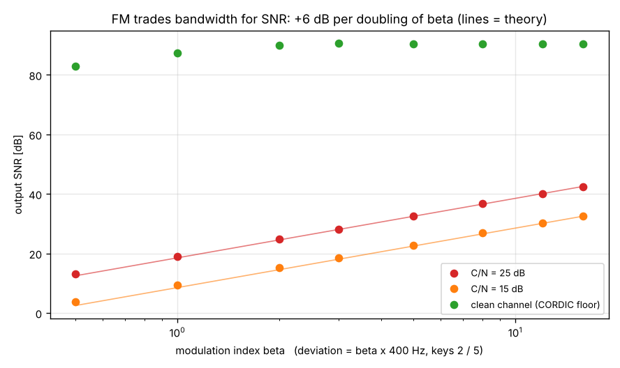
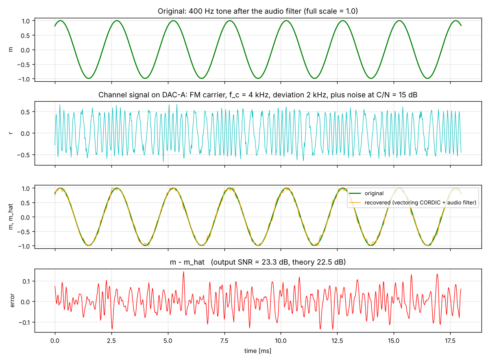
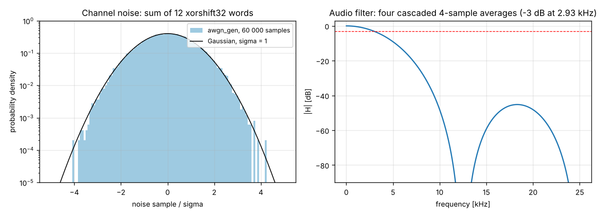

# Developer handbook: the CORDIC radio link on a chip

This is the document for the people who build, change and present this project. It assumes no
prior knowledge of modulation, CORDIC, fixed-point arithmetic or the Pmod boards. Read it top to
bottom once; after that every section stands on its own.

Companion documents in this folder:

| File | Purpose |
|---|---|
| [`WIRING.md`](WIRING.md) + [`wiring_schematic.png`](wiring_schematic.png) | every connection between the ZedBoard and the Pmods, pin by pin |
| [`TESTING.md`](TESTING.md) | step-by-step bring-up and test procedure on the real hardware |
| [`DEMO.md`](DEMO.md) | the final demonstration, with what to say and what the audience should see and hear |

**Status, stated plainly.** Every block is verified in simulation (12 self-checking test benches,
section 9, passing in both Vivado XSim and Icarus Verilog), and the complete signal path is
proven bit-for-bit equal to the Python reference model. The design has been synthesised and
implemented in Vivado 2025.2 and a bitstream generated, with all timing constraints met at
100 MHz (section 10.6). The design **has not yet been run on the board**; `TESTING.md` is the
procedure for that. Wherever a number below comes from the model or from simulation, it says so.

---

## Contents

1. [The idea in one page](#1-the-idea-in-one-page)
2. [The problem statement and how each item is met](#2-the-problem-statement-and-how-each-item-is-met)
3. [What you need on the bench](#3-what-you-need-on-the-bench)
4. [Background, from zero](#4-background-from-zero)
5. [CORDIC, from zero](#5-cordic-from-zero)
6. [The radio link: transmitter, channel, receiver](#6-the-radio-link-transmitter-channel-receiver)
7. [The peripherals: working knowledge of each Pmod](#7-the-peripherals-working-knowledge-of-each-pmod)
8. [The implementation, module by module](#8-the-implementation-module-by-module)
9. [Verification](#9-verification)
10. [Results: what the measurements show](#10-results-what-the-measurements-show)
11. [Using the system: keys, switches, LEDs, screen, VIO](#11-using-the-system)
12. [Building, simulating, regenerating](#12-building-simulating-regenerating)
13. [Design decisions, limits, ideas](#13-design-decisions-limits-ideas)
14. [Glossary](#14-glossary)

---

## 1. The idea in one page

The assignment asks for a system that captures audio, frequency-modulates it with a CORDIC,
lets the user change the parameters, stores and shows the original and the modulated signal, and
analyses what modulation does to audio quality.

A modulator alone cannot answer that last question. An FM carrier at 4 kHz played through a
loudspeaker is a warbling whistle; nobody can hear "quality" in it. Modulation exists for one
reason: to carry a signal across a **channel** that damages it, and to get it back at the far end.
So this project builds the whole journey on one FPGA:

```
 microphone --> TRANSMITTER --> CHANNEL --> RECEIVER --> loudspeaker
                (CORDIC,        (noise you   (the same
                 rotation        dial in      CORDIC,
                 mode)           from the     vectoring
                                 keypad)      mode)
```

* The **transmitter** is the assignment's CORDIC modulator: FM, plus PM and AM for comparison.
* The **channel** adds Gaussian noise to the transmitted signal. The amount is set from the
  keypad as a carrier-to-noise ratio (C/N) from 30 dB down to 0 dB, or switched off.
* The **receiver** is the same CORDIC engine running in its other mode. It recovers the audio from
  the noisy signal.
* A **meter** compares the recovered audio with the original, sample by sample, and shows the
  signal-to-noise ratio (SNR) in dB on the screen.
* The **Pmod AMP2 and a loudspeaker** play the recovered audio, so the effect is heard as well as
  measured.

With that in place the system demonstrates, live, the result that made FM radio worth inventing:

* At the same channel noise, FM delivers cleaner audio than AM, and it gets **6 dB better every
  time the modulation index is doubled**: FM trades bandwidth for quality.
* Below a certain C/N (about 10 dB here) FM collapses suddenly into clicks: the **threshold effect**.
* The measured SNR on the screen follows the textbook formula to within a fraction of a dB
  (section 10), because the hardware is bit-exact with the model the formula is checked against.

One iterative CORDIC engine does all the trigonometry: it is used three times per audio sample
(test tone, transmitter, receiver) and is still idle 97 % of the time.



*What the VGA monitor is expected to show (Python rendering of the exact RTL layout, data from
the bit-exact model): FM of the internal 400 Hz tone through a channel with C/N = 15 dB. Bottom:
the noisy channel signal. Top: original (green) and recovered audio (yellow). `SNR = 23 DB` is
the meter reading; theory says 22.5 dB.*

---

## 2. The problem statement and how each item is met

The statement is `Project Statement.pdf` in the repository root (Problem Statement 1,
*CORDIC-Based Audio Signal Processing System with User-Controlled Frequency Modulation*).

| Item of the statement | What the design does | Where |
|---|---|---|
| 1. Capture audio with the Pmod MIC | 50 000 conversions per second through a hand-written SPI master; DC removal | `mic_adc_spi`, `audio_frontend` |
| 2. Implement CORDIC to generate the modulated signal from user parameters such as the modulation index | hand-written iterative CORDIC in rotation mode produces the carrier; FM by modulating the phase increment | `cordic_engine`, `fm_dsp_core` |
| 3. User interface with the Pmod KYPD: modulation index, carrier frequency, modulation frequency, amplitude of the modulating signal, "can be extended to type of modulation" | all four parameters, plus modulation type (FM / PM / AM / bypass), signal source, **channel noise**, monitor selection | `kypd_scanner`, `param_controller` |
| 4. Store original and modulated signals in FPGA internal RAM for comparison | triggered, double-buffered block-RAM record of original, channel and recovered signals; readable numerically over JTAG | `capture_scope_ram` |
| 5. Output through the Pmod DA2; visualise on VGA or on an oscilloscope via the DAC | DAC-A = channel signal, DAC-B = monitor; VGA two-trace scope with read-outs; both at once | `da2_dac_spi`, `vga_*` |
| 6. Analyse the impact of modulation on audio quality, observe and quantify | a complete link with a noisy channel, an SNR meter, a loudspeaker; curves reproduced against theory | `awgn_gen`, `fidelity_meter`, `sd_dac`, section 10 |
| Expected outcome: insight into CORDIC performance in real time | CORDIC accuracy study, 2.9 % utilisation, clean-channel noise floor of 90 dB | section 10 |

Nothing in the statement was dropped. Two things were added, both in the direction the statement
points: the channel noise (so that item 6 has something real to measure) and the Pmod AMP2 output
(so that the result can be heard). The joystick alternative was not used; the keypad covers
everything.

---

## 3. What you need on the bench

**You have:** ZedBoard, Pmod MIC (PB200-122 rev B), Pmod DA2, Pmod AMP2 (PB200-233 rev B),
Pmod KYPD (PB200-195 rev B).

**You also need:**

| Item | Why | Notes |
|---|---|---|
| Loudspeaker, 4 to 8 ohm, with a 3.5 mm mono plug | the Pmod AMP2 only amplifies; it has no speaker | headphones or powered PC speakers also work; with those keep the volume switches low at first |
| VGA monitor and VGA cable | the scope display | any monitor that accepts 640 x 480 at 60 Hz |
| Micro-USB cable | programming and the VIO dashboard | goes to the ZedBoard connector marked PROG (J17) |
| 12 V supply of the ZedBoard | power | |
| PC with Vivado 2025.x | build, program | the free edition supports the XC7Z020 |
| Probably one 12-pin (2 x 6) Pmod cable | the keypad board is wider than one Pmod port and may not fit beside its neighbours | check by plugging everything in (`WIRING.md`); 6-pin cables for the small Pmods work as well |
| Optional: oscilloscope with two probes | the "visualise via the DAC" alternative of the statement, and for the bench tests | not required: the VGA screen shows the same signals |

No jumper wires, resistors or soldering are needed. The joystick Pmod is not used.

---

## 4. Background, from zero

### 4.1 Signals, sampling and why 50 000 samples per second

Sound is air pressure changing over time. The microphone turns it into a voltage; the ADC
measures that voltage at regular instants and reports each measurement as a number. This design
takes `Fs = 50 000` measurements per second: one every 20 microseconds, which is 2000 periods of
the board's 100 MHz clock.

A sampled system can only represent frequencies below `Fs/2` (here 25 kHz, the **Nyquist
frequency**). Anything above it does not disappear: it shows up at a wrong, mirrored frequency
("**aliasing**"). Speech needs about 300 Hz to 3.4 kHz, so 25 kHz is generous. The generous
margin is used on purpose: the modulated carrier needs much more bandwidth than the audio, and
there must be room for it below 25 kHz.

### 4.2 Numbers in hardware: fixed point

The FPGA works with integers. To represent fractions, we agree where the binary point sits.

* **Q15**: a 16-bit signed integer `v` stands for `v / 32768`. Range -1.0 to +0.99997. "Full
  scale" is 32767. All audio samples in the design (`m`, `s`, `r`, `m_hat`) are Q15.
* Multiplying two Q15 numbers gives a Q30 number in 32 bits; shifting right by 15 returns to Q15.
* Shifting a signed number right must copy the sign bit (**arithmetic shift**, `>>>` in Verilog).
  It rounds toward minus infinity; where that small bias matters, the design adds half an LSB
  first: `(v + 2^(n-1)) >>> n`.
* If a result may not fit, it is **saturated**: clamped to the largest or smallest value instead
  of wrapping around. Wrap-around turns a slightly-too-loud sample into a full-scale click of the
  opposite sign; saturation only flattens the peak.

**Angles** get a different treatment. A phase is stored as a fraction of a full turn in an
unsigned integer: with 32 bits, `2^32` is one turn, `2^30` is 90 degrees. This is called a
**binary angle** (BAM). Its great advantage: when the integer overflows, the angle has gone once
around the circle, which is exactly what angles do. No "modulo 2 pi" logic is ever needed, and the
difference of two angles is a plain subtraction that is automatically correct across the
+180/-180 degree boundary.

### 4.3 Making a tone: the phase accumulator

A sine wave is a point going round a circle at constant speed. In hardware:

```
phase[n] = phase[n-1] + fcw            (32-bit register, wraps = one turn)
tone[n]  = sin(phase[n])
```

`fcw` ("frequency control word") is how far the point moves per sample. One turn is `2^32`, and
there are `Fs` samples per second, so

```
f = fcw * Fs / 2^32          fcw = f * 2^32 / Fs
```

Examples: 100 Hz needs `fcw = 100 * 2^32 / 50000 = 8 589 935`; the default 4 kHz carrier needs
40 times that. The frequency resolution is `Fs / 2^32 = 0.0000116 Hz`. This is called direct
digital synthesis (DDS). The `sin` is computed by the CORDIC (section 5).

### 4.4 Modulation: putting audio onto a carrier

A **carrier** is a plain sine wave `A cos(theta)`. It has three properties that can be made to
follow an audio signal `m` (a number between -1 and +1 at every sample):

| Type | What follows the audio | Formula |
|---|---|---|
| **AM** amplitude modulation | the height of the carrier | `s = A (1 + mu m) cos(2 pi fc t)` |
| **PM** phase modulation | the angle of the carrier | `s = A cos(2 pi fc t + kp m)` |
| **FM** frequency modulation | the speed of the angle | `s = A cos(theta)`, with `theta` advancing at `fc + df * m` hertz |

`fc` is the **carrier frequency**. For FM, `df` is the **peak deviation**: when `m` is at +1 the
carrier runs at `fc + df`, at -1 it runs at `fc - df`.

**Modulation index.** If the audio is a single tone of frequency `fm`, the FM phase swings by
`beta = df / fm` radians around the unmodulated carrier. `beta` is the modulation index, the
"how strongly" knob of FM. In this design the user sets `beta` and `fm` and the deviation follows:

```
df = beta * fm          default: 5 * 400 Hz = 2000 Hz   (shown as DEV on the screen)
```

With the microphone as the source there is no single `fm`; `df = beta * fm` is then simply the
deviation produced by a full-scale input, and `beta` is still the knob that scales it.

For AM, `mu` is the **depth**: at `mu = 1` (100 %) the carrier just touches zero in the troughs.
For PM, `kp` is the peak phase swing in radians. In this design the one knob `beta` sets all
three, each mode clamping it to its legal range:

| Mode | Meaning of `beta` | Range used | Why the clamp |
|---|---|---|---|
| FM | `df = beta * fm` | 0 to 15.875 | none needed |
| PM | `kp = min(beta, 2)` radians | 0 to 2 rad | a phase detector cannot tell +190 degrees from -170 degrees; 2 rad leaves 1.14 rad of room for noise |
| AM | `mu = min(beta, 1)` | 0 to 100 % | beyond 100 % the envelope crosses zero and an envelope detector folds it |

### 4.5 How much bandwidth FM needs

An FM signal is not a single frequency sliding back and forth: seen in the frequency domain it
is the carrier plus **sidebands** at `fc +/- fm`, `fc +/- 2 fm`, `fc +/- 3 fm`, ... whose strengths are
given by Bessel functions of `beta`. The larger `beta`, the more sidebands matter. A reliable
estimate of the total width that holds about 98 % of the power is **Carson's rule**:

```
bandwidth = 2 (df + fm) = 2 fm (beta + 1)        default: 2 (2000 + 400) = 4800 Hz
```

So FM with a large index uses far more spectrum than the audio itself. The next sections show
what it buys.



*Spectra of the transmitter output computed with the bit-exact model. Red lines: Carson's rule.*

If `fc + df + fm` comes near 25 kHz, the upper sidebands alias back and the receiver can no longer
recover the audio (`img/aliasing.png`). The keypad allows going there on purpose.

### 4.6 Noise, C/N and SNR

Every real channel adds **noise**: a random voltage. The standard model is additive white
Gaussian noise (AWGN): each noise sample is drawn independently from a bell-shaped (Gaussian)
distribution with standard deviation `sigma`; "white" means it contains all frequencies equally.

Two ratios describe how bad it is, both in decibels (`dB = 10 log10(power ratio)`):

* **C/N, carrier-to-noise ratio**: power of the transmitted carrier over power of the noise, as
  measured **on the channel**, before the receiver. This is what the keys `9` / `E` set.
* **SNR, signal-to-noise ratio**: power of the wanted audio over power of the error, as measured
  **at the receiver output**. This is what the screen shows.

The whole point of a modulation scheme is the relationship between the two.

Definition used here: the carrier has amplitude `A = 32767`, so its power is `A^2 / 2`. The noise
is added to both the in-phase and the quadrature component of the signal (section 6.2), each with
variance `sigma^2`, spread evenly over the whole 0 to 25 kHz band:

```
C/N = (A^2 / 2) / sigma^2
```

### 4.7 Why FM beats AM, in formulas

Noise pushes the tip of the carrier vector around by a small random amount. The component of that
push **along** the carrier changes its length (amplitude); the component **across** it changes
its angle. For a carrier of amplitude `A`, an angle error is `n_across / A`: variance
`sigma^2 / A^2 = 1 / (2 C/N)` radians squared per sample.

The receiver's output passes through an audio low-pass filter with response `H(f)` (section 6.4).
Two numbers characterise how much noise it lets through:

```
Bn = integral of |H(f)|^2 df             = 3087 Hz      (for flat noise)
F2 = integral of f^2 |H(f)|^2 df         = (3751 Hz)^3 / 3   (for noise that grows with f^2)
```

For a full-scale audio tone (power 1/2) the output SNR, as a multiple of C/N, is:

| Mode | Detector output noise | SNR / (C/N) | Default settings |
|---|---|---|---|
| base band (no modulation) | flat | `Fs / (2 Bn)` | **+9.0 dB** |
| AM, depth `mu` | flat, but the signal is only `mu/2` of the carrier | `mu^2 Fs / (8 Bn)` | **+3.0 dB** at 100 % |
| PM, index `kp` | flat (angle noise) | `kp^2 Fs / (2 Bn)` | **+15.0 dB** at 2 rad |
| FM, deviation `df` | grows as `f^2` | `Fs df^2 / (2 F2)` | **+7.5 dB** at 2 kHz, **+17.5 dB** at 6.35 kHz |

Where the FM row comes from: the FM receiver outputs the *change* of angle per sample. Taking a
difference is a differentiator, which multiplies the noise at frequency `f` by `f`: the noise
power grows as `f^2`. Low audio frequencies therefore get very little noise, and the audio filter
removes the noisy high end. Meanwhile the wanted signal at the detector output is proportional
to the deviation `df`. Doubling `df` (doubling `beta`) doubles the signal and leaves the noise
unchanged: **+6.02 dB per doubling**, for free, as long as there is bandwidth to spend.
AM has no such knob: its depth cannot exceed 100 %.

### 4.8 The FM threshold

The formulas above assume the noise is small compared with the carrier. When the noise vector is
occasionally **longer than the carrier**, the sum can swing right around the origin: the angle
jumps by a full turn. The FM receiver sees that as a huge frequency spike and outputs a click.
This starts when C/N falls to about 10 dB and gets rapidly worse below: the SNR no longer falls
1 dB per dB but collapses. A wide-deviation FM system is superb above the threshold and useless
below it; AM just degrades steadily.



### 4.9 Removing DC: why and how

The microphone circuit delivers its signal riding on a constant offset (roughly mid-scale of the
ADC). A constant fed into an FM modulator is a constant frequency shift: the carrier would sit off
its nominal frequency. A **DC blocker** removes it:

```
y[n] = x[n] - x[n-1] + a * y[n-1]          a = 1 - 2^-8
```

The difference `x[n] - x[n-1]` is exactly zero for a constant; the feedback term `a * y[n-1]`
restores normal gain for everything above a corner frequency of
`Fs (1 - a) / (2 pi) = 31 Hz`. After a step in the offset the output decays with a time
constant of 256 samples (5 ms).

---

## 5. CORDIC, from zero

CORDIC (COordinate Rotation DIgital Computer, Jack Volder, 1959) computes sines, cosines, angles
and lengths using only **additions, subtractions and bit shifts**. No multiplier, no table of
sines. That is why it has been the standard way to do trigonometry in hardware for sixty years,
and why the assignment is built around it.

### 5.1 Rotating a vector

Take a point `(x, y)` and rotate it about the origin by an angle `a`. The new coordinates are

```
x' = x cos a - y sin a
y' = y cos a + x sin a
```

Pull `cos a` out of both lines:

```
x' = cos a * ( x - y tan a )
y' = cos a * ( y + x tan a )
```

Two multiplications by `tan a` remain. Now the trick: only allow angles whose tangent is a power
of two,

```
tan a_i = 2^-i        a_i = atan(2^-i) = 45, 26.565, 14.036, 7.125, 3.576, 1.790, 0.895, ... degrees
```

Multiplying by `2^-i` is a right shift by `i` bits, which in hardware is just wiring. One such
**micro-rotation** costs two shifts and two additions:

```
x_next = x - d * (y >> i)
y_next = y + d * (x >> i)          d = +1 (counter-clockwise) or -1 (clockwise)
```

### 5.2 Any angle from a fixed set of micro-rotations

Do the micro-rotations `i = 0, 1, 2, ...` one after the other, each either clockwise or
counter-clockwise. Because each angle is smaller than the sum of all the following ones, any
target angle between about -99.9 and +99.9 degrees (the sum of all `a_i`) can be reached to within
the size of the last step. A third register `z` keeps track of how much angle is left:

```
z_next = z - d * a_i               (the a_i come from a small table, one entry per iteration)
```

### 5.3 The gain K

The `cos a_i` factor was dropped, and it cannot be recovered by shifts. Leaving it out means every
micro-rotation also **stretches** the vector by `1 / cos a_i = sqrt(1 + 2^-2i)`. Since every
iteration is always executed (only the direction varies), the total stretch is the same constant
every time:

```
K = product over i of sqrt(1 + 2^-2i) = 1.6467602581...
```

So the result is `K` times too long, always by the same factor. The fix costs nothing: start
with a vector that is `1/K` times the wanted length.

### 5.4 Two modes

The only decision in each iteration is the direction `d`. Two rules give two different machines.

**Rotation mode: drive `z` to zero.** `d = +1` if `z >= 0`, else `-1`. Start with `(x, y) = (X0, 0)`
and `z` = the wanted angle. At the end the vector has been rotated by that angle:

```
x = K X0 cos(angle)        y = K X0 sin(angle)
```

This is a **sine/cosine generator**. In this project: the test tone and the carrier.

**Vectoring mode: drive `y` to zero.** `d = +1` if `y < 0`, else `-1`. The vector is rotated until
it lies along the x-axis; `z` accumulates how much rotation that took:

```
x = K sqrt(x0^2 + y0^2)    z = atan2(y0, x0)
```

This is a **rectangular-to-polar converter**: it measures the length and the angle of a vector.
In this project: the receiver. The angle is what FM and PM carry; the length is what AM carries.

### 5.5 A worked example of each

Rotation: compute cos and sin of 30 degrees, starting from `(1, 0)`.

| i | `a_i` | z before | d | x after | y after | z after |
|---|---|---|---|---|---|---|
| 0 | 45.000 | +30.000 | +1 | 1.00000 | 1.00000 | -15.000 |
| 1 | 26.565 | -15.000 | -1 | 1.50000 | 0.50000 | +11.565 |
| 2 | 14.036 | +11.565 | +1 | 1.37500 | 0.87500 | -2.471 |
| 3 | 7.125 | -2.471 | -1 | 1.48438 | 0.70312 | +4.654 |
| 4 | 3.576 | +4.654 | +1 | 1.44043 | 0.79590 | +1.078 |
| 5 | 1.790 | +1.078 | +1 | 1.41556 | 0.84091 | -0.712 |
| 6 | 0.895 | -0.712 | -1 | 1.42870 | 0.81879 | +0.183 |
| 7 | 0.448 | +0.183 | +1 | 1.42230 | 0.82996 | -0.265 |

Divide by `K = 1.6467`: `(0.8637, 0.5040)`. The true values are `(0.8660, 0.5000)`. Eight
iterations give about 2.5 correct digits; every further iteration adds one bit. The design uses 18.

Vectoring: find the length and angle of `(3, 4)`.

| i | d | x after | y after | z after |
|---|---|---|---|---|
| 0 | -1 | 7.00000 | 1.00000 | 45.000 |
| 1 | -1 | 7.50000 | -2.50000 | 71.565 |
| 2 | +1 | 8.12500 | -0.62500 | 57.529 |
| 3 | +1 | 8.20312 | 0.39062 | 50.404 |
| 4 | -1 | 8.22754 | -0.12207 | 53.980 |
| 5 | +1 | 8.23135 | 0.13504 | 52.190 |
| 6 | -1 | 8.23346 | 0.00643 | 53.085 |
| 7 | -1 | 8.23351 | -0.05790 | 53.533 |

`x / K = 5.0000` (true length 5) and `z = 53.53` degrees (true angle 53.13).

### 5.6 Covering the whole circle

The micro-rotations only reach about +/-99.9 degrees. To handle any angle, the engine first makes
a **90-degree pre-rotation** when needed, which is exact and free: rotating `(x, y)` by +90 degrees
gives `(-y, x)`, by -90 degrees gives `(y, -x)`.

* Rotation mode: the top two bits of the angle tell the quadrant. Targets in the second or third
  quadrant are reduced by a quarter turn after rotating the start vector by that quarter turn.
* Vectoring mode: if `x` is negative the vector is in the left half plane; it is rotated by
  -90 or +90 degrees into the right half and `z` starts at +90 or -90 degrees instead of 0, so the
  final `z` is still the true `atan2`.

### 5.7 Accuracy: how many iterations, how many bits

Three error sources, and how the design handles each:

1. **Angle resolution.** After `N` iterations the leftover angle is at most `atan(2^-(N-1))`.
   With `N = 18` that is 7.6 microradians.
2. **Truncation.** Each `>> i` drops bits; `N` iterations can accumulate up to about `N` LSBs of
   error. The datapath therefore carries 4 extra **guard bits** below the 16-bit result: values
   enter shifted left by 4 and leave through a rounding shift right by 4.
3. **Growth.** The vector grows by `K = 1.65`, and in the receiver noise is added on top of the
   carrier, so the datapath has 4 bits of **headroom** above the 16-bit payload.

That is the 24-bit datapath: 4 headroom + 16 payload + 4 guard. The angle path is also 24 bits
(one LSB = 0.37 microradians).



*Bit-exact model. Rotation error flattens at about 1 LSB of the 16-bit output from 16 iterations
on; the vectoring angle error reaches its floor at 18. Fewer iterations would raise the receiver's
noise floor; more would cost clocks and gain nothing.*

Measured at `N = 18` (model, identical to the RTL): rotation error at most 1.04 LSB (0.34 LSB
RMS); vectoring angle error 4.8 microradians RMS for a full-scale vector; magnitude error below
0.7 LSB.

### 5.8 Iterative or pipelined?

A CORDIC can be built two ways. **Pipelined**: 18 copies of the micro-rotation hardware in a row,
one new result every clock, 100 million per second. **Iterative**: one copy, used 18 times, one
result every 19 clocks.

This system needs 3 results per audio sample: 150 000 per second. The iterative engine can
deliver 5.2 million per second. It is 35 times faster than needed and about one eighteenth of the
size of the pipelined version, so it is the right choice. Picking the architecture from the
required throughput, instead of defaulting to the fastest one, is the main architectural decision
of the project.

---

## 6. The radio link: transmitter, channel, receiver

Everything in this section happens once per audio sample, inside `fm_dsp_core`.

### 6.1 Transmitter

The modulating signal is `m[n] = saturate(A * source[n])`, where `source` is the microphone or
the internal tone and `A` is the amplitude setting (0 to 3.94 in steps of 1/16).

Two phase accumulators exist: `phi_m` for the internal tone and `phi_c` for the carrier.

```
FM:     phi_c[n] = phi_c[n-1] + fcw_c + kdev * m[n]        theta = phi_c
PM:     phi_c[n] = phi_c[n-1] + fcw_c                      theta = phi_c + kpm * m[n]
AM:     phi_c[n] = phi_c[n-1] + fcw_c                      theta = phi_c
```

* `fcw_c` is the carrier's frequency control word (section 4.3).
* `kdev` is the extra phase step that a full-scale `m` adds: `kdev = df * 2^32 / Fs`. Because
  `df = beta * fm`, this is simply `beta` times the tone's own control word `fcw_m`.
* `kpm` is `kp` radians expressed in turns: `kp * 2^32 / (2 pi)`.

The CORDIC in rotation mode turns `theta` into the carrier's two components:

```
I = 32767 cos(theta)        Q = 32767 sin(theta)
```

`I` is the signal a real transmitter would radiate. `Q` is the same carrier a quarter cycle
later. Together they describe the carrier as a rotating vector (a "phasor"), which is what the
receiver's CORDIC needs. For AM both are multiplied by the envelope `(1 + mu m) / 2`; the factor
1/2 makes 100 % modulation exactly fill the number range.

In **bypass** mode nothing is modulated: the audio itself is put on the channel. This is the
"base band" reference of section 4.7, and the A/B comparison for the ear.

### 6.2 Channel

```
rx_I = tx_I + n_I          rx_Q = tx_Q + n_Q
```

`n_I` and `n_Q` are two independent Gaussian noise samples from `awgn_gen` (section 8.5). Adding
noise to both components is the correct model of a real noisy radio channel seen by a receiver
that mixes the signal down with a cosine and a sine: the noise has an in-phase and a quadrature
part of equal power. `sigma` is chosen by the C/N setting:

```
sigma = (32767 / sqrt 2) / 10^(CN_dB / 20)         C/N 30 dB: sigma = 733      C/N 0 dB: sigma = 23170
```

The signal tapped for DAC-A, the scope and the capture RAM is `rx_I / 2`: half scale, so that
6 dB of noise peaks above the carrier remain visible instead of being clipped.

### 6.3 Receiver

The CORDIC in vectoring mode converts the noisy `(rx_I, rx_Q)` into an angle and a length:

```
theta_hat = atan2(rx_Q, rx_I)          mag = K * sqrt(rx_I^2 + rx_Q^2)
```

From these, one subtraction recovers a number proportional to the audio:

| Mode | Raw detector output | What it is called |
|---|---|---|
| FM | `theta_hat[n] - theta_hat[n-1] - fcw_c` | frequency discriminator: the angle step per sample is the instantaneous frequency; subtract the carrier's own step |
| PM | `theta_hat[n] - phi_c[n]` | phase detector: compare with the unmodulated carrier phase (available because transmitter and receiver share the chip) |
| AM | `mag - carrier level` | envelope detector |
| bypass | `rx_I` | nothing to do |

All angle arithmetic is 24-bit binary-angle arithmetic, so the subtraction wraps correctly.

**Scaling back to audio.** The raw number must be divided by a constant `D` that depends on the
settings (`kdev` for FM, `kpm` for PM, the carrier level times `mu` for AM). Dividing every sample
would need a divider running at the sample rate. Instead the design computes the reciprocal
`G = 2^39 / D` **once, when a setting changes** (42 clocks in `recip_divider`), and multiplies
every sample by it: `m_hat_raw = (raw * G) >> 24`. Because of this exact calibration the recovered
audio has the same amplitude as the original for every setting, so the two can be drawn on top of
each other and subtracted to get the error.

`m_hat_raw` is kept 20 bits wide (16 times full scale). This matters: with noise on, the raw FM
detector output contains large wide-band noise. If it were clipped to 16 bits before filtering,
the clipping would create distortion inside the audio band. (This was found with the model: the
SNR came out 7 dB below theory until the headroom was added.)

### 6.4 Audio filter and fair comparison

The raw receiver output still contains noise from 0 to 25 kHz. Speech lives below about 3 kHz,
so a low-pass filter removes the rest. The filter is four moving averages of 4 samples each, in
series (section 8.6): -3 dB at 2.93 kHz, and **every frequency is delayed by exactly 6 samples**.

To compare recovered and original audio fairly, the original `m` is passed through an identical
second filter. Both are then band-limited and delayed in exactly the same way, and the difference

```
e[n] = m_ref[n] - m_hat[n]
```

contains only what the link added: channel noise and the CORDIC's own arithmetic noise. The SNR
meter, the scope's top pane and the capture RAM all use `m_ref` and `m_hat`.

### 6.5 What the SNR meter computes

Over a window of 32768 samples (0.66 s) the meter accumulates the two sums

```
S = sum of m_ref^2            E = sum of e^2            SNR = 10 log10(S / E)   dB
```

Both sums are available exactly on the VIO dashboard. For the screen, the logarithm is estimated
without a divider: `log2` of each sum is taken as the position of its leading one bit plus the
next three bits (accurate to about 1/16 of an octave), the two are subtracted, and the difference
is multiplied by 3.01 dB per octave. The on-screen value is within 1 dB of the exact one (checked
in simulation).

---

## 7. The peripherals: working knowledge of each Pmod

A **Pmod** is a small plug-in board with a 6-pin or 12-pin header: pins 1 to 4 (and 7 to 10) are
signals, pin 5 (and 11) is ground, pin 6 (and 12) is 3.3 V. The ZedBoard has four Pmod ports
wired to the FPGA (JA, JB, JC, JD; the fifth, JE, belongs to the processor and is not usable
from FPGA logic), each with two rows of six pins: the top row is pins 1 to 6,
the bottom row pins 7 to 12. A 6-pin Pmod uses one row; a 12-pin Pmod uses both. All four ports
are on FPGA bank 13, which runs at 3.3 V.

Two 6-pin Pmods cannot share one port (they would sit on top of each other), so each Pmod has
its own port. Exact pins: [`WIRING.md`](WIRING.md).

### 7.1 Pmod MIC (PB200-122 rev B) on JC

*What is on it* (reference manual in `Manuals/`): an electret condenser microphone, an SA575
"compandor" used as a dynamic-range **compressor**, and a Texas Instruments **ADCS7476** 12-bit
analog-to-digital converter. The compressor halves the level range in dB (a sound 40 dB below
the reference comes out 20 dB below): quiet sounds are raised, loud sounds are lowered. Two
practical consequences: speech fills the ADC range without a gain control (this board has no
potentiometer, unlike its successor the Pmod MIC3), and the background noise of a quiet room is
clearly visible on the trace.

*How the ADC talks* (ADCS7476 datasheet):

```
CS    ‾‾‾‾\_______________________________________________/‾‾‾‾
SCLK  ‾‾‾‾‾‾\_/‾\_/‾\_/‾\_/‾\_/‾\_/‾ ... 16 clock periods ... \_/‾‾‾‾
SDATA ---<  0   0   0   0  D11 D10  D9 ...            D1  D0 >---
```

* The falling edge of CS starts a conversion and is the instant at which the input is sampled.
* The ADC then puts out 16 bits, one per falling edge of SCLK: four zeros, then the 12-bit
  result, most significant bit first. The receiver is meant to read each bit on the *next* falling
  edge.
* SCLK may be between 1 and 20 MHz. After 16 clocks CS goes high again.

The result is an unsigned number 0 to 4095 where about 2048 means "no sound". `mic_adc_spi` runs
SCLK at 5 MHz, so a conversion takes 3.3 microseconds out of the 20 available.

### 7.2 Pmod DA2 on JA

*What is on it:* two Texas Instruments **DAC121S101** 12-bit digital-to-analog converters. They
share the SYNC and SCLK lines and have one data line each (DINA, DINB), so one 16-clock frame
updates both outputs at the same instant. Each output swings from 0 V (code 0) to 3.3 V
(code 4095); "no signal" is mid-scale, 1.65 V.

*Frame format* (DAC121S101 datasheet): 16 bits, most significant first:

```
 X  X  PD1 PD0  D11 D10 ... D0          PD1 PD0 = 00 for normal operation
```

Data is read by the DAC on each falling edge of SCLK while SYNC is low; the output changes on the
16th falling edge. `da2_dac_spi` changes the data lines on rising edges (half a period away from
the reading edge) and also runs at 5 MHz.

*Where the analog signals come out:* header J2 of the Pmod DA2: pin 1 = output A, pin 3 = output
B, pin 5 = ground. In this design **A is the channel signal** and **B is the monitor** (whatever
the loudspeaker plays). A Q15 sample `s` becomes the DAC code `(s + 32768) >> 4`.

### 7.3 Pmod AMP2 (PB200-233 rev B) on JD

*What is on it:* an Analog Devices **SSM2377** class-D audio power amplifier (up to 2.5 W into
4 ohm from 5 V; less from 3.3 V), an RC low-pass filter in front of its input, and a 3.5 mm mono
jack for a loudspeaker.

*It has no digital interface.* Its pins are:

| Pin | Name | Meaning |
|---|---|---|
| 1 | AIN | the audio input: an analog voltage |
| 2 | GAIN | high = 6 dB of gain, low = 12 dB |
| 4 | ~SHUTDOWN | low = amplifier off (0.1 microampere), high = on |

An FPGA pin can only be 0 V or 3.3 V, so how can it deliver audio to an analog input? By
switching very fast, in such a way that the **average** voltage follows the audio. The RC filter on
the Pmod (the rev B schematic shows 330 ohm and 4.7 nF sections, a corner near 100 kHz) and the
loudspeaker itself remove the fast switching and keep the average. The reference manual
describes exactly this use ("a pulse-width modulated signal can also be accepted after it passes
through the reconstruction filter").

The design uses a **sigma-delta modulator** (`sd_dac`, section 8.7) instead of plain pulse-width
modulation: it produces the same average with the switching noise pushed far above the audio band.

*Level.* A full-scale bit stream averages between 0 and 3.3 V, which already drives the amplifier
to its limit at the 6 dB setting. Normal speech is far below full scale. The volume switches
(SW5:4) attenuate digitally in 6 dB steps; SW6 selects the 12 dB amplifier gain for quiet
sources; SW7 shuts the amplifier down. The amplifier is also held off during reset.

*Acoustic feedback.* With the microphone as source and the loudspeaker playing the recovered
audio, the loudspeaker's sound re-enters the microphone and the system can howl. Keep them apart,
reduce the volume, or use the internal tone (key `7`).

### 7.4 Pmod KYPD (PB200-195 rev B) on JB

*What is on it:* sixteen push buttons at the crossings of four **column** wires and four **row**
wires, and a pull-up resistor on every row. Nothing else: no chip.

*How to read it:* drive **one** column low and the other three high, then look at the rows. A row
that reads low has a pressed key at its crossing with the low column. Repeat for the four
columns: sixteen keys with eight wires. Mechanical contacts **bounce** for a few milliseconds
(they open and close several times when pressed), so a key is only accepted when the complete
picture of all sixteen keys has been identical for 16 scans in a row (5 ms).

Key caps and their position (COL1 is the column of `1 4 7 0`, ROW1 the row of `1 2 3 A`):

```
        COL1 COL2 COL3 COL4
 ROW1     1    2    3    A
 ROW2     4    5    6    B
 ROW3     7    8    9    C
 ROW4     0    F    E    D
```

Header pins: 1 to 4 = COL4, COL3, COL2, COL1; 7 to 10 = ROW4, ROW3, ROW2, ROW1.

### 7.5 The ZedBoard itself

* **Zynq-7000 XC7Z020-1CLG484C.** A chip with an ARM processor (the "PS") and an FPGA (the "PL").
  This design uses only the FPGA part; the processor is left unconfigured, which Vivado reports as
  a harmless warning.
* **Clock:** a 100 MHz oscillator on FPGA pin Y9. It is the only clock in the design.
* **VGA:** three 4-bit resistor-ladder DACs (red, green, blue) plus two sync signals.
* **Buttons and switches** are on banks 34/35, powered by the adjustable rail VADJ: 1.8 V with
  the jumper J18 as shipped. The constraint file declares them `LVCMOS18`. If J18 is on another
  setting, change that I/O standard to match.
* **Programming:** micro-USB port J17 (labelled PROG) is the JTAG connection for Vivado.

---

## 8. The implementation, module by module



### 8.1 Ground rules of the RTL

* **Language:** Verilog-2001, every file starts with `` `default_nettype none `` so that a
  misspelt signal name is an error instead of a silently created unconnected wire.
* **One clock:** the 100 MHz board oscillator. The serial clocks of the ADC and DAC are ordinary
  registered outputs toggled by counters; the VGA pixel rate is a clock *enable* (one clock in
  four). There is no PLL and no clock-domain crossing inside the design.
* **Synchronous reset** everywhere, from a power-on reset generator ORed with the BTND button.
* **Asynchronous inputs** (buttons, switches, keypad rows, the ADC data line) each pass through
  two flip-flops (`sync_2ff`) before use. A signal that changes at an arbitrary moment can catch
  a flip-flop mid-decision ("metastability"); the second flip-flop gives it a full clock period
  to settle.
* **FSMD style** (finite-state machine with datapath), as taught in the course: each block is a
  small state machine that steers registers and arithmetic.
* **Short paths.** Every multiplication has registers on its inputs and its output and is at most
  25 x 18 bits (one DSP48E1 block); wider products are built from two partial products in the
  following state. Slow-changing read-outs are computed serially.

File map (`CORDIC.srcs/sources_1/new/`):

| Module | Lines of thought |
|---|---|
| `cordic_fm_top` | pins, power-on reset, synchronisers, LEDs, VIO |
| `cordic_fm_system` | wires everything together; sample clock; monitor mux |
| `fm_dsp_core` | the link: sequencer around one CORDIC |
| `cordic_engine` | the CORDIC |
| `awgn_gen` | channel noise |
| `audio_lpf` | audio filter (two instances) |
| `param_controller`, `recip_divider` | settings, derived constants, receiver gain |
| `mic_adc_spi`, `audio_frontend` | microphone path |
| `da2_dac_spi`, `sd_dac` | the two outputs |
| `kypd_scanner`, `btn_debounce`, `sync_2ff` | inputs |
| `capture_scope_ram`, `fidelity_meter` | storage and measurement |
| `vga_timing`, `vga_scope_render`, `vga_text_rom`, `vga_font`, `bin2bcd` | display |

### 8.2 One sample period, clock by clock

Measured in simulation (clock 0 = the sample tick):

| Clock | Event |
|---|---|
| 0 | `sample_tick` |
| 1 | ADC chip-select falls: **the sampling instant** |
| 1 to 331 | 16 SCLK periods at 5 MHz; one bit captured per falling edge |
| 331 | `adc_valid`: the 12-bit code is available |
| 332 | `audio_frontend` done: Q15 sample without DC |
| 332 to 415 | **the DSP sequence, 83 clocks** (section 8.4) |
| 415 | `out_valid`: reference, channel signal and recovered audio published together |
| 417 | DAC frame starts |
| 737 | 16th falling edge of the DAC clock: **both DAC outputs update** |
| 737 to 1999 | idle (63 % of the period) |

Latency from the sampling instant to the DAC-A output (the channel signal): **7.36 microseconds**,
the same for every sample. The recovered audio and the reference additionally pass through the
audio filter, which delays them by 6 samples (120 microseconds).

The CORDIC is busy for 3 x 19 = 57 of the 2000 clocks: 2.9 %.

### 8.3 `cordic_engine`

```
parameters  W = 24 (data bits)   Z = 24 (angle bits)   N = 18 (iterations)
inputs      start, vectoring, x_in, y_in (signed W), z_in (Z-bit binary angle)
outputs     busy, done (one-clock pulse), x_out, y_out, z_out (held until the next start)
latency     N + 1 = 19 clocks
```

Registers: `x`, `y`, `z`, an iteration counter `i`, a `running` flag and the latched mode.

* On `start` (when idle) the pre-rotation of section 5.6 is applied to the inputs and the result
  is loaded.
* While running, each clock performs one micro-rotation: two variable right-shifts (`x >>> i`,
  `y >>> i`), the direction bit `d` (sign of `z` in rotation mode, sign of `y` in vectoring mode),
  three add/subtracts, and `i + 1`.
* When `i == N - 1` the last result is stored and `done` pulses for one clock.

The `atan(2^-i)` table is a `case` statement holding the values at 32-bit precision; they are
rounded to `Z` bits when the design is elaborated. The start vector for sine/cosine generation is
`X0 = round((32767 << 4) / K) = 318366`, which makes the output amplitude exactly 32767 after the
final rounding. An exhaustive check over all 16.7 million angles showed that the largest value
the engine ever produces is 524279, one count below the point where the rounding would overflow
16 bits: there is no overflow, and also no slack, so `X0` and `N` must not be changed without
repeating that check.

### 8.4 `fm_dsp_core`: the sequencer

One pass per audio sample, 21 states:

```
IDLE -> TONE_W -> SRC -> GAIN -> SAT -> PHMUL -> PHSUM -> PHUPD -> CAR_W -> AMMUL -> OUTSEL
     -> CHAN -> DEM_GO -> DEM_W -> DEM_R -> DEM_MUL -> DEM_SUM -> DEM_FIN -> LPF_GO -> LPF_W -> OUT -> IDLE
```

| State | What is registered at the end of the state |
|---|---|
| `IDLE` | on `in_valid`: latch the microphone sample; start CORDIC job 1 (rotation, angle `phi_m`); advance `phi_m`; start the noise generator |
| `TONE_W` | wait for the CORDIC; `tone = sin(phi_m)` |
| `SRC` | `src = source ? tone : microphone` |
| `GAIN` | `gain_p = src * amp` |
| `SAT` | `m = saturate(gain_p >> 4)`: the modulating signal |
| `PHMUL` | partial products of `kdev * m`, `kpm * m`; `mu * m` |
| `PHSUM` | assemble the two wide products |
| `PHUPD` | advance `phi_c` (FM adds the deviation); `theta`; envelope; start CORDIC job 2 (rotation, angle `theta`) |
| `CAR_W` | wait; `I = cos(theta)`, `Q = sin(theta)` |
| `AMMUL` | `I * env`, `Q * env` |
| `OUTSEL` | pick what is transmitted for the current mode |
| `CHAN` | wait until the noise samples are ready (they always are), then `rx = tx + noise` |
| `DEM_GO` | start CORDIC job 3 (vectoring on `rx_I`, `rx_Q`); tap `rx_I / 2` for the channel output |
| `DEM_W` | wait; `theta_hat`, `mag` |
| `DEM_R` | raw detector output for the current mode; remember `theta_hat` for the next sample |
| `DEM_MUL` | partial products of `raw * G` |
| `DEM_SUM` | assemble |
| `DEM_FIN` | `m_hat_raw = saturate20(product >> 24)` |
| `LPF_GO`, `LPF_W` | run both audio filters (5 clocks) |
| `OUT` | publish all outputs, pulse `out_valid` |

All outputs change in the same clock, so the DAC, the capture RAM and the meter need no
alignment logic.

**Why partial products.** A DSP48E1 block multiplies 25 x 18 bits in one clock with ease.
`kdev * m` is 33 x 16 bits and `raw * G` is 25 x 33 bits, too wide for one block. The constant is
split into a low part of 17 bits and a high part, both are multiplied in one state, and the next
state adds `high << 17` to `low`. The result is exact and every multiplier has a full clock.

### 8.5 `awgn_gen`: the channel noise

Three steps (the comments in the file repeat this):

1. **Uniform random numbers.** A 32-bit *xorshift* generator: `x ^= x << 13; x ^= x >> 17;
   x ^= x << 5`. Three XOR layers, no adders; it visits every non-zero 32-bit value once before
   repeating (about 4.3 billion steps, an hour of audio). The top 16 bits are used as a signed
   number between -32768 and +32767.
2. **Bell shape.** Add 12 such numbers. By the central limit theorem the sum of independent
   uniform numbers approaches a Gaussian; with 12 terms the match is very good out to about 4
   standard deviations (figure in section 10), and the result can never exceed 6 standard
   deviations, which makes overflow analysis easy. The variance of one term is `2^32 / 12`, so the
   sum of 12 has standard deviation exactly `2^16`.
3. **Level.** Multiply by a gain `g` from a 32-entry table and shift right by 16: the output has
   standard deviation `g`.

Two samples (I and Q) are produced per audio sample, in 28 clocks, while the CORDIC is busy with
jobs 1 and 2. `noise_idx = 0` selects `g = 0`: the channel is clean.

### 8.6 `audio_lpf`: the audio filter

A moving average over 4 samples is `y[n] = x[n] + x[n-1] + x[n-2] + x[n-3]` (times 1/4). It is
computed recursively with one adder: `acc = acc + x[n] - x[n-4]`. Four of these in series give a
filter whose impulse response is

```
1  4  10  20  31  40  44  40  31  20  10  4  1        (divided by 256)
```

Symmetric, hence **linear phase**: a pure delay of 6 samples for every frequency, no phase
distortion. The frequency response has nulls at 12.5 kHz and 25 kHz, is 3 dB down at 2.93 kHz and
its first side lobe is 45 dB down. No multipliers. One stage is evaluated per clock (5 clocks per
sample), so the longest path is one three-input adder.

### 8.7 `sd_dac`: one pin, analog audio

```
every 16 clocks:   {carry, acc} = acc + u          u = sample + 32768  (unsigned 16 bit)
                   output pin   = carry
```

Adding `u` to a 16-bit accumulator overflows `u` times in every 65536 additions, so the output
pin is high for a fraction `u / 65536` of the time: its average voltage is `3.3 V * u / 65536`.
The pattern of ones and zeros is spread as evenly as possible, which pushes the switching energy
up to megahertz frequencies ("noise shaping") where the Pmod's RC filter and the loudspeaker do
not respond. Bit rate 6.25 MHz, 125 bits per audio sample.

### 8.8 `param_controller` and `recip_divider`

`param_controller` holds the settings as small integers:

| Register | Meaning | Range | Default |
|---|---|---|---|
| `fc_idx` | carrier = `fc_idx * 100 Hz` | 1 to 100 | 40 (4 kHz) |
| `beta_q` | index = `beta_q / 8` | 0 to 127 | 40 (5.0) |
| `fm_idx` | modulating frequency = `fm_idx * 50 Hz` | 1 to 40 | 8 (400 Hz) |
| `amp` | amplitude = `amp / 16` | 0 to 63 | 16 (1.00) |
| `noise_idx` | 0 = off, else C/N = `31 - noise_idx` dB | 0 to 31 | 0 |
| `mode` | 0 FM, 1 PM, 2 AM, 3 bypass | | 0 |
| `source` | 0 microphone, 1 tone | | 0 |
| `mon_sel` | 0 recovered, 1 original, 2 channel, 3 error x4 | | 0 |
| `hold`, `coarse` | scope hold, coarse step | | 0 |

Each key press adds or subtracts a step (fine or coarse) with clamping at both ends. From these it
derives the constants the DSP core needs, in three registered steps:

```
step 1   fcw_c = fc_idx * 8589935               (8589935 = 100 Hz in phase units)
         fcw_m = fm_idx * 4294967               (4294967 =  50 Hz)
step 2   kdev  = (beta_q * fcw_m) >> 3          (beta = beta_q / 8)
         kpm   = min(beta_q, 16) * 85445659     (85445659 = 1/8 rad in phase units)
         mu_q  = min(beta_q, 8) << 12           (depth as Q15)
step 3   div_den = FM: kdev >> 8 | PM: kpm >> 8 | AM: K * 16384 * mu | bypass: 0
```

When `div_den` changes, `recip_divider` recomputes `G = floor(2^39 / div_den)`: a classic
restoring division, one quotient bit per clock, 42 clocks. A "pending" flag in
`cordic_fm_system` guarantees that a change arriving during a division is not lost and that the
first division happens right after reset.

### 8.9 `mic_adc_spi` and `audio_frontend`

`mic_adc_spi` is a three-state machine (idle, transfer, tail) with a divide-by-10 counter that
toggles SCLK. On each falling edge it shifts in the (synchronised) data line; after 16 bits it
raises CS and pulses `valid` with the lower 12 bits.

`audio_frontend`, one clock later: converts the code to signed Q15 (`(code - 2048) * 16`, done by
inverting the top bit and appending four zeros), applies the DC blocker of section 4.9 with 8
extra fractional bits in its accumulator, saturates, and raises a clip flag if the raw code is
within 64 of either end of the range.

### 8.10 `da2_dac_spi`

Mirror image of the ADC master: on `start` SYNC falls and the two 16-bit frames
`{0000, code}` are loaded; data changes on rising SCLK edges, the DACs read on falling edges;
after the 16th falling edge SYNC rises. One frame, 3.3 microseconds, both channels.

### 8.11 `kypd_scanner` and `btn_debounce`

The scanner drives one column low for 8192 clocks (82 microseconds, time for the pull-ups to
charge the cable), samples the four rows, and moves to the next column. After each complete scan
(328 microseconds) the 16-bit key picture is compared with the previous one; after 16 identical
scans it is accepted. Exactly one key down produces a `key_valid` pulse with the key's value;
holding it repeats after 0.5 s, ten times per second. Two keys at once are ignored.

`btn_debounce` handles the five board buttons: the output follows the input after it has been
stable for 10 ms and a one-clock pulse marks each press.

### 8.12 `capture_scope_ram`

A 2048 x 48-bit memory (Vivado maps it to three 36-kbit block RAMs) holding two **banks** of 1024
samples of `{m_ref, r, m_hat}`.

```
ARM  --trigger-->  REC (1024 samples)  -->  SWAP (wait for vertical blanking)  -->  ARM or HOLD
```

* **Trigger:** the original signal crossing zero upward, armed only after it has been below
  -1024 (hysteresis, so noise near zero does not trigger). If nothing triggers for 32768
  samples the capture starts anyway, so silence still gives a picture.
* **Double buffering:** recording goes into one bank while the screen shows the other. They swap
  only during the monitor's vertical blanking, so the picture never shows half of one record and
  half of another, and periodic signals stand still.
* **Hold** (key `C`) freezes the last complete record.
* The second memory port is shared: it writes during recording and otherwise serves the VIO
  read-back address, so the stored numbers can be read out over JTAG.

### 8.13 `fidelity_meter`

Two pipeline stages per sample (square, accumulate) into 48-bit sums over 32768 samples, plus
the peak error. When a window ends the sums are latched, and the dB estimate of section 6.5 is
computed in the next five clocks.

### 8.14 The display: `vga_timing`, `vga_scope_render`, `vga_text_rom`, `vga_font`, `bin2bcd`

**VGA 640 x 480 at 60 Hz** draws the picture line by line. Each line is 800 pixel periods: 640
visible, then 16 idle, a 96-pixel horizontal sync pulse, 48 idle. Each frame is 525 lines: 480
visible, 10 idle, a 2-line vertical sync pulse, 33 idle. The standard pixel clock is 25.175 MHz;
this design uses exactly 25 MHz (every fourth 100 MHz clock), giving 59.5 frames per second,
which monitors accept.

`vga_timing` counts `h` (0 to 799) and `v` (0 to 524) and produces `pix_en`, the sync pulses and
the blanking flags.

`vga_scope_render` decides the colour of each pixel. Screen layout: 40 x 30 text cells of
16 x 16 pixels (an 8 x 8 font drawn double size); two scope panes of 160 lines, each +/-64 pixels
for full scale.

A pixel lasts four clocks, and the work is spread over them so no step is long:

```
pix_en          issue the capture-RAM address of the NEXT pixel
pix_en + 2      RAM data has arrived: convert the three samples to screen heights
next pix_en     stage 1: compare heights with v (trace hit?), look up the character code of this cell
+ 1 clock       stage 2: font ROM gives the text pixel
+ 2 clocks      stage 3: colour priority, registers at the pins (RGB and sync together)
```

Each trace is drawn as the vertical segment between the previous sample's height and the current
one, so steep signals appear as connected lines. Colour priority, top first: text (white),
overlay (yellow recovered signal, or red error x16 with SW2), original (green), channel (cyan),
centre line, grid, frame, background.

Static text comes from `vga_text_rom` and the glyphs from `vga_font`; both files are **generated**
by `scripts/gen_text_layout.py` and `scripts/gen_font.py` and must not be edited by hand. The
changing fields (numbers, mode names) are placed by the renderer at fixed cell positions.
Decimal digits are produced by `bin2bcd`, a serial "double dabble" converter (one bit per clock)
started once per frame during vertical blanking.

### 8.15 `cordic_fm_top` and the constraints

* **Power-on reset.** After configuration every FPGA flip-flop holds its initial value, which
  for most registers is 0, not the design's reset state (parameter defaults, the noise seed).
  A 16-bit shift register initialised to all ones shifts in zeros; its last bit is the reset for
  the first 16 clocks. ORed with the synchronised BTND. The top-level test bench never presses
  the button, to prove this works.
* **LEDs and VIO** (section 11).
* **Constraints** (`zedboard_cordic_fm.xdc`): pin and I/O standard for every port, the 100 MHz
  clock, internal pull-ups on the keypad rows, output registers placed in the I/O cells for the
  serial and VGA signals, and "false path" declarations for all board inputs (they are
  resynchronised) and slow outputs.

**Timing.** What was done to make 100 MHz likely on the first build: no path contains two
multipliers; wide products are split; the 48-bit logarithm of the meter, the decimal conversion
and the pixel path are pipelined or serial; the audio filter evaluates one stage per clock.
The first implementation still missed by 0.276 ns on one path: `beta_q * fm_idx * 125` in
`vga_scope_render`, the deviation shown on screen, mapped as a LUT multiplier feeding a DSP
slice without an input register. It is now two register stages (`bf_r`, then `dev10_r`); the
read-out is converted once per frame, so the extra clock is free. The next path, inside
`audio_lpf`, had +0.248 ns. If a path fails after a change, `reports/timing_summary.rpt` names
it and the fix is another register.

All serial and VGA outputs are driven from flip-flops packed into the I/O cells, so they leave
the chip with matched delays. The SPI clocks need one extra register each for this: a flip-flop
in an I/O cell can drive only its pin, but each state machine reads its own SCLK back to decide
which edge comes next. Each master therefore keeps two registers: the output port register
(`adc_sclk`, `dac_sclk`) drives only the pin, and `sclk_nq`, holding the complement, is read by
the logic. Two attempts that did not pack are worth recording. Two *identical* registers are
merged by synthesis into one; and with KEEP or DONT_TOUCH on the pin register, Vivado reported
that it "does not connect directly to an IO cell" (REQP-1618). In both cases the register was
not packed (Place 30-722). The
final form has no attribute on the pin register, and DONT_TOUCH only on `sclk_nq`.

### 8.16 Numerics reference

| Quantity | Format | Note |
|---|---|---|
| ADC code | 12-bit unsigned | mid-scale 2048 |
| `m`, `m_ref`, `m_hat`, `r`, `s`, `tone`, `I`, `Q` | 16-bit signed Q15 | full scale 32767 |
| DC-blocker accumulator | 28-bit signed, 8 fractional bits | |
| `amp` | 6-bit, 4 fractional bits | 16 = 1.0 |
| `phi_m`, `phi_c`, `theta` | 32-bit binary angle | `2^32` = one turn |
| CORDIC `x`, `y` | 24-bit signed | Q15 shifted left 4, 4 bits headroom |
| CORDIC `z` | 24-bit binary angle | 1 LSB = 0.37 microradian |
| `fcw_c`, `fcw_m`, `kdev` | 32-bit | |
| `kpm` | 31-bit | at most 16 x 85445659 |
| `mu_q` | 16-bit | 32768 = 100 % |
| noise `n_I`, `n_Q` | 19-bit signed | at most 6 sigma = 139 020 |
| `rx_I`, `rx_Q` | 20-bit signed | carrier + noise |
| raw detector output | 25-bit signed | |
| `G = 2^39 / D` | 32-bit unsigned | clamped |
| `m_hat_raw` | 20-bit signed | 16 x full scale of headroom before the filter |
| audio filter state | 28-bit signed | gain 256 |
| capture word | 48 bits | `{m_ref, r, m_hat}` |
| meter sums | 48-bit unsigned | |

---

## 9. Verification

### 9.1 Method

Every block has a **self-checking** test bench: it counts its checks and ends with
`ALL PASS (n checks)` or `FAILED: k of n`. The references the benches compare against are chosen
to be **independent of the design**: a different algorithm, or the manufacturer's datasheet.

* CORDIC against the simulator's double-precision `cos`, `sin`, `atan2`, `hypot`.
* Audio filter against a direct 13-tap convolution (the DUT uses recursive sums).
* Divider and BCD converter against the simulator's `/` and `%`.
* SPI masters against behavioural models of the ADCS7476 and DAC121S101 written from the
  datasheet timing diagrams; the models count protocol violations.
* Keypad scanner against a model of the key matrix with pull-ups and settling delay.
* The transmitter against a floating-point FM/PM/AM model fed with the RTL's own audio.
* **The noisy link against theory:** the output SNR measured in the RTL simulation must equal
  the formula of section 4.7.

One bench is deliberately *not* independent: `tb_fm_dsp_core` compares the whole DSP path with
the Python model `scripts/cordic_model.py`, bit for bit, over 2900 samples in ten parameter
segments including noise and extreme settings. Its purpose is to prove that the model **is** the
hardware, so that the curves in section 10 (computed with the model over hundreds of thousands
of samples, far more than an RTL simulation can run) are statements about the hardware.

### 9.2 The benches and their results

All run with Icarus Verilog 12 (`iverilog -g2012`); the same files run in Vivado's XSim via
`scripts/run_sims.tcl`.

| Bench | What it proves | Result |
|---|---|---|
| `tb_cordic_engine` | 4096 rotation angles vs `cos`/`sin` (worst 0.94 LSB); 600 vectors bit-exact vs the model; 2000 vectoring jobs vs `atan2`/`hypot`; latency 19; start-while-busy ignored | ALL PASS (8701 checks) |
| `tb_awgn_gen` | 448 noise pairs bit-exact vs the model at 7 levels; latency 28; over 20 000 samples: sigma within 0.5 % of the table value, I/Q correlation 0.002, 68.3 % inside one sigma, peak 4.2 sigma | ALL PASS (967 checks) |
| `tb_audio_lpf` | impulse response `1 4 10 20 31 40 44 40 31 20 10 4 1`; 3000 samples incl. saturation bit-exact vs direct convolution; DC gain exactly 1; 12.5 kHz nulled | ALL PASS (3056 checks) |
| `tb_sd_dac` | ones in 65536 bits = sample + 32768 exactly, at 9 levels; 1 kHz sine tracked within 0.28 % | ALL PASS (11 checks) |
| `tb_bin2bcd` | all 8-bit values, 2000 random 20-bit values | ALL PASS (2256 checks) |
| `tb_mic_adc_spi` | 48 conversions, every code received, 16 falling edges, no protocol errors | ALL PASS (286 checks) |
| `tb_da2_dac_spi` | 45 dual frames, both channels, setup margin, framing | ALL PASS (316 checks) |
| `tb_kypd_scanner` | all 16 keys, bounce rejected, auto-repeat timing, chord ignored | ALL PASS (70 checks) |
| `tb_recip_divider` | 709 divisions incl. 0, 1, maximum; latency 42 | ALL PASS (1417 checks) |
| `tb_fm_dsp_core` | **whole link bit-exact vs the Python model**: 2900 samples x 5 outputs, 0 mismatches; sequence length 83 clocks | ALL PASS (14502 checks) |
| `tb_cordic_fm_top` | comes up from **power-on reset alone** (button never pressed); pins, LEDs, AMP2 pins, keys, BTNU, BTND | ALL PASS (16 checks) |
| `tb_cordic_fm_system` | the complete system through its real pins, see below | ALL PASS (859 checks) |

`tb_cordic_fm_system` in detail (ADC model fed with a 300 Hz sine, both DAC models, keypad model):

| Test | Result |
|---|---|
| T1 defaults and receiver-gain calibration after reset | pass |
| T2 bypass, clean channel: front end vs floating-point DC blocker; reference = 13-tap FIR of the input; DAC codes; AMP2 bit-stream density, volume, gain and shutdown pins | pass |
| T3 FM, clean channel: transmitter within 2.2 LSB of the floating-point model; link SNR 87.6 dB; hardware meter sums give 87.55 dB, on-screen estimate 87 dB | pass |
| T4 PM, AM: transmitter within 1.8 LSB; link SNR 87.6 dB (PM), 76.9 dB (AM) | pass |
| T5 all sixteen keys: steps, clamping, coarse, monitor, defaults | pass |
| **T6 noisy channel, C/N = 15 dB set on the keypad:** FM 23.1 dB (theory 22.5), base band 24.6 dB (theory 24.0), AM 13.4 dB | pass (within 1.5 dB; FM beats AM by 9.7 dB) |
| T7 capture RAM: 1024 stored samples read back over the VIO port equal the bench's log, 0 mismatches; trigger on a rising zero crossing | pass |
| T8 VGA: line period 32.0 microseconds, HS 3.84 microseconds, frame 16.8 ms, VS 64 microseconds; one frame written to a file | pass |



*The frame produced by the RTL in `tb_cordic_fm_system` (converted from `vga_frame.ppm`).*

### 9.3 What is not verified

* **No hardware run** yet (see the status note at the top).
* The analog behaviour of the Pmods (microphone level and compression, amplifier loudness, DAC
  settling) is not modelled; the benches cover the digital interfaces.
* The pin numbering of ports JC and JD (pin 1 = `_P`, pin 2 = `_N` of each pair) is taken from
  the ZedBoard schematic's Pmod header sheet, which is the reference; the Hardware User's Guide
  table lists N before P and is not (`WIRING.md` section 4).

### 9.4 Bugs found on the way (worth knowing)

| Found by | Bug | Fix |
|---|---|---|
| system bench, first check | parameters settle during reset, so no "changed" pulse followed and the receiver gain stayed 0 until a key was pressed | the divider's pending flag is set by reset |
| code review | no power-on reset: after configuration all registers were 0 instead of the defaults | power-on reset generator in the top level, tested without the button |
| model vs theory | FM output SNR 7 dB below theory with noise on: receiver output clipped to 16 bits before the audio filter | 20-bit raw receiver output, saturation after the filter |
| model | PM limit of 3 rad left too little room for noise before the phase wrapped | limit 2 rad |
| code review | capture RAM read-back register was overwritten during a write clock | read only in clocks without a write |
| review of path lengths | decimal conversion, 48-bit logarithm, wide multipliers, pixel path were long single-cycle paths | serial conversion, pipelining, partial products |

---

## 10. Results: what the measurements show

All figures come from `scripts/analysis.py`, which runs the bit-exact model. Reproduce them with
`python3 scripts/analysis.py` (about one minute).

### 10.1 Output SNR against channel C/N: the main result



Markers are the model (the hardware); lines are the small-noise theory of section 4.7.

| C/N | keys from "OFF" | FM, 2 kHz deviation | PM, 2 rad | AM, 100 % | bypass |
|---|---|---|---|---|---|
| off | | 90.3 | 90.5 | 79.9 | exact |
| 30 dB | `9` once | 37.5 | 45.0 | 30.7 | 38.9 |
| 25 dB | | 32.5 | 40.0 | 25.1 | 34.0 |
| 20 dB | | 27.7 | 35.1 | 19.4 | 29.1 |
| 15 dB | | 22.8 | 30.1 | 13.6 | 24.2 |
| 10 dB | | 17.8 | 25.1 | 7.7 | 19.4 |
| 5 dB | | 10.8 | 17.8 | 1.7 | 14.7 |
| 0 dB | | 2.0 | 9.5 | -3.6 | 10.0 |

*Output SNR in dB, 400 Hz tone, default settings, 20 000 samples per point. These are the values
the VGA read-out should show (it rounds to whole dB and updates every 0.66 s).*

What to read from it:

* **Above about 10 dB every curve is a straight line with slope 1**, offset from C/N by exactly
  the constant the theory predicts (FM +7.5, PM +15.0, base band +9.0 dB). Model and theory agree
  to 0.3 dB.
* **AM is the worst**, and sits about 2 dB below its own small-noise line: at 100 % depth the
  carrier vanishes in the troughs and the envelope detector rectifies the noise there. At 50 %
  depth it matches its line.
* **The threshold:** below 10 dB the FM and PM points fall away from their lines. At 0 dB the
  wide-deviation FM, which was the best system at 20 dB, is worse than no modulation at all.

### 10.2 FM trades bandwidth for SNR



At C/N = 20 dB:

| beta | deviation | Carson bandwidth | output SNR | theory |
|---|---|---|---|---|
| 1 | 400 Hz | 1.6 kHz | 14.1 dB | 13.5 |
| 2 | 800 Hz | 2.4 kHz | 20.0 dB | 19.5 |
| 5 | 2 kHz | 4.8 kHz | 27.7 dB | 27.5 |
| 10 | 4 kHz | 8.8 kHz | 33.7 dB | 33.5 |
| 15.875 | 6.35 kHz | 13.5 kHz | 37.6 dB | 37.5 |

Each doubling of beta adds 6 dB, and costs bandwidth. With the channel clean (green points) the
SNR stops improving at about 90 dB: that is the CORDIC's own arithmetic noise, the floor of the
instrument.

### 10.3 The signals



### 10.4 The CORDIC's own contribution

With the channel noise off, the only error source is arithmetic: finite iterations, truncation,
the 24-bit angle grid. Clean-channel SNR (model): FM 90.3 dB, PM 90.5 dB, AM 79.9 dB. Even the
lowest of these is far beyond what the 12-bit ADC and DAC can deliver (about 72 dB), so the
CORDIC is not the limiting part of the system. That is the "insight into CORDIC performance" the
statement asks for: 18 iterations and 24 bits are enough, and the accuracy plot in section 5.7
shows that fewer would not be.

### 10.5 The channel's building blocks



Left: histogram of 60 000 noise samples against the ideal Gaussian. Right: the audio filter.

### 10.6 Resources and timing

From `scripts/build_bitstream.tcl` (Vivado 2025.2, default strategies, reports in `reports/`):

| Resource | Design | VIO + debug hub | Total | of device |
|---|---|---|---|---|
| Slice LUTs | 3 702 | 1 553 | 5 255 | 9.5 % |
| Slice registers | 3 545 | 2 800 | 6 345 | 5.8 % |
| DSP48E1 | 20 | 0 | 20 | 9.1 % |
| RAMB36 | 3 | 0 | 3 | 2.1 % |
| Latches | 0 | 0 | 0 | |
| Global clock buffers | 1 | 1 (JTAG) | 2 | |

| Block | LUTs | Registers | DSP48E1 |
|---|---|---|---|
| `fm_dsp_core` | 1 644 | 1 950 | 11 |
| `cordic_engine` (inside it) | 374 | 81 | 0 |
| `awgn_gen` (inside it) | 135 | 141 | 1 |
| `audio_lpf` x 2 (inside it) | 508 | 1 217 | 0 |
| `fidelity_meter` | 327 | 306 | 2 |
| `param_controller`, `recip_divider` | 389 | 242 | 6 |
| `vga_timing`, `vga_scope_render` | 598 | 341 | 1 |
| `capture_scope_ram` | 120 | 32 | 0 (3 RAMB36) |
| `adau1761_out` (codec interface, top level) | 180 | 127 | 0 |

The two audio filters hold most of the registers: each keeps 16 delay-line words of 28 bits.
The VIO alone is larger than the CORDIC, the noise generator and the meter together; it is a
bring-up tool and can be left out (build without `USE_VIO`).

Power estimate: 0.225 W on chip (0.117 W dynamic, 0.108 W static), junction 27.6 °C. The
estimate uses default switching activity and Vivado rates its confidence as low.

Timing (post-route, slow corner, 10 ns): setup WNS +0.199 ns, hold WHS +0.042 ns, no failing
endpoints; all constraints met. The critical path is in the receiver's `audio_lpf`, from the
stage counter through the accumulator adder and rounding to the saturated output. If a future
change pushes it negative, register `nv` before the saturation (one more clock per sample, of
which the filter has 2000).

---

## 11. Using the system

### 11.1 Keypad

```
         COL1      COL2      COL3        COL4
ROW1   [1] fc +   [2] beta + [3] fm +    [A] amp +
ROW2   [4] fc -   [5] beta - [6] fm -    [B] amp -
ROW3   [7] source [8] mode   [9] noise + [C] hold
ROW4   [0] default[F] step   [E] noise - [D] monitor
```

The top two rows are four up/down pairs. `9` over `E` is the fifth pair: channel noise.

| Key | Action | Range, fine step (coarse step) |
|---|---|---|
| `1` / `4` | carrier frequency up / down | 100 Hz to 10 kHz, 100 Hz (1 kHz) |
| `2` / `5` | modulation index beta up / down | 0 to 15.875, 0.125 (1.0) |
| `3` / `6` | modulating frequency up / down | 50 Hz to 2 kHz, 50 Hz (200 Hz) |
| `A` / `B` | modulating amplitude up / down | 0 to 3.94, 1/16 (1/4); 1.00 = unity |
| `9` / `E` | channel noise more / less | off, then C/N 30 dB down to 0 dB, 1 dB (5 dB) |
| `7` | source: microphone / internal tone | |
| `8` | mode: FM, PM, AM, bypass, FM, ... | |
| `C` | scope hold / run | freezes the last complete record |
| `D` | monitor: recovered, original, channel, error x4 | what the loudspeaker and DAC-B play |
| `F` | fine / coarse step | |
| `0` | restore all defaults | 4 kHz, beta 5, 400 Hz, amp 1.00, FM, microphone, noise off, monitor = recovered |

Keys repeat when held (after 0.5 s, 10 per second). Pressing two keys at once does nothing.

### 11.2 Buttons, switches, LEDs

| Control | Function |
|---|---|
| BTND | reset (everything back to defaults) |
| BTNU | next mode (same as key `8`) |
| BTNL / BTNR | carrier down / up (same as keys `4` / `1`) |
| BTNC | hold / run (same as key `C`) |
| SW1, SW0 | scope time base: `00` = 1 pixel per sample (12.8 ms across the screen), `01` = 2 pixels (6.4 ms), `10`/`11` = 4 pixels (3.2 ms) |
| SW2 | top pane overlay: down = recovered signal (yellow), up = error x16 (red) |
| SW3 | LEDs show the key code (bring-up aid) |
| SW5, SW4 | loudspeaker volume: `00` = full, `01` = -6 dB, `10` = -12 dB, `11` = -18 dB |
| SW6 | amplifier gain: down = 6 dB, up = 12 dB |
| SW7 | loudspeaker mute (amplifier shut down) |

| LED | Meaning (SW3 down) | With SW3 up |
|---|---|---|
| LD1, LD0 | mode: `00` FM, `01` PM, `10` AM, `11` bypass | key code bits 1, 0 |
| LD2 | source is the tone | key code bit 2 |
| LD3 | scope hold | key code bit 3 |
| LD4 | channel noise is on | off |
| LD5 | microphone clipping (held 250 ms) | off |
| LD6 | key accepted (200 ms flash) | off |
| LD7 | heartbeat, 1 Hz | a key is held down |

### 11.3 The screen

| Text row | Content |
|---|---|
| 0 | title; `K=` and the key currently held |
| 1 | legend of the top pane; `CLIP` at the right while the microphone clips |
| 2 to 11 | **top pane:** original audio (green); on top of it the recovered audio (yellow) or, with SW2, the error x16 (red) |
| 12 | legend of the bottom pane; time base `TB=X1/X2/X4`; `REC` while a record is being written; `MUTE` |
| 13 to 22 | **bottom pane:** the channel signal, i.e. the modulated carrier plus noise, at half scale (cyan) |
| 24 to 29 | left: `FC`, `BETA`, `FM`, `AMP`, `DEV` (= beta x fm), `SNR`; right: `MODE`, `SRC`, `CNR`, `HOLD`, `STEP`, `MON`, each with its key |

The vertical grid lines are 64 pixels apart: 1.28 ms at time base X1.

### 11.4 The VIO dashboard

The Vivado "virtual input/output" core gives numeric access over the JTAG cable.

| Probe | Width | Content |
|---|---|---|
| `probe_in0` to `in6` | 7, 7, 6, 6, 2, 1, 5 | `fc_idx`, `beta_q`, `fm_idx`, `amp`, `mode`, `source`, `noise_idx` |
| `probe_in7` | 4 | last key code |
| `probe_in8` | 12 | raw ADC code |
| `probe_in9`, `in10`, `in11` | 16 each | `m_ref`, `r`, `m_hat` (set radix to signed decimal) |
| `probe_in12`, `in13` | 48 each | meter sums `S`, `E`: `SNR = 10 log10(S / E)` |
| `probe_in14`, `in15` | 16, 7 | peak error, SNR estimate in dB |
| `probe_in16` | 48 | capture RAM read-back `{m_ref, r, m_hat}` at the address in `probe_out8` |
| `probe_in17` | 8 | status `{clip, recording, coarse, hold, displayed bank, mute, mon_sel[1:0]}` |
| `probe_in18`, `in19` | 32, 26 | receiver gain `G`, divisor `D` |
| `probe_out0` | 1 | **override**: 1 = the dashboard sets the parameters instead of the keypad |
| `probe_out1` to `out7` | 7, 7, 6, 6, 2, 1, 1 | `fc_idx`, `beta_q`, `fm_idx`, `amp`, `mode`, `source`, `hold` |
| `probe_out8` | 11 | capture RAM address `{bank, index}` |
| `probe_out9` | 5 | `noise_idx` |

With override on, the system can be operated without the keypad (the monitor key `D` still
works). To export a record: press `C` (hold), read bit 3 of `probe_in17` for the displayed bank,
then step `probe_out8` through `{bank, 0 .. 1023}` and note `probe_in16`.

---

## 12. Building, simulating, regenerating

### 12.1 Vivado

The repository folder name must not contain spaces.

```tcl
# Vivado Tcl console
cd <repository folder>
source create_project.tcl            ;# creates vivado/CORDIC.xpr and the VIO core vio_0
source scripts/run_sims.tcl          ;# all 12 benches in XSim, PASS/FAIL table (about 30 min)
source scripts/build_bitstream.tcl   ;# synthesis, implementation, bitstream, reports/
```

Program with **both** files from `vivado/CORDIC.runs/impl_1/`: `cordic_fm_top.bit` and
`cordic_fm_top.ltx` (the probe names; without it the VIO probes appear unnamed).

`create_project.tcl` never overwrites an existing project. To rebuild from scratch (needed if the
VIO probe list changes): `git clean -fdX` removes the generated Vivado folders, then source the
script again.

In the GUI simulator, type `run all` in the Tcl console: the default 1000 ns run stops every
bench after its first few clocks. `$display` output appears in the Tcl console.

### 12.2 Icarus Verilog (fast, no Vivado)

```bash
mkdir /tmp/sim && cd /tmp/sim
cp <repo>/CORDIC.srcs/sim_1/new/*.mem .
iverilog -g2012 -o t <repo>/CORDIC.srcs/sources_1/new/*.v \
         <repo>/CORDIC.srcs/sim_1/new/model_*.v <repo>/CORDIC.srcs/sim_1/new/tb_fm_dsp_core.v
vvp -n t
```

Replace the bench name as needed. The unit benches take seconds; `tb_cordic_fm_system` takes
about 15 minutes.

### 12.3 The Python side

| Script | What it does |
|---|---|
| `scripts/cordic_model.py` | the bit-exact reference model: CORDIC, parameters, noise, filter, the whole link |
| `scripts/gen_vectors.py` | writes the golden vectors `cordic_vectors.mem`, `awgn_vectors.mem`, `dsp_vectors.mem` |
| `scripts/analysis.py` | all figures of section 10 |
| `scripts/gen_font.py`, `scripts/gen_text_layout.py` | generate `vga_font.v`, `vga_text_rom.v` |
| `scripts/render_vga_mockup.py` | expected-screen images |
| `scripts/draw_architecture.py`, `scripts/draw_wiring.py` | the block diagram and the wiring schematic (the latter checks itself against the XDC) |
| `scripts/lint_slang.py` | optional static check with `pyslang` |

They need `numpy` and `matplotlib`.

**If you change any arithmetic** (a width, a constant, the filter, the noise table): change
`cordic_model.py` first, run `gen_vectors.py`, mirror the change in the RTL, and run
`tb_fm_dsp_core` until it reports 0 mismatches. Then regenerate the figures. If you change the
screen text, edit `gen_text_layout.py`, run it, and update the field positions in
`vga_scope_render.v` (they are listed at the top of the generated ROM file).

---

## 13. Design decisions, limits, ideas

| Decision | Reason |
|---|---|
| A whole link instead of a modulator | "impact of modulation on audio quality" can only be measured across a channel |
| Noise generated on chip | repeatable, adjustable from the keypad, and bit-exact with the model |
| One iterative CORDIC, time-shared | 150 000 results per second are needed, the engine delivers 5 million; one eighteenth of the logic of a pipeline |
| Same engine for transmitter and receiver | both CORDIC modes shown; they agree by construction |
| Binary angles | frequency exact, wrap-around free, phase differences need no unwrapping |
| Reciprocal gain instead of per-sample division | recovered audio has the original's amplitude at every setting, so it can be overlaid and subtracted |
| Identical audio filter on the reference | the error then contains only what the link added |
| 20-bit receiver output before the filter | clipping before filtering would create in-band distortion |
| Sigma-delta output for the AMP2 | the AMP2 input is analog; one pin and no extra hardware |
| One Pmod per port | two 6-pin Pmods cannot share a port mechanically |
| Pixel enable instead of a pixel clock | one clock domain |
| Triggered, double-buffered capture | a stable picture; numeric read-back |
| Power-on reset | registers do not configure to the design's reset state |
| Everything derived from one Python model | hardware and analysis cannot drift apart |

**Limits, honestly.**

* Not yet run on hardware (see top).
* The channel is simulated inside the chip; the DAC output is not received back through an ADC.
  The loop therefore measures the algorithm and the simulated channel, not the analog parts.
* The receiver knows the transmitter's carrier phase (same chip), which is what makes the simple
  PM detector possible. A real PM receiver would need carrier recovery. FM does not use this
  knowledge (it differences successive angles), so the FM results carry over to a real receiver.
* There is no band-pass filter before the detector: the noise bandwidth is the full 25 kHz
  regardless of the setting. C/N is therefore defined over the full band, and the threshold
  appears at about 10 dB of *that* C/N.
* AM at 100 % depth is about 2 dB worse than its small-noise formula (explained in 10.1).
* Parameter changes take effect at the next sample without smoothing: a large carrier step can
  click.
* The microphone's compressor changes the dynamics of the voice; the meter is unaffected because
  it compares after the microphone.

**Ideas that fit the same structure:** a pre-detection band-pass filter that tracks Carson's
bandwidth (lowers the threshold); pre-emphasis/de-emphasis as in broadcast FM; an SSB mode; a
true over-the-wire loop using the ZedBoard's XADC input; the theoretical SNR on screen next to
the measured one.

---

## 14. Glossary

| Term | Meaning |
|---|---|
| ADC / DAC | analog-to-digital / digital-to-analog converter |
| AWGN | additive white Gaussian noise |
| BAM | binary angle measurement: an integer in which the full range is one turn |
| beta | modulation index; in FM, peak deviation divided by modulating frequency |
| BRAM | block RAM, the FPGA's built-in memory blocks |
| carrier | the sine wave that is modulated |
| Carson's rule | FM bandwidth is about `2 (df + fm)` |
| C/N | carrier-to-noise ratio on the channel, in dB |
| CORDIC | shift-and-add algorithm for rotations, sines, cosines, angles and lengths |
| DDS | direct digital synthesis: a phase accumulator followed by a sine function |
| deviation (`df`) | how far FM moves the carrier frequency at full-scale input |
| DSP48 | the FPGA's built-in multiplier block (25 x 18 bits) |
| envelope | the slowly varying height of an AM carrier |
| FSMD | finite-state machine with datapath |
| I / Q | in-phase and quadrature components: cosine and sine of the carrier |
| LSB | least significant bit; also "one count" of a number |
| metastability | a flip-flop caught between 0 and 1 by an input that changed at the wrong moment |
| Nyquist frequency | half the sample rate; the highest representable frequency |
| Pmod | Digilent's small plug-in module standard |
| Q15 | 16-bit signed fixed point with 15 fractional bits |
| rotation mode | CORDIC used to compute sine and cosine of a given angle |
| sigma-delta | a way to represent an analog value by the density of ones in a fast bit stream |
| SNR | signal-to-noise ratio of the recovered audio, in dB |
| SPI | serial peripheral interface: chip select, clock, data |
| threshold effect | sudden collapse of FM reception when noise peaks exceed the carrier |
| vectoring mode | CORDIC used to compute the angle and length of a given vector |
| VIO | Vivado virtual input/output debug core, operated over JTAG |
