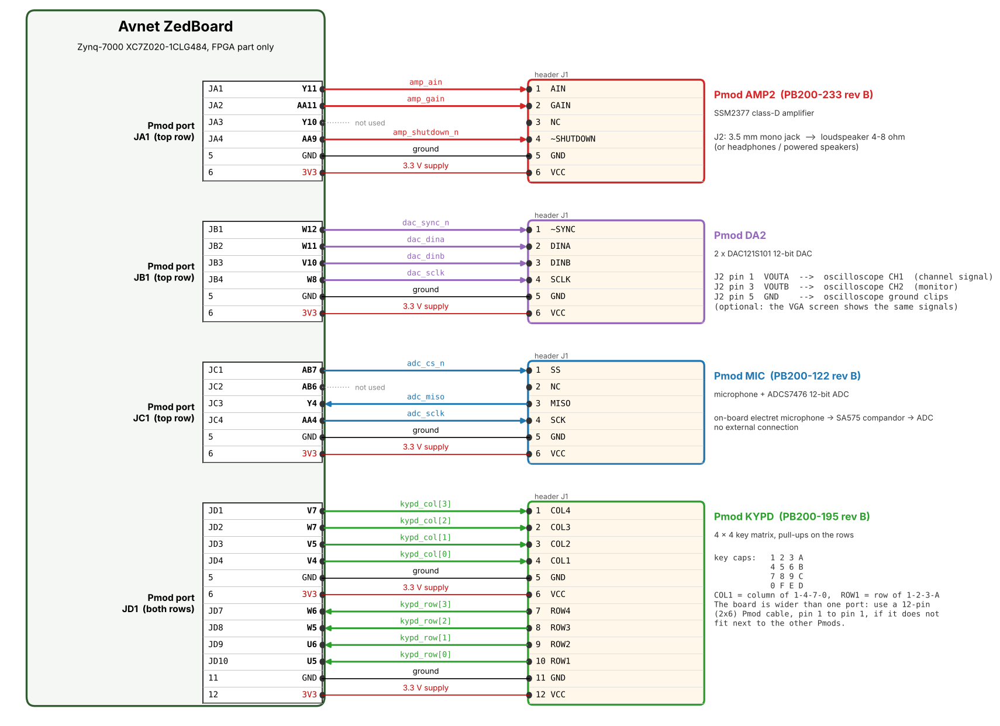

# Wiring: ZedBoard and the four Pmods

A vector version is in [`wiring_schematic.svg`](wiring_schematic.svg). The drawing is generated
by `scripts/draw_wiring.py`, which checks every pin against the constraint file
`CORDIC.srcs/constrs_1/new/zedboard_cordic_fm.xdc`; if the constraints change, run the script again.

## 1. What plugs in where

| ZedBoard port | Row | Module | Why this port |
|---|---|---|---|
| **JA1** | top (pins 1-6) | Pmod DA2 | |
| **JB1** | both (pins 1-12) | Pmod KYPD | the only 12-pin module |
| **JC1** | top (pins 1-6) | Pmod MIC | |
| **JD1** | top (pins 1-6) | Pmod AMP2 | |
| VGA | | monitor | |
| J17 "PROG" | | PC (micro-USB) | programming, VIO |
| J20 | | 12 V supply | |

Each module has its own port. Two 6-pin Pmods cannot be put into the two rows of one port: the
boards would lie on top of each other.

All four ports are on FPGA bank 13 at 3.3 V, the supply all four modules are specified for.

The fifth Pmod port, **JE**, cannot be used by this design: its pins are wired to the Zynq
processor's MIO pins, which the FPGA fabric has no connection to. Driving it would need a
processor design and software.

## 2. Pin-by-pin tables

Direction is seen from the FPGA. "Port pin" is the number printed on the ZedBoard next to the
connector (pin 1 is marked); the top row is 1-6, the bottom row 7-12.

### JA1 top row: Pmod DA2

| Port pin | FPGA pin | RTL port | Dir | Pmod DA2 J1 |
|---|---|---|---|---|
| JA1 | Y11 | `dac_sync_n` | out | 1 ~SYNC |
| JA2 | AA11 | `dac_dina` | out | 2 DINA (channel A data) |
| JA3 | Y10 | `dac_dinb` | out | 3 DINB (channel B data) |
| JA4 | AA9 | `dac_sclk` | out | 4 SCLK (5 MHz, idles low) |
| 5 | | ground | | 5 GND |
| 6 | | 3.3 V | | 6 VCC |

Analog outputs on the Pmod DA2's second header J2: pin 1 = **VOUTA (channel signal)**,
pin 3 = **VOUTB (monitor)**, pin 5 = ground. 0 to 3.3 V, resting at 1.65 V.

### JB1 both rows: Pmod KYPD

| Port pin | FPGA pin | RTL port | Dir | Pmod KYPD J1 |
|---|---|---|---|---|
| JB1 | W12 | `kypd_col[3]` | out | 1 COL4 |
| JB2 | W11 | `kypd_col[2]` | out | 2 COL3 |
| JB3 | V10 | `kypd_col[1]` | out | 3 COL2 |
| JB4 | W8 | `kypd_col[0]` | out | 4 COL1 |
| 5 | | ground | | 5 GND |
| 6 | | 3.3 V | | 6 VCC |
| JB7 | V12 | `kypd_row[3]` | in, pull-up | 7 ROW4 |
| JB8 | W10 | `kypd_row[2]` | in, pull-up | 8 ROW3 |
| JB9 | V9 | `kypd_row[1]` | in, pull-up | 9 ROW2 |
| JB10 | V8 | `kypd_row[0]` | in, pull-up | 10 ROW1 |
| 11 | | ground | | 11 GND |
| 12 | | 3.3 V | | 12 VCC |

### JC1 top row: Pmod MIC

| Port pin | FPGA pin | RTL port | Dir | Pmod MIC J1 |
|---|---|---|---|---|
| JC1 | AB7 | `adc_cs_n` | out | 1 SS (chip select, active low) |
| JC2 | AB6 | not used | | 2 NC |
| JC3 | Y4 | `adc_miso` | in | 3 MISO (serial data from the ADC) |
| JC4 | AA4 | `adc_sclk` | out | 4 SCK (5 MHz, idles high) |
| 5 | | ground | | 5 GND |
| 6 | | 3.3 V | | 6 VCC |

### JD1 top row: Pmod AMP2

| Port pin | FPGA pin | RTL port | Dir | Pmod AMP2 J1 |
|---|---|---|---|---|
| JD1 | V7 | `amp_ain` | out | 1 AIN (6.25 Mbit/s sigma-delta bit stream) |
| JD2 | W7 | `amp_gain` | out | 2 GAIN (high = 6 dB, low = 12 dB) |
| JD3 | V5 | not used | | 3 NC |
| JD4 | V4 | `amp_shutdown_n` | out | 4 ~SHUTDOWN (low = off) |
| 5 | | ground | | 5 GND |
| 6 | | 3.3 V | | 6 VCC |

Loudspeaker: 3.5 mm mono jack J2 on the Pmod AMP2.

### On-board

| Function | FPGA pins |
|---|---|
| Clock 100 MHz | Y9 |
| VGA red [0..3] | V20, U20, V19, V18 |
| VGA green [0..3] | AB22, AA22, AB21, AA21 |
| VGA blue [0..3] | Y21, Y20, AB20, AB19 |
| VGA HS, VS | AA19, Y19 |
| BTND, BTNU, BTNL, BTNR, BTNC | R16, T18, N15, R18, P16 |
| SW0 .. SW7 | F22, G22, H22, F21, H19, H18, H17, M15 |
| LD0 .. LD7 | T22, T21, U22, U21, V22, W22, U19, U14 |

### On-board audio codec (ADAU1761)

| Function | FPGA pin | RTL port | Dir |
|---|---|---|---|
| Master clock, 10 MHz | AB2 | `ac_mclk` | out |
| I2S bit clock (AC-GPIO2) | AA6 | `ac_bclk` | out |
| I2S left/right clock (AC-GPIO3) | Y6 | `ac_lrclk` | out |
| I2S data to the DAC (AC-GPIO0) | Y8 | `ac_sdata` | out |
| I2C address bits 0, 1 (both high: address 0x3B) | AB1, Y5 | `ac_adr0`, `ac_adr1` | out |
| I2C clock, data (open drain) | AB4, AB5 | `ac_scl`, `ac_sda` | out / in-out |

Audio comes out of the board's HPH OUT (earphones) and LINE OUT jacks. No wiring is needed.

## 3. How to plug a Pmod in correctly

* Power off while plugging.
* A 6-pin Pmod goes into the **top row** of its port with its component/label side up.
* The safe way to check orientation: the Pmod's **VCC and GND pins (5 and 6) must meet the port's
  GND and 3V3 pins**, which are the two pins at the end of the row away from pin 1. The ZedBoard
  silkscreen marks pin 1 of every port.
* The keypad's 12-pin header covers both rows. The keypad board is much wider than the port, so
  it will probably collide with the modules in JA and JC. Use a 12-pin (2 x 6) Pmod cable, pin 1
  to pin 1, or put the small modules on 6-pin cables instead. Electrically nothing changes.
* If a keypad key reads as the wrong key (TESTING.md step 6), the header is reversed or mirrored.
  Nothing is damaged by that as long as power and ground are on the right pins.

## 4. About the JC and JD pin numbers

Ports JC and JD are routed as differential pairs and the ZedBoard documentation names their
signals `JC1_P`, `JC1_N`, ... instead of by pin number. The mapping used here is the order in
which the nets appear on the ZedBoard schematic:

| Header pin | 1 | 2 | 3 | 4 | 7 | 8 | 9 | 10 |
|---|---|---|---|---|---|---|---|---|
| JC | JC1_P AB7 | JC1_N AB6 | JC2_P Y4 | JC2_N AA4 | JC3_P R6 | JC3_N T6 | JC4_P T4 | JC4_N U4 |
| JD | JD1_P V7 | JD1_N W7 | JD2_P V5 | JD2_N V4 | JD3_P W6 | JD3_N W5 | JD4_P U6 | JD4_N U5 |

This order is confirmed on the ZedBoard schematic: its Pmod header sheet draws JC and JD in
the same pin rows as JA and JB, with JC1_P, JC1_N, JC2_P, JC2_N against JA1 to JA4 and
JC3_P, JC3_N, JC4_P, JC4_N against JA7 to JA10 (JD likewise against JB). The ZedBoard Hardware
User's Guide (Table 16) lists the signals N before P and without header pin numbers; that table
is not a pin-order reference (it also gives JA3 as Y19 instead of Y10).

The order matters most for the Pmod MIC on JC: reversed, the FPGA's `adc_sclk` output would
land on pin 3, where the microphone drives MISO. With the schematic as the reference this cannot
happen; `TESTING.md` step 4 keeps an optional multimeter check.
